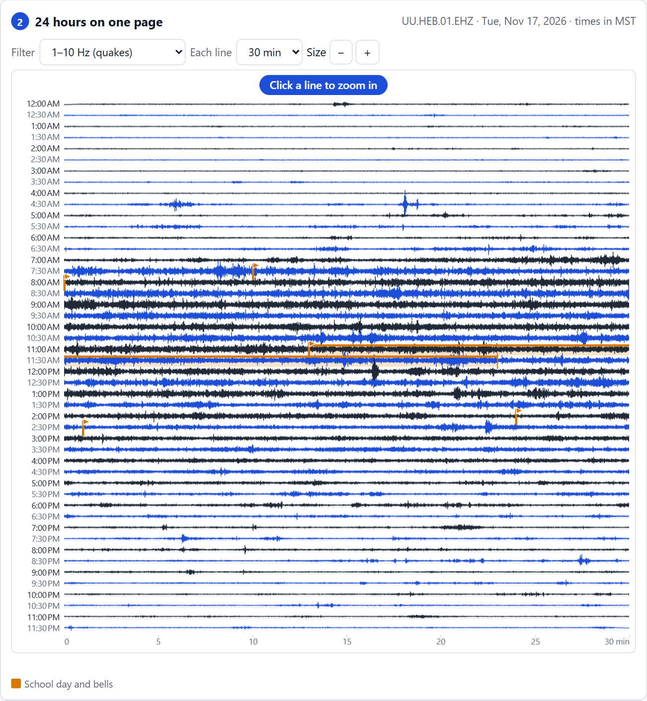
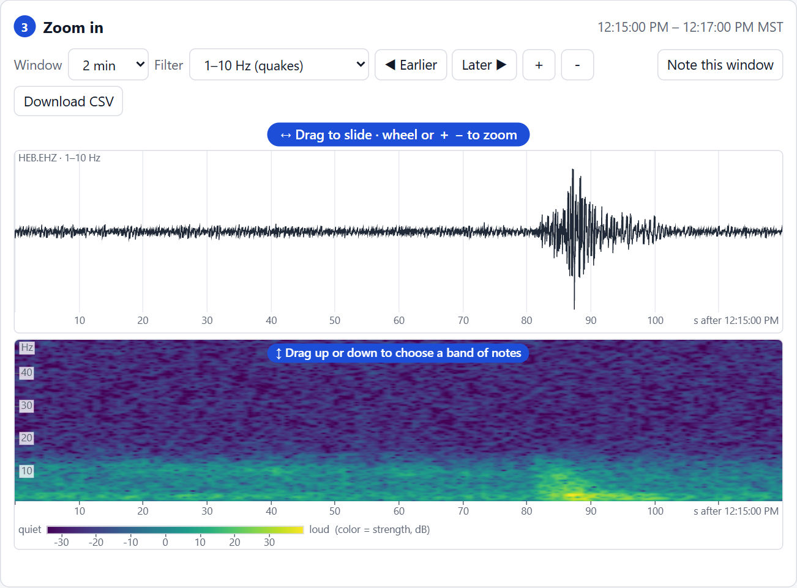
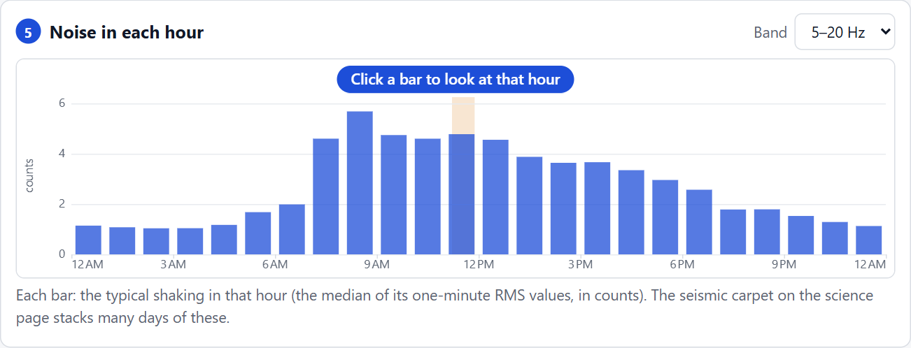
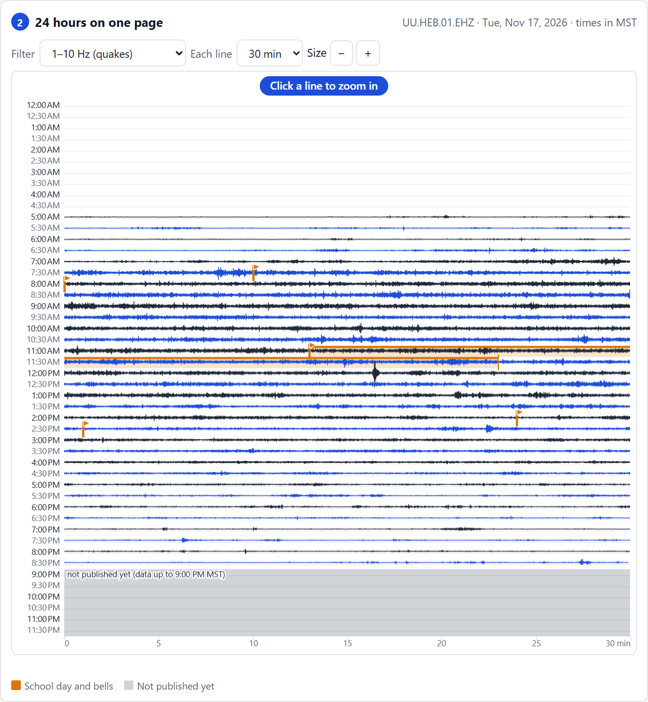

# School Shake Viewer

A day of one seismometer on one page, with your own notes on it: bells, buses, a game, a drop
experiment, a quake. It is a prototype for adult testers, to try now and to choose what the
school version should do.

[Open the School Shake Viewer](../app/shake-viewer/index.html){ .md-button .md-button--primary }

!!! warning "A prototype: not ready for classrooms yet"
    Built for Gus, Dale and Cleat to try and to choose what the school version should do. It
    has no activity card yet, and it reads University of Utah stations until the school Shakes
    send data.

!!! abstract "At a glance"
    - **You will:** open a day of a seismometer, read it as a 24-hour helicorder, zoom into
      anything that stands out, look at its spectrogram, compare the noise hour by hour, write
      notes on the record and download a window as a spreadsheet file (CSV).
    - **Time:** about 10 minutes to try everything.
    - **Works on:** any browser, including Chromebooks and phones. No install, no accounts.
      The example comes with the site; another day of a Utah station is a 6–10 MB download.
    - **The science:** [Beyond one seismogram](../theory/plots.md) (the helicorder and the
      seismic carpet) · [Reading a seismogram](../theory/seismograms.md) ·
      [Frequencies, fading and sound](../theory/frequencies.md) (the spectrogram)
    - **For teachers:** none yet: a prototype for adult testers. Activity cards come once Dale
      and Cleat choose the school Shake activities.
    - **Data:** [Our stations and data](../theory/stations.md). A file you open stays on your
      device.
    - **For developers:** [School Shake Viewer notes](../developers/shake-viewer.md)

## What it is for

Raspberry Shake's own viewers already show a sharing Shake live, with a 24-hour plot and a
spectrogram. This viewer is meant for what they can't do: the class's own **notes on the
record** (bells, buses, games, drops), the **numbers** to download, and later a comparison
with professional stations and an experiment mode for drop tests. It reads files first, so it
works today with a day file a teacher downloads from the school's Shake, and later with the
files DRI's server will publish.

It never reads data from Raspberry Shake's servers: only a file from your own Shake, University
of Utah stations, or files laid out the way UHSN's own server will publish them.

## 1. Choose where the data come from

Nothing loads until you ask. The quickest start is **Try the example**: station HEB near Heber
City on Tuesday, November 17, 2026 (a regular school day in Wasatch County), from 5 am to 9 pm,
with two schools' bell times as notes. Its data come with this site, so it works even where the
school network blocks other data services.

Or choose one of three sources:

- **A day file from the Shake.** A Shake keeps one file per channel per day (UTC), named like
  `AM.R1234.00.EHZ.D.2026.329`. A teacher downloads it from the Shake's own web page, on a
  computer inside the school (the Shake's address, then Actions › Downloads › Data; not yet
  tried on a UHSN Shake). Choose the file, or drop it on the page: it is read in your browser
  and nothing is uploaded. Open two days to follow an evening across midnight UTC (a 7 pm game
  is 02:00 UTC the next day).
- **A Utah station.** A University of Utah station near each school (the stand-ins), or HEB near
  Heber City, where a town's daily rhythm shows clearly. Pick a day and press **Show the day**
  (a 6–10 MB download from EarthScope, the University of Utah's data service).
- **School Shakes (test folder).** The files UHSN's server will publish, read the way the
  apps will read them ([below](#the-test-folder)).

Times on the page are Mountain time. A day you choose runs from midnight to midnight; a file
from the Shake shows its own UTC day (5 pm to 5 pm in winter), and the **Show** menu offers
the local days too.

## 2. Read the day: the helicorder

{ loading=lazy }

*Figure 1. A day at station HEB near Heber City, Tuesday, November 17, 2026, with the example
notes (orange).*

Each line is 30 minutes, read like a book: left to right, then the next line down (see
[A day at a glance](../theory/plots.md#a-day-at-a-glance-the-helicorder)). Quiet nights are
thin lines; the school day is thick. Bursts that spill over their neighbors are quakes, blasts
or something big nearby.

- **Click a line to zoom in** (tap on a phone): the label on the plot says so until you do.
  With the keyboard, Tab to the plot, move with the arrow keys and press Enter.
- **Filter:** 1–10 Hz shows quakes best; 5–20 Hz shows people and traffic.
- **Each line:** 15 minutes, 30 minutes or an hour. **Size − +** draws the wiggles smaller or
  bigger.
- Notes show as colored flags (a moment) or bands (a span), quakes with a small **P** and **S**
  where their waves should arrive. Point at the plot to read the time and the notes there.

## 3. Zoom in: the trace and its spectrogram

{ loading=lazy }

*Figure 2. Two minutes at HEB, 12:15 to 12:17 pm. The burst at 12:16:27 is not in the USGS quake
catalog: something near the station. Its spectrogram shows mostly low notes, 2–5 Hz.*

- **Window:** 1 minute to 1 hour. **◀ Earlier** and **Later ▶** step along the day.
- **Drag** the trace to slide it, and zoom with the mouse wheel or **＋ −**.
- **The spectrogram** (as in [Quake Explorer](quake-explorer.md#b)): time across, pitch up, color
  for strength. **Drag up or down on it** to choose a band of notes; the trace is then filtered
  to that band.
- **Note this window** turns what is on screen into a note.
- **Download CSV** saves the window on screen as a spreadsheet file: UTC time, seconds, the raw
  counts and the filtered counts, with notes at the bottom (channel, filter, credit). Up to an
  hour (360,000 rows).

## 4. Notes

The notes are the class's own record of what happened. HEB comes with example notes: the
published bell times of Wasatch High School and Rocky Mountain Middle School in Heber City for
that Tuesday. Does the town get busier when school starts?

- **Add a note on the helicorder,** then click the time it happened. Change its time (Mountain
  time), kind and words in the list. A note can have an end time (a span).
- **Mark quakes (USGS)** adds the quakes of the day from the U.S. Geological Survey catalog:
  in the Utah region from magnitude 2, anywhere from magnitude 6. **P** and **S** mark when their
  waves should reach the station (straight lines at Quake Locator's speeds within 150 km, the
  iasp91 Earth model farther away).
- **Download notes** saves them as a small file (JSON); **Open a notes file** brings them back,
  on any computer. The page also keeps them in this browser, one set per station. Nothing is
  uploaded.
- **No student names.** Write what happened, not who did it.

## 5. Noise in each hour

{ loading=lazy }

*Figure 3. The typical shaking in each hour at HEB, 5–20 Hz (the median of the one-minute RMS
values, in counts). The lunch note shows as a band.*

Each bar is one hour; the [seismic carpet](../theory/plots.md#months-at-a-glance-the-seismic-carpet)
stacks many days of these. **Click a bar** to open that hour in the zoom panel. Choose the band
at the top right.

## The test folder { #the-test-folder }

{ loading=lazy }

*Figure 4. HEB from the test folder: the files start at 5 am and are published up to 9:00 pm, so
the rest of the day is shaded "not published yet".*

UHSN plans to collect each school Shake's data at DRI and publish it as files on the web, laid
out in a fixed way so that every app can read them. **School Shakes (test folder)**, and
**Try the example**, read a small folder that comes with this site, laid out exactly that way
and made from University of Utah data: part of HEB's November 17, as if a school's Shake had
been connected at 5 am and the last publish run were at 9 pm. The badge says how recent the data are ("data up to 9:00 PM"), and later times are shaded.
The page reads only the few kilobytes it needs from each file.

When DRI runs a test server, add `?uhsn=` and its address to this page's address to read it
instead.

## What to try and send

**Try:** the example, a day at your own school's stand-in, and (if you can) a day file downloaded
from a Shake. Zoom into something, choose a band on the spectrogram,
add a note, mark the quakes, download a CSV and the notes.

**Send to Gus:** what was useful, what was confusing, and what a class would need. The site
collects nothing.

**Not in this prototype yet:** an experiment mode for drop tests, comparing a school Shake with a
professional station, a clock check, several days at once, and live data.
