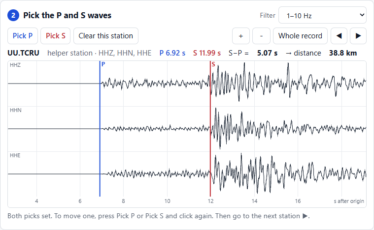
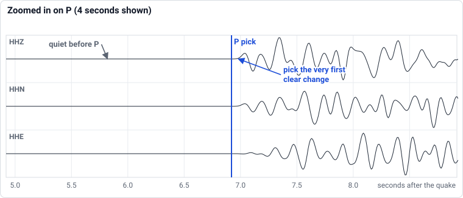
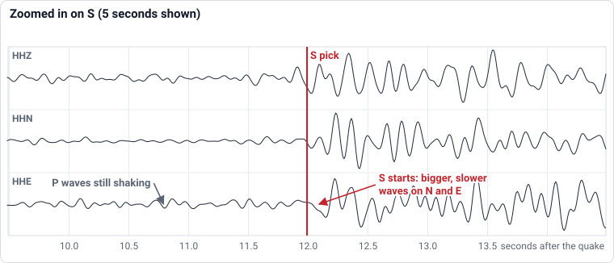

# Wave Race

Find where a real Utah earthquake happened from the waves it sent to stations around it.

[Open Wave Race](../app/wave-race/index.html){ .md-button .md-button--primary }

!!! abstract "At a glance"
    - **You will:** pick the P and S waves on real seismograms, turn the time between them into
      distances, find where the quake was, and see how close you got to the official answer.
    - **Time:** about 15 minutes as a class demo, or a full class period (45–55 minutes) in pairs.
    - **Works on:** any browser, including Chromebooks. No install, no accounts.
    - **The science:** [Seismic waves](../theory/waves.md) · [Distance from S minus P](../theory/s-minus-p.md) · [Locating a quake](../theory/locating.md)
    - **For teachers:** [Activity card](../teachers/wave-race-card.md) · [Standards](../teachers/standards.md#wave-race)
    - **Data:** [Our stations and data](../theory/stations.md)
    - **For developers:** [Wave Race notes](../developers/wave-race.md)

When an earthquake happens, two kinds of waves race outward: the fast **P wave** and the
slower **S wave**. The farther a station is from the quake, the bigger the gap between them.
In Wave Race you measure that gap on real seismograms from University of Utah stations,
turn it into a distance, and use several stations to find where the quake was. Then you
compare your answer with the official one.

!!! info "Whose stations?"
    Until the Raspberry Shakes at the UHSN schools stream their data, a University of Utah
    station near each school **stands in** for it. The app marks these as "stands in for …".
    Other "helper" stations are added around the quake so you can surround it.
    [Our stations and data](../theory/stations.md) lists the stand-in for each school.

!!! tip "New to P and S waves? Watch Quake Waves first"
    The [Quake Waves animation](../theory/locating.md#watch-it-happen) shows P and S waves
    racing out from a quake, the seismograms they make at four stations, and how the gap
    between them turns into circles that cross at the quake. It takes about a minute.

## The steps

### 1. Choose a quake

The list shows Utah quakes of magnitude 2 and up from the last 90 days. A ★ marks quakes
near the UHSN schools. **The location is hidden**: finding it is your job. Magnitude 3 and up
is easiest; small quakes are harder to see above the background noise.

You can also pick a **classic quake**, such as the 2020 Magna earthquake (M5.7).

### 2. Pick the P and S waves

The big panel shows the selected station. A three-part station has three traces:
**Z** (up–down), **N** (north–south) and **E** (east–west). The time axis is in seconds
after the quake started.

<figure markdown="span">
  { loading=lazy }
  <figcaption>Figure 1. The picking panel, zoomed in, with P and S picked at station TCRU.
  The line above the seismogram turns S − P into a distance.</figcaption>
</figure>

1. **Pick P** is on when you open a station. Click where the **first wave** arrives: the first
   clear change from the quiet background. P is usually clearest on the **Z** trace.
2. The app then switches to **Pick S**. Click where the **second, usually bigger** wave
   arrives. S is usually clearest on the **N** and **E** traces.
3. The panel shows **S − P** in seconds and the **distance** in km.
4. Go to the next station with **▶**, or click any station in the list or on the map.

#### How to find P and S: look wide, then zoom in

Zoom in before you pick: precise picks give a precise location. The three figures below use
station TCRU and the offline sample quake. The picks shown are the ones made by University of
Utah analysts.

**First, look at the whole record.** Find where the quiet background ends. The first change
is P. A few seconds later the waves usually get clearly bigger: that is S. These are only
rough places at this zoom, because one pixel covers about a tenth of a second.

<figure markdown="span">
  { loading=lazy }
  <figcaption>Figure 2. The whole 90-second record. The shaded boxes are where to zoom in
  next: blue for P, red for S.</figcaption>
</figure>

**Then zoom in on P** (scroll over the blue box, or press ＋). Now the quiet part looks flat,
and the very first wiggle stands out. Click exactly where the trace first leaves the
background, not at the first big peak.

<figure markdown="span">
  { loading=lazy }
  <figcaption>Figure 3. Zoomed in on P: 4 seconds instead of 90. Pick the first clear
  change.</figcaption>
</figure>

**Then zoom in on S.** S arrives while the ground is still shaking from P, so look for where
the waves suddenly get **bigger and slower** (wider wiggles), usually clearest on **N** and
**E**. Pick the start of that change.

<figure markdown="span">
  { loading=lazy }
  <figcaption>Figure 4. Zoomed in on S: the shaking from P is still there, then the S waves
  start, bigger and slower.</figcaption>
</figure>

Here S − P = 11.99 − 6.92 = **5.07 s**, which the app turns into **38.8 km**
(see [Distance from S minus P](../theory/s-minus-p.md)).

| To do this | Do this |
| --- | --- |
| Zoom in or out | Scroll over the seismogram, or use ＋ and － |
| Move left or right | Drag the seismogram, or use the ← → keys |
| See the whole record | **Whole record**, the 0 key, or double-click |
| Pick at the mouse position | Hover and press **P** or **S** |
| Move a pick | Press **Pick P** (or **Pick S**) and click again |
| Turn picking off | Esc |

The **Filter** menu changes which vibrations you see. **1–10 Hz** (the default) hides slow
drifts and fast hum, so quake waves stand out. **2–8 Hz** is even cleaner for small quakes.
**Raw** shows everything.

!!! tip "You don't have to pick every station"
    Pick the stations where you can see P and S clearly. **Three stations** give a location;
    **four or more around the quake** give a much better one. A station with no clear S is
    better skipped than guessed.

### 3. Locate the quake

Each station with both picks draws a **circle** on the map: the quake is somewhere on that
circle. Where the circles cross is the epicenter. There are two ways to find it, and you can
use both.

<figure markdown="span">
  { loading=lazy }
  <figcaption>Figure 5. Three circles, a guess placed by hand (green pin) and the best fit
  from the picks (purple star). The speed and depth settings are in the orange box.</figcaption>
</figure>

**By eye: Place my own epicenter.** Press **Place my own epicenter**, then click the map where
you think the circles cross. A green pin appears. The app tells you how far, on average, your
circles miss that point. Click again, or drag the pin, to make that number smaller. Press
**Done placing** (or Esc) when you are happy.

**By computer: Find the best epicenter.** The app tries every point on a grid and keeps the one
whose distances fit your circles best (purple star). It also tells you:

- how far, on average, your circles miss that point (smaller is better);
- a rough uncertainty (dashed circle).

Try your own guess first, then let the computer search. Did it land near your pin? The
[Locating a quake](../theory/locating.md) page explains how the search works.

#### Changing the speeds and depth

The **P speed**, **S speed** and **Depth** boxes are under the map (orange box in Figure 5).
Click in a box and type a new number, or use the arrows in the box.

- The line next to them shows how many **km of distance per second of S − P** those speeds
  give. Wave Race starts with 5.8 and 3.3 km/s, which give 7.66.
- The circles redraw as soon as you change a number. Faster speeds make the circles bigger;
  a bigger difference between the P and S speeds makes them smaller.
- A deeper quake makes the circles a little smaller, most of all for nearby stations.
- The purple star is removed, because it was found with the old numbers: press
  **Find the best epicenter** again. Your green pin stays where it is, and its "miss" number
  updates.

The theory page [Distance from S minus P](../theory/s-minus-p.md) explains these numbers.

### 4. Reveal the answer

**Reveal the official answer** shows the University of Utah / USGS location (orange star) and
how many km your guess and the best fit were from it. For many quakes you can also show the
**picks made by University of Utah analysts** as dashed lines, to compare with yours.

**Download my picks (CSV)** saves your picks, distances, guess and best fit as a spreadsheet
file on your device. Nothing is sent anywhere.

## If the school network blocks the data

If the quake list doesn't load, press **Use the offline sample** (top right). It loads a
magnitude 3.3 quake from October 2026 that is stored with the site, so you can still do every
step. Tell your teacher, too.

Teachers: see [Before class](../teachers/index.md#before-class).

## Going further

- Locate the same quake with only the school stand-in stations. Why is it harder?
  (Hint: where are the schools compared with the quake?)
- Pick the same station twice, once with Raw and once with 2–8 Hz. How much do your picks move?
- Try P speed 6.0 and S speed 3.5, the textbook values. Is your answer better or worse?
- Read [Locating a quake](../theory/locating.md) to see how professionals do it.

---

*Data: waveforms from University of Utah Seismograph Stations (network UU,
[doi:10.7914/SN/UU](https://doi.org/10.7914/SN/UU)) via EarthScope; quake locations and
analyst picks from USGS ComCat / UUSS. See [Our stations and data](../theory/stations.md).*
