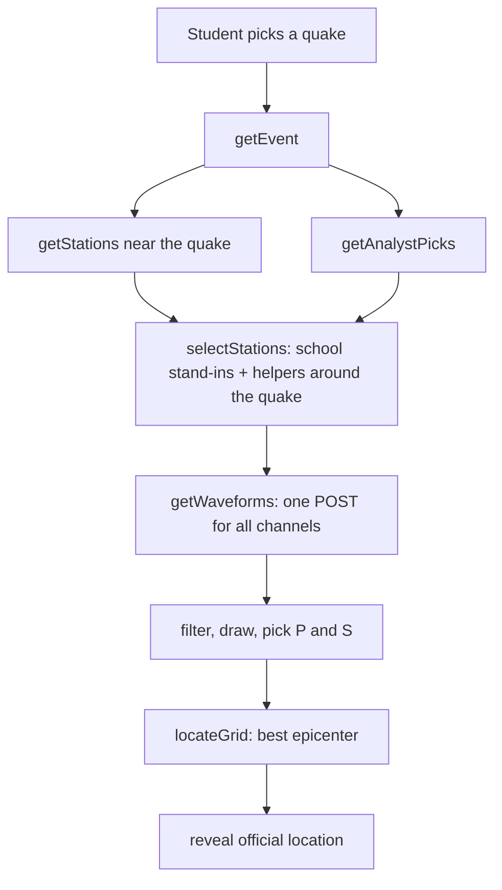

# Architecture

The apps are **static web pages written as plain ES modules**. There is no build step for the
app itself: what is in `docs/app/` is exactly what the browser runs, so students can read and
change the code. MkDocs builds the guides, copies `docs/app/` unchanged, and GitHub Actions
publishes both to GitHub Pages.

```
docs/app/
  index.html               app list
  wave-race/index.html     Wave Race page
  css/app.css              shared styles (light and dark)
  js/
    config.js              schools, stand-in stations, defaults, presets, credits
    lib/                   pure logic, no browser APIs; tested with node --test
      geo.js               distances, azimuths, local projection
      locate.js            S-P distance, grid-search epicenter, misfit, uncertainty
      fdsn.js              parsers for USGS GeoJSON, FDSN station text, QuakeML picks
      stations.js          which stations to show for a quake
      signal.js            gaps, tapers, min/max per pixel, dead-channel check
    data/
      datasource.js        the DataSource interface; picks a source from the URL
      earthscope-usgs.js   live source: USGS events + EarthScope stations/waveforms
      sample-source.js     offline source: files in data/samples/
      mseed.js             miniSEED -> traces (vendored seisplotjs)
      filters.js           Butterworth band-pass (vendored seisplotjs)
    ui/
      trace-view.js        canvas seismogram with zoom, pan, picks
      map-view.js          Leaflet map: stations, circles, epicenters
    wave-race/app.js       the Wave Race page controller
  vendor/                  seisplotjs + Leaflet bundles (generated; see below)
  data/samples/<event>/    offline sample: event, stations, picks, waveforms.mseed
tests/                     node --test, including real-data checks on the sample
tools/
  vendor/                  esbuild script that regenerates docs/app/vendor/
  samples/fetch-sample.mjs bundles a quake for offline use
  serve.mjs                tiny local server for docs/
```

## Data flow in Wave Race



All data goes through a **DataSource** object (`js/data/datasource.js`), never straight to a web
service. Swapping in the UHSN school Shakes later means writing a `UHSNSource` with the same
methods and changing `SCHOOLS[].standIn` in `config.js`. See [Data sources](data-sources.md).

## Running locally

```bash
node tools/serve.mjs          # apps only: http://127.0.0.1:8001/app/
mkdocs serve                  # full site with guides: http://127.0.0.1:8000/
npm test                      # unit + sample tests (Node 22+)
```

Add `?source=sample` to the Wave Race address to use the offline sample, and
`?event=<ComCat id>` to open a quake directly.

## Vendored libraries

[seisplotjs](https://github.com/crotwell/seisplotjs) 3.3.0 (MIT) parses miniSEED and builds
the Butterworth filters. [Leaflet](https://leafletjs.com) 1.9.4 (BSD-2-Clause) draws the map.
Both are bundled as single ES modules in `docs/app/vendor/`, with their licenses in
`THIRD_PARTY_LICENSES.txt`. Only the seisplotjs `miniseed` and `filter` modules are bundled
(about 400 KB). To change versions:

```bash
cd tools/vendor
# edit versions in package.json
npm install
npm run build
```

The seisplotjs bundle registers a web component when it loads, so code that imports it in
Node must first define `globalThis.HTMLElement` and `globalThis.customElements` (see
`tests/sample.test.js`).

## Design choices worth knowing

- **Picks never leave the device.** They are kept in the browser's `localStorage` per quake,
  for convenience only, and can be downloaded as CSV. No accounts, no server, no student data
  (Utah R277-487).
- **The location is hidden until "reveal".** The event list shows time and magnitude only.
- **Causal filter.** The band-pass runs forward in time only, so it never smears energy to
  before an arrival, which would bias P picks early.
- **Velocity defaults** (Vp 5.8, Vs 3.3 km/s) were calibrated against UUSS analyst picks; see
  decision D9 in `planning/decisions.md`.
- **Dead channels** (a flat line of a few counts) are dropped, because auto-scaling would make
  digitizer noise look like a quake.
