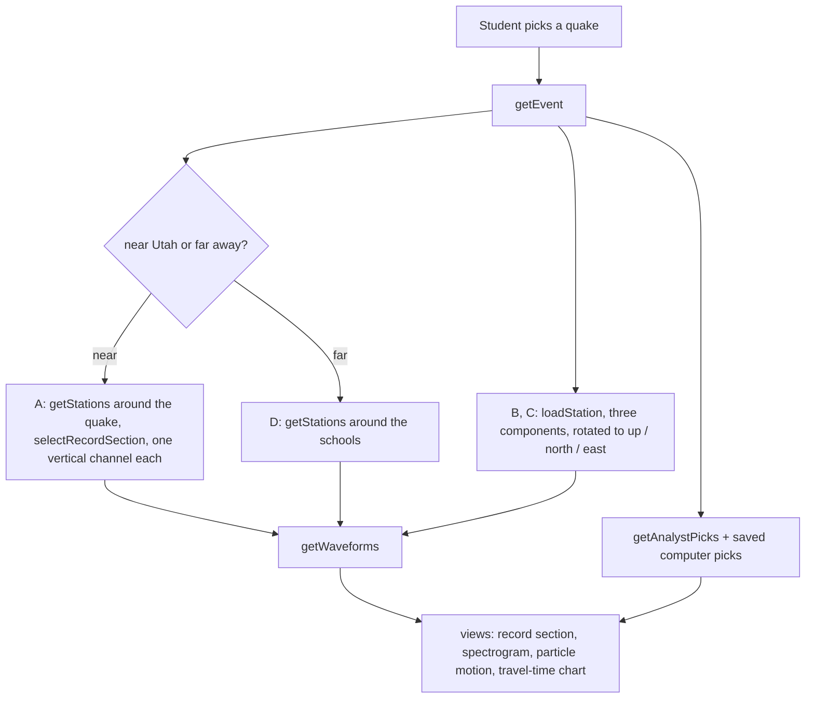

# Quake Explorer notes

How the app behind the [Quake Explorer guide](../apps/quake-explorer.md) works inside. The
shared code layout, local preview and conventions are in [Architecture](architecture.md); the
data services and their licenses are in [Data sources and licensing](data-sources.md).

## Files

| File | What it does |
| --- | --- |
| `docs/app/quake-explorer/index.html` | The page: top bar, quake chooser, the four investigation tabs |
| `docs/app/css/quake-explorer.css` | Its layout, on top of `app.css` |
| `docs/app/js/quake-explorer/app.js` | Page controller: choosing a quake, tabs, page address, CSV; the shared context the investigations use |
| `docs/app/js/quake-explorer/inv-a.js` … `inv-d.js` | One controller per investigation |
| `docs/app/js/quake-explorer/steps.js` | The Predict · Explore · Why? · Check panel every investigation uses |
| `docs/app/js/quake-explorer/station-select.js` | The station menu shared by B, C and D |
| `docs/app/js/quake-explorer/data.js` | Loading a record section (`loadRecordSection`) or one station's three components (`loadStation`) from any DataSource |
| `docs/app/js/quake-explorer/config.js` | Presets (each with an offline sample), per-investigation settings |
| `docs/app/js/quake-explorer/record-section-view.js` | Canvas record section: traces by distance, rulers, picks, fitted lines, model curves, reduced time |
| `docs/app/js/quake-explorer/spectrogram-view.js` | Canvas spectrogram with a draggable band (the filter) and a play cursor; `followTraceView` keeps it in step with a TraceView. In B an on-plot hint ("↕ Drag up or down…") shows until the band is first changed, then the band readout; edges have grips (grabbed from 16 px by touch, 7 px by mouse); double-click or Esc keeps all notes. In D the spectrogram is look-only (no band, no tab stop). Edge logic tested in `tests/spectrogram-band.test.js` |
| `docs/app/js/quake-explorer/motion-view.js` | Particle motion: three-component strip, paths from above and from the side, guess / computer / true arrows, trust meter |
| `docs/app/js/quake-explorer/audio.js` | Sped-up playback with Web Audio |
| `docs/app/js/quake-explorer/travel-time-chart.js` | Travel-time chart for distant quakes |
| `docs/app/js/lib/` | Pure, tested logic: `spectral.js` (FFT, spectrogram), `traveltime.js` (Pg, Pn, crossover, crust from the intercept), `linefit.js` (speeds, two-line fit), `motion.js` (rotations, direction from P), `units.js` (counts to m/s), `picker.js` (AIC computer picks), `teleseism.js` (Earth-model travel times), `audify.js`, `record-section.js`, `hodogram.js`, and additions to `signal.js` (decimate, clipping) |
| `docs/app/data/samples/qe-*/` | Six offline samples (the `explorer` list in `samples/index.json`) |
| `docs/app/data/traveltimes-iasp91.json` | First P and S times through the iasp91 Earth model, by depth and distance |
| `tools/quake-explorer/` | Science checks (`pn-check.mjs`, `motion-check.mjs`, `blast-check.mjs`), the answer key (`answer-key.mjs`), the sample builder (`make-sample.mjs`) and the travel-time table (`traveltime_table.py`, needs ObsPy) |

## Data flow



Every call goes through the DataSource object (see [Data access](architecture.md#data-access)).
Offline, `SampleSource` reads the `explorer` list and only offers the stations of the
requested quake's own sample.

## Page address options

- `?source=sample` uses the offline samples.
- `?event=<ComCat id>` opens a quake; `&inv=A` (or B, C, D) opens an investigation.

The app writes both into the address, so a teacher can share it to send a class to the same
quake and investigation.

## Choices specific to Quake Explorer

- **Predict before checking.** The Check button stays off until a prediction is chosen
  (`steps.js`). Predictions are kept in `localStorage` per quake, for convenience only.
- **Record sections spread stations by distance**, one per 12.5 km band, preferring
  analyst-picked and three-component stations, plus the school stand-ins. The nearest stations
  alone would bunch up (around Junction, 15 FORGE stations sit at 49–74 km).
- **Computer picks fill the gaps.** The analysts pick P only out to about 180 km; the Pg → Pn
  bend shows beyond that. AIC picks (`lib/picker.js`) are saved with the samples, shown as
  squares, and labeled as computer picks.
- **The bend is shown only when it is clear:** a two-line fit with an F ratio above 12, at
  least 8 far stations and a Pn speed of 7.2–8.6 km/s known to within 0.3 km/s. Magna (2020)
  passes; Junction's few noisy far picks don't, so it gets a hint instead.
- **"True ground speed" is offered only when the records are clean**: no clipped station and
  m/s known for at least 80% of them. Many of the 2020 short-period stations were 16-bit and
  clipped in the Magna quake (`lib/signal.js` `flatTopInfo` finds them).
- **Per-quake station notes** (`stationNotes` on a preset in `quake-explorer/config.js`) are
  listed in A beside the clipped stations, for example SGU in the 2020 Magna quake.
- **Particle motion** uses 1–5 Hz and a window from 0.05 s before to 0.5 s after the P pick;
  stations beyond 100 km get a "far" warning.
- **Distant quakes** are recorded at stations near the schools, shown downsampled to 20
  samples per second; travel times come from the precomputed iasp91 table, because the
  EarthScope travel-time web service has been retired.

The checks behind these numbers are in section 9 of
[planning/quake-explorer.md](https://github.com/gus-p-williams/utahshake/blob/main/planning/quake-explorer.md)
on GitHub, and `tests/explorer-sample.test.js` recomputes them from the bundled samples.

## Figures in the Quake Explorer guide

The screenshots in `docs/apps/img/qe-*.png` come from the app in headless Chrome, using the
offline samples:

```bash
cd tools/figures && npm install           # once: puppeteer-core, uses your installed Chrome
node ../serve.mjs                         # in another terminal
node quake-explorer-screens.mjs           # all five; or name some: choose, a, b, c, d
```

The figures on the science pages it uses come from `tools/figures/science-travel-times.mjs`,
`science-frequencies.mjs` and `science-ground-motion.mjs`.

## Rebuilding the samples and the answer key

```bash
node tools/quake-explorer/answer-key.mjs  # the numbers in the activity cards (offline)
node tools/quake-explorer/make-sample.mjs uu80162166 --dir qe-junction --section 300 \
  --threeC MTPU,TCRU,FOR1,TMU,SGU,SUU,PSUT,LIUT --pre 10 --post 110
```

Each sample's `sample.json` records the exact command that made it.
