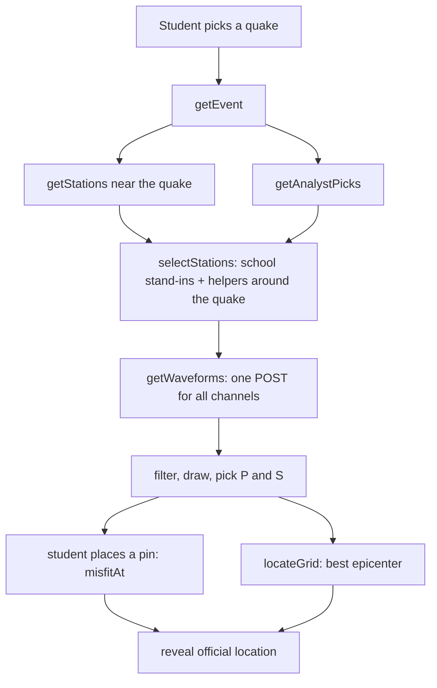

# Quake Locator notes

Quake Locator (its folder and addresses still say wave-race; it was called Wave Race until
November 2026). The code keeps the old name too: the `WAVE_RACE` config, the `js/wave-race/`
folder and the `uhsn.waveRace.*` storage keys, so no link or saved pick breaks.

How the app behind the [Quake Locator guide](../apps/wave-race.md) works inside. The shared code
layout, local preview and conventions are in [Architecture](architecture.md); the data
services and their licenses are in [Data sources and licensing](data-sources.md).

## Files

| File | What it does |
| --- | --- |
| `docs/app/wave-race/index.html` | The Quake Locator page |
| `docs/app/js/wave-race/app.js` | The Quake Locator page controller |
| `docs/app/js/lib/locate.js` | S-P distance, grid-search epicenter, misfit, uncertainty |
| `docs/app/js/lib/stations.js` | Which stations to show for a quake |
| `docs/app/js/ui/trace-view.js` | Canvas seismogram with zoom, pan, picks |
| `docs/app/js/ui/map-view.js` | Leaflet map: stations, circles, epicenters, the student's pin |
| `docs/app/js/ui/page.js` | Shared with the other apps: credits footer (`showCredits`), Live/Offline badge (`showSourceBadge`), CSV download (`csvRow`, `downloadCsv`), HTML escaping (`esc`) |
| `docs/app/js/config.js` | Schools, stand-in stations, defaults, presets (classic quakes), credit texts (`ATTRIBUTION`) |
| `docs/app/data/samples/uu80162166/` | The offline sample quake (M3.3 near Junction) |

## Data flow in Quake Locator { #data-flow-in-wave-race }



Every call goes through the DataSource object, never straight to a web service (see
[Data access](architecture.md#data-access)).

## Page address options

Add `?source=sample` to the Quake Locator address to use the offline sample, and
`?event=<ComCat id>` to open a quake directly. When a quake loads, the app writes its ID into
the address, so teachers can share the address to send a class to the same quake.

## Choices specific to Quake Locator { #choices-specific-to-wave-race }

- **The location is hidden until "reveal".** The event list shows time and magnitude only,
  because the USGS place name gives the answer away. The UUSS analysts' picks are the answer
  key and can be shown after the reveal.
- **Ten stations per quake: the school stand-ins plus helpers around the quake.** The five
  schools sit in a north–south line in central Utah, so for most quakes they do not surround
  the epicenter. `selectStations()` adds helpers that fill empty compass quadrants first, then
  the nearest. Within each pass, stations where UUSS analysts picked P and S come first
  (their arrivals are known to be clear).
- **Velocity defaults** (Vp 5.8, Vs 3.3 km/s) were calibrated against UUSS analyst picks; the
  textbook 6.0 and 3.5 made distances about 10% too long. Students can still edit them.
- **Picks and the student's pin** are kept in the browser's `localStorage` per quake, for
  convenience only, and are included in the CSV download, `quake-locator-<quake id>.csv`
  (built with `csvRow` and saved with `downloadCsv` from `ui/page.js`).

The reasons are logged as decisions D9, D10, D11 and D14 in
[planning/decisions.md](https://github.com/gus-p-williams/utahshake/blob/main/planning/decisions.md)
on GitHub.

## Figures in the Quake Locator guide { #figures-in-the-wave-race-guide }

The seismogram figures in `docs/apps/img/` are SVG files made from the offline sample with
the app's own parser and filter, and the screenshots are taken from the app in headless
Chrome. Regenerate them after changing the app's look or the sample:

```bash
node tools/figures/trace-figures.mjs      # picking-*.svg (no install needed)
cd tools/figures && npm install           # once: puppeteer-core, uses your installed Chrome
node ../serve.mjs                         # in another terminal
node screenshots.mjs                      # wave-race-*.png; set CHROME=... if Chrome is elsewhere
node screenshots.mjs choose               # just one shot: choose (step 1, live list), picker or locate
```

The step 1 screenshot shows the live quake list, so it changes each time it is retaken. The
science figures are listed in [Architecture](architecture.md#figures-in-the-docs).
