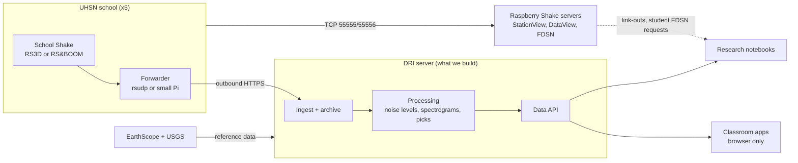

# Raspberry Shake in Utah High Schools: Network Evaluation & Student App Concepts

!!! note "Snapshot"
    Markdown snapshot (2026-11-23) of the living planning doc: <https://claude.ai/artifact/138FYiSqhWYYs268h66uxn>. The living doc is canonical; re-export it here when it changes.


Nov 23, 2026 · @Gus Williams

## Summary

Raspberry Shake gives students free, polished viewers for a 2,000+ station global network, but its license blocks the two things our apps most need: live data from other stations, and our own app built on network data. The fix is to build our apps on the data our own school Shakes stream to us directly, link out to Raspberry Shake's tools for the rest of the network, and pull professional open data (EarthScope, University of Utah) for comparison and research.

- **What Raspberry Shake offers:** StationView (live global map), DataView (waveforms, spectrograms, filters), the ShakeNet phone app, free FDSN downloads of any shared station 30+ minutes old, and the open-source rsudp toolkit for live plots and alerts.
- **What it does not offer:** real-time data from other stations without a paid contract, permission to show a "network"-style page of other Shakes in our area, or permission to feed network data into a back-end or mobile app. Our own Shakes are exempt when we read them directly over the school LAN.
- **Recommended data path:** each school Shake streams to a small ingest server we run; our apps read from that server; students reach the wider network through StationView/DataView links and their own on-demand FDSN requests in notebooks.
- **Apps to build first:** School Pulse (class changes, buses, daily rhythm), Game Night Quake (whose crowd shook harder), and Wave Race (time P and S waves, find distance, locate quakes with several schools). Each carries a short theory card at an advanced high-school level and maps to Utah SEEd standards PHYS.4.1 and ESS.2.2.
- **Research track:** (separate from the classroom apps) a lab-run program for a few motivated students on event discrimination, location, wave propagation, and whether many low-cost sensors beat a few high-quality ones. Utah is unusually rich in ground truth for this: coal-mine seismicity, mine blasts, and rocket-motor detonations at the Utah Test and Training Range.
- **Built for UHSN:** these apps and the research track are designed as the student layer of DRI's Utah High School Seismic Network (Phase I: Juab, North Sanpete, Wasatch Academy, Gunnison Valley, Millard), so they assume DRI runs the ingest server and owns the station registrations.

## The Raspberry Shake network today

Raspberry Shake (Raspberry Shake, S.A., Panama) sells Raspberry Pi-based seismographs and runs the community server they stream to; its [Data Center](https://raspberryshake.org/data-center/) advertises "over 2000" stations, with an archive back to December 2016. Every unit timestamps by network time (NTP, about ±10 ms) and samples at 100 per second, a 10 ms step ([manual](https://manual.raspberryshake.org/specifications.html); [Anthony et al. 2019](https://www.usgs.gov/publications/do-low-cost-seismographs-perform-well-enough-your-network-overview-laboratory-tests)).

| Model | Sensors | Best for | Price, assembled / DIY kit |
| --- | --- | --- | --- |
| [RS1D](https://raspberryshake.org/all-products/) | 1 vertical geophone | Classroom basics, campus noise, distant quakes | $584.99 / $384.99 |
| [RS3D](https://raspberryshake.org/all-products/) | 3 geophones (up, north, east) | Telling P from S waves, wave direction, location work | $1,134.99 / $954.99 |
| [RS4D](https://raspberryshake.org/all-products/) | 1 vertical geophone + 3-axis accelerometer | Strong shaking that would clip a geophone | $784.99 / $604.99 |
| [RS&BOOM](https://raspberryshake.org/all-products/) | Vertical geophone + infrasound (air pressure) | Thunder, sonic booms, blasts, the gym crowd through the air | $934.99 / $794.99 |
| [School Lite / Standard](https://raspberryshake.org/schools) | 1 or 2 RS1D + a cut-open geophone | Raspberry Shake's school bundles | $644.98 / $1,479.97 |

Prices are from the [product page](https://raspberryshake.org/all-products/) as of this writing; DIY kits exclude the Raspberry Pi.

**How good is the data?** USGS lab tests found the geophone's sensitivity within 4% of nominal and judged the RS4D "suitable for densifying backbone networks" for local and regional events, but its self-noise is too high for weak, long-period signals such as surface waves from moderate distant quakes ([Anthony et al. 2019](https://www.usgs.gov/publications/do-low-cost-seismographs-perform-well-enough-your-network-overview-laboratory-tests)). In practice: excellent for anything within a few hundred kilometres and for large distant quakes; weak for small distant ones.

**Education offer.** Raspberry Shake's [curriculum](https://raspberryshake.org/curriculum) has four one-hour lessons (intro and "stomp quake", understanding earthquakes, computer science with the Shake, and building a Node-RED "shakemeter"), plus classroom tips such as asking IT to open firewall ports. It is aimed at beginners; it has no data-science or research thread, which is the gap our apps fill.

**Programs to learn from.** The [Alaska Earthquake Center's Seismology in Schools](https://earthquake.alaska.edu/schools) runs 15+ rural school Shakes, a monthly online "Shake Ambassador Club" for students, and student-built hallway displays. In Utah, DRI's Utah High School Seismic Network installed its first Shake at [Juab High School](https://www.juabsd.org/article/2666429) in January 2026, with North Sanpete, Wasatch Academy, Gunnison Valley and Millard in [Phase I](https://www.juabsd.org/article/2794120).

## Getting the data

There are two kinds of data with different rules: data read straight off our own Shakes, which is ours, and data pulled from Raspberry Shake's servers, which falls under their [license](https://raspberryshake.org/license/). Our apps should run on the first and only point students to the second.

| Path | What you get | Delay | Rules |
| --- | --- | --- | --- |
| Shake's own web page (`rs.local`) | Settings, 12-hour helicorder, file downloads; 7 days kept on the SD card by default | Helicorder refreshes every 2 min | Ours |
| [UDP "datacast"](https://manual.raspberryshake.org/udp.html) from the Shake (port 8888) | Raw counts, one packet per channel, streamed to any address we choose | Real time (under 1 s) | Ours; this is what [rsudp](https://github.com/raspishake/rsudp) reads |
| [SeedLink](https://manual.raspberryshake.org/traces.html) on the Shake (port 18000) or its wave server (port 16032) | Standard real-time protocol; ObsPy, Swarm and jAmaSeis connect directly | Real time | Ours; needs a route from our server into the school network |
| [FDSN web services](https://manual.raspberryshake.org/fdsn.html) at `data.raspberryshake.org` | Any shared station, miniSEED plus instrument response, back to 2016 | 30 minutes and older | Free for teachers and researchers for "irregular and reasonable in size" requests; attribution required |
| Real-time streaming from Raspberry Shake's servers (CAPS/SeedLink) | Other stations, live | Real time | Paid; quote from sales |
| [StationView](https://stationview.raspberryshake.org/#/), [DataView](https://dataview.raspberryshake.org/#/), ShakeNet app | Viewing any station | Live | Free to view |

**License limits that shape the design.** The [license](https://raspberryshake.org/license/) says "Integration into a back end application such as a mobile app is not allowed," asks users to "refrain from showing a 'network'-style page with data from other Raspberry Shakes in your area," and prohibits redistributing real-time data from its servers (visual redistribution is allowed, digital is not). Two consequences follow:

1. A page showing all our schools side by side is fine only if it reads our Shakes directly, not Raspberry Shake's servers. DRI should get this confirmed in writing by Raspberry Shake for the UHSN stations it registers.
2. Students exploring other Shakes worldwide should do so in StationView/DataView, or with their own FDSN requests in a notebook, not through a cache we host.

**School networks.** The Shake only makes outbound connections: TCP 55555 and 55556 to `raspberryshakedata.com` plus NTP (UDP 123) ([firewall page](https://manual.raspberryshake.org/firewallIssues.html)). District filters often block these non-standard ports, so the IT request should go in before installation. For our own ingest, the simplest route is a forwarder on the Shake's LAN (rsudp's forward module, or a second small Pi) that pushes data out over HTTPS, so no inbound port is opened at the school.

**Professional open data to pair with it.** University of Utah Seismograph Stations (network UU) and other EarthScope-archived networks are open through the EarthScope FDSN service without the restrictions above, and the USGS earthquake catalog API supplies event lists. These give students broadband "truth" stations near their school and let research projects compare low-cost and high-quality sensors directly.

## Raspberry Shake's own tools, and the gaps

Raspberry Shake's viewers are good enough that we should not rebuild them; our apps should add what they lack: campus context, comparisons between our schools, and student analysis.

| Tool | What students can do with it | Live? | Cost / openness |
| --- | --- | --- | --- |
| [StationView](https://raspberryshake.org/the-new-stationview/) | Global map of stations; recent-quake list; click a quake, then any station, to see its record; live trace with spectrogram and ground-motion values | Yes | Free web app |
| [DataView](https://raspberryshake.org/dataview-official-release/) | 24-hour helicorder, zoomed waveform, spectrogram, custom high/low-pass filters, quake annotation, export a combined waveform + spectrogram + spectrum image | Yes | Free web app |
| ShakeNet app ([iOS](https://apps.apple.com/us/app/shakenet/id1517784831), [Android](https://play.google.com/store/apps/details?id=org.raspberryshake.app)) | Phone version of the two above, with quake details | Yes | Free |
| [rsudp](https://github.com/raspishake/rsudp) | Live scrolling plot with spectrogram, STA/LTA quake trigger, alert sound, RSAM amplitude, data forwarding, custom code on alarm | Yes (own Shake) | Open source, public domain |
| [Swarm](https://manual.raspberryshake.org/traces.html) (USGS) | Desktop helicorder, spectra and spectrograms; preconfigured download from the Shake | Yes (own Shake) | Free |
| [jAmaSeis, seisgram2k](https://manual.raspberryshake.org/traces.html) | Pick arrivals, travel-time curves, simple location and magnitude | Yes (own Shake) | Free, older desktop software |
| [FDSN + ObsPy](https://manual.raspberryshake.org/fdsn.html) | Any station's history in Python notebooks | 30 min delay | Free for reasonable requests |

**Gaps for our goals:**

- No campus context: nothing marks bell times, bus schedules, game times or weather on the record.
- No school-to-school comparison: and the license discourages building one from their servers.
- No student annotation or labeling: students cannot tag "bus", "bell", "blast" and build a shared catalog.
- No guided analysis: no S-minus-P distance tool, no multi-station location, no magnitude estimate, no spectral comparisons.
- No classroom layer: no assignments, no teacher view, no record of student work.
- The infrasound channel of an RS&BOOM is shown, but nothing pairs air and ground signals to tell a sonic boom from a quake.

## Theory primer for students

Eight ideas carry every app below. Each app opens with the one or two it needs, written for strong high-school students who know algebra and logarithms; calculus appears only as an optional aside.

**1. What the instrument measures.** A geophone is a magnet hanging on a spring inside a coil. When the ground moves, the coil moves and the magnet lags behind, so the coil cuts magnetic field lines and makes a voltage proportional to ground velocity (Faraday's law). The Shake turns that voltage into "counts" 100 times a second. Dividing counts by the instrument's sensitivity gives velocity in metres per second; the accelerometer in an RS4D measures acceleration instead.

**2. Waves and their speeds.** A disturbance spreads as P waves (push-pull, fastest), S waves (side-to-side, slower, cannot cross liquid) and surface waves (slowest, largest far away). Every wave obeys

```latex
v = f\lambda
```

so a 10 Hz footstep signal in soil travelling 300 m/s has a 30 m wavelength, while a 0.05 Hz surface wave at 3.5 km/s is 70 km long.

**3. Distance from the S-minus-P time.** P and S leave the source together and separate as they travel. With P speed V\_P and S speed V\_S, the gap between their arrivals grows with distance d:

```latex
d = \Delta t_{S-P} \cdot \frac{V_P V_S}{V_P - V_S}
```

For typical Utah crust (V\_P ≈ 6.0 km/s, V\_S ≈ 3.5 km/s) that is about 8.4 km of distance per second of S-minus-P time. Three stations give three circles, and the circles cross at the epicenter.

**4. Frequency and the spectrogram.** Any wiggle is a sum of sine waves (Fourier's idea). A spectrogram shows which frequencies are present at each moment, so it acts like a fingerprint: footsteps and machinery are 5 to 50 Hz, nearby quakes 1 to 20 Hz, distant quakes below 1 Hz, ocean microseism 0.1 to 0.3 Hz. Sampling at 100 per second means nothing above 50 Hz (the Nyquist frequency) can be seen; faster vibrations fold back as false lower ones (aliasing).

**5. Logarithms, magnitude and "twice as strong".** Magnitude counts powers of ten in amplitude: one magnitude unit is 10 times the ground motion and about 32 times the energy. That is why the 2023 "Swift Quake" (magnitude-equivalent 2.3) was reported as twice the 2011 "Beast Quake" (2.0): 10^0.3 ≈ 2 ([KOMO](https://komonews.com/sports/seahawks/taylor-swift-seattle-seismic-activity-beast-quake-swiftquake-earthquake-register-magnitude-washington-fans-lumen-field-the-eras-tour-shows-concert-sounders-concacaf-cnn-report-western-shaking-shake-it-off)). Decibels use the same idea.

**6. Why waves fade, and why high notes fade first.** Energy spreads over a growing wavefront (geometric spreading) and some turns to heat (attenuation). A simple model of amplitude A at distance r:

```latex
A(r) \approx \frac{A_0}{r} \, e^{-\pi f r / (Q v)}
```

The exponent grows with frequency f, so high frequencies die first: a bus 50 m away is crisp, a quake 300 km away arrives as a low rumble. Q measures how "lossy" the rock is; sediment fills of Utah valleys have low Q.

**7. Signal, noise and detection.** A signal is only useful above the background. The ratio of short-term to long-term average amplitude (STA/LTA) flags sudden events, and is what rsudp's alarm uses. The background itself ("noise") is data: it rises when people are moving and drops at night, on weekends and during holidays, as the 2020 lockdown study showed worldwide ([Lecocq et al. 2020](https://authors.library.caltech.edu/104578)).

**8. Filtering and timing.** A band-pass filter keeps only a chosen frequency band, so a 2 to 8 Hz filter can hide footsteps and reveal a local quake. Timing limits precision: at 100 samples per second and about ±10 ms clock error, a P wave at 6 km/s is uncertain by about 60 m per station, which sets how well a school network can locate events.

## Student app concepts

The hook is the school itself: students first see their own hallways, buses and games in the data, then use the same skills on earthquakes. Ten apps, in three groups; the first three are the recommended starting set. "Primer" numbers refer to the theory section above.

| App | Driving question | What students do | Primer | Data | Level |
| --- | --- | --- | --- | --- | --- |
| **School Pulse** (start) | Can the ground tell when class changes? | Plot noise level (5 to 20 Hz) by minute over the bell schedule; average a "seismic week"; spot assemblies, snow days, holidays | 4, 7 | Own Shake, live | Intro |
| **Game Night Quake** (start) | Whose crowd shook harder, and is that a fair comparison? | Align the record with the play-by-play; measure peak and average shaking; find the band's beat as a line in the spectrogram; design a "standard stomp" to calibrate schools against each other | 4, 5, 6 | Own Shakes, all schools | Intro to mid |
| **Wave Race** (start) | How far away was that quake, and what is inside Earth? | Pick P and S on the school record; compute distance; for distant quakes, add points to a class travel-time chart and find the core's shadow | 2, 3 | Own Shake + StationView + USGS list | Mid |
| **Bus Detective** | Can we hear the buses arrive, and which is which? | Log real arrival times as ground truth; build a detector; score it with hits, misses and false alarms | 4, 7, 8 | Own Shake, live | Mid |
| **Campus Wave Speed** | How fast does a stomp travel across the parking lot? | Jump or drop a weight at measured distances from two sensors; time the arrivals; compute v, then wavelength from v = fλ | 2, 8 | Two Shakes at one school | Mid |
| **Weather Ears** | Can a seismometer feel wind, and hear thunder? | Compare noise with wind speed from a nearby weather station; catch thunder on the infrasound channel and time the flash-to-boom delay | 4, 6 | Own Shake (RS&BOOM ideal) | Intro |
| **Utah Quake Locator** | Can our schools locate a Utah quake as well as the University of Utah? | Each school picks arrivals; the app draws S-minus-P circles and finds the best point; compare to the official location | 3, 8 | All UHSN schools + University of Utah | Mid to hard |
| **How Big Was It?** | Can we estimate magnitude from our own records? | Measure peak amplitude at each school; plot against distance; fit the fade-out curve; estimate magnitude and compare | 5, 6 | All schools + USGS | Hard |
| **Signal Detective** | What made that wiggle? | Label short clips (bus, bell, train, quake, blast, thunder); build a shared catalog; later train a simple classifier on duration and dominant frequency | 4, 7 | Own Shakes | Mid, feeds research |
| **Build a Detector** | Can you code your own quake alarm? | Write an STA/LTA trigger in Python or blocks; wire it to a hallway display or LED | 7, 8 | Own Shake, live | Mid (CS) |

**Why these three first.** School Pulse works on day one with one sensor and gives every student a personal connection. Game Night Quake is the excitement engine, and its "is it fair?" question teaches controls, distance and site effects: a gym floor next to the sensor will beat a stadium across town unless schools calibrate with the same standard stomp at the same distance. Wave Race carries the core earthquake physics and the clearest standards fit.

**Rural advantages to lean into.** Quiet nights make distant quakes easier to see than in cities. Long freight trains, I-15 trucks, wind farms, farm machinery, sonic booms over the west desert and mine blasts all leave distinct fingerprints, which makes Signal Detective richer here than in a suburb.

## Visualizations and hands-on experiments

Two additions turn the apps into a lab: a standard set of plots every app can produce, and a family of controlled campus experiments that start with the parking-lot weight drop and grow into real near-surface geophysics.

### Plots students should learn to read

| Plot | What it shows | Best uses | Needs |
| --- | --- | --- | --- |
| Waveform (trace) | Ground velocity against time, raw or filtered | Picking arrivals, timing impacts, comparing events | Any Shake |
| Helicorder | 24 hours folded into rows like a drum recorder | Daily overview; spotting events at a glance | Any Shake |
| Spectrogram | Frequency against time, color = strength | Source fingerprints: band beats, engine hum, quakes vs footsteps | Any Shake |
| Spectrum and PPSD | Strength at each frequency; a month of spectra as a probability cloud against the global quiet/noisy reference curves | "How quiet is our school?", ranking sites, comparing sensors | Any Shake |
| Seismic carpet | Hour of day (across) by date (down), color = noise level | Bell schedule, lunch, weekends, holidays, snow days, even the daylight-saving shift (data are in UTC) | Any Shake, weeks of data |
| Waterfall / record section | One event at many stations, traces stacked by distance; the P, S and surface-wave lines slope at their speeds | Wave Race, Utah Quake Locator; the weight-drop distance line | Several stations, or one sensor and many drops |
| Event stack | Many similar events (each bus arrival, each daily mine blast) aligned as rows, then averaged | Repeatability; averaging N events cuts random noise by about √N | Any Shake + a detector |
| Particle motion | North against east (and vertical) motion traced as a path | Direction to a quake from one station; Rayleigh waves draw backward-rolling ellipses | RS3D |
| Amplitude against distance (log-log) | Peak amplitude for each station or drop point | Fading rate, attenuation, magnitude | Several distances |
| H/V ratio | Horizontal-to-vertical noise ratio by frequency; its peak is the ground's resonance | Sediment thickness under each school | RS3D |
| Cross-correlation | How alike two signals are at each time shift | Delays between stations; finding repeats; ambient-noise studies | Two records |
| Audification | The record played back 100 to 400 times faster | Hearing a quake, a train, a game; frequency made intuitive | Any record |

The H/V peak gives sediment thickness H from the shear-wave speed V\_S of the fill, a formula students can use directly:

```latex
f_0 \approx \frac{V_S}{4H}
```

### Campus experiments

The weight drop is the anchor because students control the source: they know when, where and how hard it happened, which is exactly what is missing for earthquakes.

*Diagram (see living doc): Sensor A fixed; drop points at 2, 4, 8, 16, 32, 64 m; Sensor B moves beside each drop as the clock. Cross-section: the direct wave travels through slower soil; the refracted wave travels along the top of a faster layer. Arrival-time plot: a steep line (slow soil) then a shallower line (faster layer); the bend (crossover distance) sets the layer depth.*

Drops at doubling distances from a fixed sensor give the fade rate; with a second sensor beside each drop as the clock, the bend in the arrival-time line reveals a faster layer and how deep it is.

| Experiment | Change this | Measure this | Physics and standard | Kit |
| --- | --- | --- | --- | --- |
| **Surface swap** | Drop surface: asphalt, concrete, grass, packed dirt, gravel, sand, gym floor, snow | Peak amplitude, dominant frequency, duration, at a fixed sensor distance | Same momentum change over a longer impact = smaller force and lower frequencies (impulse); PHYS.1.3, PHYS.2.1 | Medicine ball or sandbag, tape measure |
| **Height and mass ladder** | Drop height and mass | Amplitude against drop energy mgh on a log-log plot | What fraction of mgh becomes seismic waves; PHYS.2.1 | Several weights, step ladder |
| **Distance line** | Distance, doubling each time (2, 4, 8, 16, 32, 64 m) | Amplitude and arrival time at each point | Spreading and attenuation (primer 6); PHYS.4.1 | One Shake, many drops |
| **Mini refraction survey** | Distance along a straight line, with a second sensor beside the drop as the clock | First-arrival time against distance; a bend in the line marks a faster layer below | Finding a hidden layer with the same logic that found Earth's core; PHYS.4.1, ESS.2.2 | Two Shakes or a phone array |
| **Frozen vs thawed** | Season, rain or irrigation | Repeat the distance line and refraction survey in January and May | Frozen or wet ground changes wave speed and loss; a long-term class dataset | Same as above |
| **Bouncing-ball clock** | Ball type and surface | Time between successive bounce spikes | Kinematics and energy loss (formulas below); PHYS.1.2, PHYS.2.1 | Basketball, superball |
| **Quiet Landing challenge** | Pad design: foam, sand box, tires, springs | Peak ground velocity from a fixed drop, against cost and thickness | Engineering design to minimize impact force; PHYS.1.3, links to ESS.2.6 base isolation | Craft materials |
| **Floor by floor** | Sensor on the ground floor, an upper floor, the stage | Ambient spectra and the same footsteps at each spot | Buildings amplify their own natural frequency; ESS.2.6 | One Shake, moved |
| **Rhythm lab** | Students jump to a metronome at 1, 2, 3 Hz, in sync and out of sync | Spectrogram lines at the beat and its harmonics; peak amplitude | In-sync jumping adds amplitudes (about N times), random jumping adds about √N times; PHYS.4.1 | Metronome app, a class |
| **Sensor coupling test** | Mounting: carpet, tile, concrete, outdoor spike, buried | The same drop recorded each way | Installation matters as much as the sensor; data quality | One Shake |
| **Phone vs Shake** | Phones running a sensor app (such as phyphox) beside the Shake | Noise floor and how far away each still detects a drop | A miniature "many cheap vs few good" study; research track D | Student phones, with teacher approval under the school's device policy |
| **Vehicle speed trap** | Car, bus, loaded truck passing two sensors 20 to 50 m apart | Time between peak passages = speed; amplitude against vehicle weight | Kinematics, signal timing; CS 9/10.DA.3 | Two Shakes |
| **Speaker sweep** | A subwoofer on the floor sweeping 10 to 45 Hz, then tones above 50 Hz | Floor resonances; whether tones above the 50 Hz limit leak through or are filtered out | Resonance, sampling and the Nyquist limit (primer 4) | Speaker, tone app |
| **ShakeOut jump** | Every UHSN school jumps at the same minute during the Great Utah ShakeOut drill (10:15 a.m., April 16 in 2026, per [UDOT](https://employeeresources.udot.utah.gov/news/archive-news/april-2026/tomorrow-is-the-2026-great-utah-shakeout)) | Each school's record, compared across the network; how far away a jump is still seen | Cross-school comparison and calibration; ties to Game Night Quake | All schools |

For the bouncing-ball clock, if t is the time between two bounces, the bounce height and the coefficient of restitution e follow from the record alone:

```latex
h = \frac{g t^2}{8}, \qquad e = \frac{t_{n+1}}{t_n}
```

**Timing caution for two-sensor experiments.** Each Shake's clock is good to about ±10 ms, and near-surface waves cross a 30 m line in roughly 20 to 100 ms. Keep sensor spacing long, average 5 to 10 drops per point, and record a drop right beside both sensors at the start to measure their clock offset.

### Questions to ask of passive data

- Do snow days, holidays and testing weeks show up as quiet days in the seismic carpet, and can students predict the school calendar from the data alone?
- When is campus quietest, and is that the best time to look for small Utah quakes?
- Do Pacific storms raise the ocean microseism (0.1 to 0.3 Hz) as far inland as Utah, and can a Shake see it or only a University of Utah broadband station? This is a direct test of sensor quality.
- Which trains, wind farms or mines leave a daily signature, and at what times?
- Does a gym's design (wood floor over joists vs slab) change how strongly a game registers?

## Research track (separate from the classroom apps)

The research track is a small, mentored program (for example 5 to 15 students across UHSN schools, a summer session plus monthly online meetings) that works in Python notebooks on a DRI-hosted server, not in the classroom apps. It reuses the same ingest server and the labeled catalog students build in Signal Detective, and aims at real outputs: a student poster at the Seismological Society of America or AGU meeting, a state science fair project, or a co-authored data report.

Central Utah suits this unusually well because the answers are known for many events. Ground-truth sources: the University of Utah catalog with event types; a published catalog of explosion source parameters in the Utah region covering mine blasts and weapons testing and disposal ([Voyles et al. 2020, SRL](https://stacks.cdc.gov/view/cdc/227941/cdc_227941_DS1.pdf)); the Utah Geological Survey coal-mining-region catalog ([OFR-667](https://ugspub.nr.utah.gov/publications/open_file_reports/ofr-667/ofr-667.pdf)); recurring rocket-motor demolitions at the Utah Test and Training Range used as seismic and infrasound ground truth ([Park et al., AGU 2014](https://agu.confex.com/agu/fm14/webprogram/Paper10771.html); [Sandia/OSTI](https://www.osti.gov/biblio/2480087)); and Utah FORGE's microseismic monitoring near Milford ([UUSS FORGE](https://quake.utah.edu/research/forge/)).

| Project | Research question | Method students learn | Ground truth | Difficulty |
| --- | --- | --- | --- | --- |
| **A. Discrimination** | Can school Shakes tell a tectonic quake from a mine blast, mining-induced event or surface detonation? | Features: time of day, location, high-frequency P/S ratio, spectral ratios, presence of an air wave on RS&BOOM, local vs coda magnitude; then logistic regression or a random forest | Voyles et al. 2020; coal-region catalog; UTTR schedule | Hard |
| **B. Location** | How well does a sparse low-cost school network locate central Utah events, alone and combined with UU broadband stations? | Arrival picking (manual, then a machine-learning picker), grid-search location, error ellipses, velocity-model sensitivity, the ±10 ms timing limit | UUSS locations | Mid to hard |
| **C. Wave transport** | How do seismic and acoustic waves lose energy crossing central Utah, and how much does each school's ground amplify them? | Amplitude-distance fits for attenuation (Q); horizontal-to-vertical spectral ratio for site response (needs RS3D); infrasound arrival times vs season and wind for UTTR events | UUSS events, UTTR detonations | Hard |
| **D. Many cheap vs few good** | Do many lower-quality sensors beat a few high-quality ones, and for which tasks? | Co-locate a Shake with a broadband station; measure self-noise and coherence; then subsample networks to compare detection threshold, location error and discrimination accuracy | UU broadband, Haiti and USGS studies | Hard |

**Discrimination, in brief.** Utah already has published discriminants to test against: the difference between local and coda magnitude (ML minus MC) averages 0.44 units smaller for mining-induced events than for tectonic quakes, which works as a shallow-depth flag at local distances ([Koper et al. 2016](https://stacks.cdc.gov/view/cdc/207664/cdc_207664_DS1.pdf)), and a thesis on the Wasatch Plateau combined relocation and waveform clustering on 6,402 events ([Stein 2016](https://collections.lib.utah.edu/ark:/87278/s6fn4fj5)). Students ask whether close-in, low-cost, school-sited sensors add anything to those methods, especially the air-wave channel, which a buried event cannot produce.

**Many cheap vs few good, in brief.** This is a live question with clear theory behind it. If noise at different stations is independent, stacking N stations improves signal-to-noise by about √N, and location error shrinks roughly as timing error divided by √N, scaled by how well the stations surround the event. Three things break that ideal: shared noise (traffic and wind hit nearby stations alike), site effects that differ from school to school, and self-noise that hides weak long-period signals entirely ([Anthony et al. 2019](https://www.usgs.gov/publications/do-low-cost-seismographs-perform-well-enough-your-network-overview-laboratory-tests)). The best real-world case is Haiti, where 15 citizen-hosted Shakes characterized the 2021 M7.2 earthquake and its aftershocks while the national network was down ([Calais et al. 2022, Science](https://shop.raspberryshake.org/media/science.abn1045.pdf); [Temblor](https://temblor.net/?p=13942)); an Oslo study used up to 11 Shakes to detect, locate and classify urban blasts ([Seismica 2024](https://seismica.library.mcgill.ca/article/view/1166)). A controlled Utah comparison, with UU broadband as the reference, would be a genuine contribution.

Project C scales up the campus distance-line and refraction experiments above: the same amplitude-against-distance fit students make over 64 m with a dropped weight is made here over 50 to 300 km with earthquakes and detonations.

## Fit with Utah state requirements

Every classroom app maps to at least one Utah SEEd high school standard in a graduation-counting course, and the SEEd framing (standards built on science practices, crosscutting concepts and core ideas, used "to make sense of phenomena") matches a phenomenon-first design like School Pulse ([SEEd standards](https://www.schools.utah.gov/curr/science/_science_/UtahSEEdStandards.pdf)).

**Which courses.** Utah requires 3.0 science credits; two must come from two different Foundational areas (Biology, Chemistry, Earth Science, Physics, Computer Science), and the third may be Foundational or Applied/Advanced, which includes Geology ([USBE course list](https://www.schools.utah.gov/curr/_curr_/_earlycollege_/202526%20Current%20Core%20Courses%20Meeting%20the%20Criteria%20for%20Graduation%20Requirements.pdf)). Earth and Space Science, Physics and Computer Science are therefore the main homes, with Geology as an elective home.

| Standard | What it asks (paraphrased) | Apps that address it |
| --- | --- | --- |
| [PHYS.4.1](https://www.uen.org/core/core.do?courseNum=3642) | Analyze data to relate frequency, wavelength and speed of waves in various media; examples include seismic waves through Earth | Campus Wave Speed, Wave Race, School Pulse, Game Night Quake |
| [PHYS.2.1](https://www.uen.org/core/core.do?courseNum=3642) | Analyze data to track and calculate energy transfer within a system | Game Night Quake, How Big Was It? |
| [ESS.2.2](https://www.uen.org/core/core.do?courseNum=3601) | Model Earth's interior from evidence; examples include 3-D structure from seismic waves | Wave Race (travel times, core shadow) |
| [ESS.2.3](https://www.uen.org/core/core.do?courseNum=3601) | Explain how plate tectonics produces patterns on Earth's surface | Wave Race, Utah Quake Locator (Intermountain Seismic Belt) |
| [ESS.2.6](https://www.uen.org/core/core.do?courseNum=3601) | Evaluate design solutions that reduce the effects of natural disasters, including earthquakes | Build a Detector, How Big Was It? |
| [ESS.4.1](https://www.uen.org/core/core.do?courseNum=3601) | Explain how resources, natural hazards and climate change affect human activity | Signal Detective (mining, blasts), Utah Quake Locator |
| [GEOL.3.1, 3.2, 3.3, 5.2](https://www.uen.org/core/core.do?courseNum=3608) | Earth's interior, plate tectonics evidence, crustal stress, hazard mitigation (Geology elective) | Wave Race, Utah Quake Locator, Build a Detector |
| [CS 9/10.DA.3](https://Schools.Utah.gov/cte/_cte/computer/612ComputerScienceStandards.pdf) | Create data visualizations that help others understand real phenomena | School Pulse, Bus Detective, any app's export |
| [CS 11/12.DA.1](https://Schools.Utah.gov/cte/_cte/computer/612ComputerScienceStandards.pdf) | Refine or create computational models from factual data | Signal Detective, Build a Detector, research track |
| [CS 9/10.AP.6](https://Schools.Utah.gov/cte/_cte/computer/612ComputerScienceStandards.pdf) | Explain limits that licenses place on using others' resources | The Raspberry Shake license itself, as a case study |
| [CS 9/10.NI.1](https://Schools.Utah.gov/cte/_cte/computer/612ComputerScienceStandards.pdf) | What a device needs to connect to a network; what breaks it | Shake setup, firewall ports, Build a Detector |

Standard wording above is paraphrased from UEN's course pages; confirm exact text against the 2023 SEEd PDF before teacher-facing materials go out.

**Math.** Utah's revised P-12 math standards, with a data-science strand and a Secondary Math III Data Science pathway, were still in draft after a July 2026 external review ([WestEd review](https://www.utah.gov/pmn/files/1482225.pdf)). Design the apps around the statistical-investigation cycle (ask, collect, analyze, interpret) so they map cleanly once the standards are adopted.

**Student data privacy.** If an app stores anything tied to a student (logins, labels, saved work), DRI becomes a third-party contractor under Utah's Student Data Protection Act and Board rule [R277-487](https://www.law.cornell.edu/regulations/utah/Utah-Admin-Code-R277-487-7), which requires protecting student information, a documented security program and audit cooperation. Utah districts handle this through the Utah Student Data Privacy Agreement; North Sanpete, a Phase I district, already uses it ([example DPA](https://sdpc.a4l.org/agreements/UT_DPA_V2%20no%20Exhibit%20E_Naviance.pdf)). The simplest path is apps that need no student accounts (class codes and anonymous labels); otherwise sign a DPA with each district before launch. R277-487 was under amendment in fall 2026, so check the current text.

## Practical constraints in small rural schools

The apps have to survive a busy science teacher who covers several subjects, district IT that blocks odd ports, and student devices that cannot install software.

- **Two sensors, two jobs.** Campus apps want a sensor near foot traffic; earthquake work wants a quiet one on a ground-floor slab, away from HVAC and doors. Where a school can have two Shakes (as Juab now does), site one in a hallway or gym and one in a quiet room; with one, favor the quiet site and accept a weaker School Pulse signal.
- **Sensor model.** For new purchases, RS3D or RS&BOOM over RS1D: three components matter for S-wave picks and site studies, and the infrasound channel matters for blasts, booms and thunder.
- **IT first.** Request outbound TCP 55555/55556 and NTP before installation, plus whatever our forwarder needs (HTTPS only, if designed as proposed). Get the Shake a fixed address or reserved DHCP lease so its local tools stay reachable.
- **Browser only.** Student devices are usually managed laptops or Chromebook-class machines, so every classroom app must run in a browser with no install. Desktop tools such as Swarm stay with teachers and the research group.
- **Short class blocks.** Each app needs a 15 to 20 minute activity card and a full-period version, so it fits a busy week rather than needing a unit.
- **Power and storage.** A small UPS rides through outages and protects the SD card; an industrial-grade card and remote health checks (is SeedLink up, is the disk filling) avoid silent failures.
- **Occupancy privacy.** A live public trace from a hallway sensor shows when a building is busy or empty. Show campus-level data live only inside the school, and publicly only delayed or averaged; earthquake channels can be public in real time.
- **Student ownership.** Alaska's model of student station keepers and an online club across schools keeps stations alive between visits ([Alaska Seismology in Schools](https://earthquake.alaska.edu/schools)). UHSN could name a student "station lead" at each school who runs a monthly health check.
- **Bandwidth is not a problem.** Four channels at 100 samples per second is a few kilobits per second, well within any school connection.

## Proposed architecture and roadmap

DRI runs one small server that every UHSN school Shake streams to; both the classroom apps and the research notebooks read from it, while other stations stay in Raspberry Shake's own tools.



The Shake keeps sending to Raspberry Shake's community server as usual, so StationView and DataView still work; our server adds the campus context, cross-school comparisons and student analysis that those tools lack.

**Suggested sequence (dates to be set by the team):**

1. **Groundwork.** Written license confirmation from Raspberry Shake; IT port requests at Phase I schools; decide accounts-free design or Utah DPAs; stand up ingest from Juab's two Shakes. Gate: one school streaming reliably for a month.
2. **Pilot.** School Pulse and Wave Race at the five Phase I schools, each with a 15-minute and a full-period activity card; collect teacher feedback.
3. **First research cohort.** Projects A (discrimination) and D (many cheap vs few good) first, since they reuse Signal Detective labels and open UU data.
4. **Network apps.** Game Night Quake with standard-stomp calibration, then Utah Quake Locator once at least five schools stream reliably; extend to Phase II schools.

## Sources

**Raspberry Shake**

- [Raspberry Shake home](https://raspberryshake.org/) · [Data Center](https://raspberryshake.org/data-center/) · [Legacy data / FDSN](https://raspberryshake.org/legacy-data/) · [License](https://raspberryshake.org/license/)
- [All products and prices](https://raspberryshake.org/all-products/) · [School packages](https://raspberryshake.org/schools) · [Curriculum](https://raspberryshake.org/curriculum) · [Software ecosystem](https://raspberryshake.org/ecosystem/)
- Manual: [FDSN web services](https://manual.raspberryshake.org/fdsn.html) · [Visualizing waveforms](https://manual.raspberryshake.org/traces.html) · [UDP datacast](https://manual.raspberryshake.org/udp.html) · [Downloading data](https://manual.raspberryshake.org/download.html) · [Firewall ports](https://manual.raspberryshake.org/firewallIssues.html) · [Specifications](https://manual.raspberryshake.org/specifications.html)
- [StationView](https://raspberryshake.org/the-new-stationview/) · [DataView](https://raspberryshake.org/dataview-official-release/) · [rsudp](https://github.com/raspishake/rsudp) · [Community: data access addresses](https://community.raspberryshake.org/t/raspberry-shake-data-access/4632)

**Utah programs and requirements**

- DRI / UHSN: [Juab High School install, Jan 2026](https://www.juabsd.org/article/2666429) · [Lions Club and Phase I schools, Mar 2026](https://www.juabsd.org/article/2794120)
- [Utah SEEd standards (USBE)](https://www.schools.utah.gov/curr/science/_science_/UtahSEEdStandards.pdf) · [UEN Earth and Space Science](https://www.uen.org/core/core.do?courseNum=3601) · [UEN Physics](https://www.uen.org/core/core.do?courseNum=3642) · [UEN Geology](https://www.uen.org/core/core.do?courseNum=3608)
- [Courses meeting graduation requirements, 2025-26](https://www.schools.utah.gov/curr/_curr_/_earlycollege_/202526%20Current%20Core%20Courses%20Meeting%20the%20Criteria%20for%20Graduation%20Requirements.pdf) · [Utah 6-12 Computer Science standards](https://Schools.Utah.gov/cte/_cte/computer/612ComputerScienceStandards.pdf) · [WestEd math standards review, 2026](https://www.utah.gov/pmn/files/1482225.pdf)
- [R277-487-7, third-party contractors](https://www.law.cornell.edu/regulations/utah/Utah-Admin-Code-R277-487-7) · [Example Utah Student Data Privacy Agreement, North Sanpete](https://sdpc.a4l.org/agreements/UT_DPA_V2%20no%20Exhibit%20E_Naviance.pdf)

**Science and comparable programs**

- [Anthony et al. 2019, low-cost seismograph tests (USGS)](https://www.usgs.gov/publications/do-low-cost-seismographs-perform-well-enough-your-network-overview-laboratory-tests)
- [Calais et al. 2022, citizen seismology in Haiti (Science)](https://shop.raspberryshake.org/media/science.abn1045.pdf) · [Temblor summary](https://temblor.net/?p=13942)
- [Lecocq et al. 2020, global seismic quieting (Science)](https://authors.library.caltech.edu/104578)
- [Oslo urban blast classification with Raspberry Shakes (Seismica 2024)](https://seismica.library.mcgill.ca/article/view/1166)
- [Koper et al. 2016, ML-MC discrimination in Utah](https://stacks.cdc.gov/view/cdc/207664/cdc_207664_DS1.pdf) · [Voyles et al. 2020, Utah explosion catalog](https://stacks.cdc.gov/view/cdc/227941/cdc_227941_DS1.pdf) · [Stein 2016, Wasatch Plateau discrimination](https://collections.lib.utah.edu/ark:/87278/s6fn4fj5) · [UGS OFR-667 catalogs](https://ugspub.nr.utah.gov/publications/open_file_reports/ofr-667/ofr-667.pdf)
- [Park et al. 2014, UTTR rocket-motor infrasound](https://agu.confex.com/agu/fm14/webprogram/Paper10771.html) · [Sandia seismoacoustic location of a UTTR explosion](https://www.osti.gov/biblio/2480087) · [UUSS Utah FORGE monitoring](https://quake.utah.edu/research/forge/)
- [Alaska Seismology in Schools](https://earthquake.alaska.edu/schools) · ["Swift Quake" vs "Beast Quake" (KOMO)](https://komonews.com/sports/seahawks/taylor-swift-seattle-seismic-activity-beast-quake-swiftquake-earthquake-register-magnitude-washington-fans-lumen-field-the-eras-tour-shows-concert-sounders-concacaf-cnn-report-western-shaking-shake-it-off)
