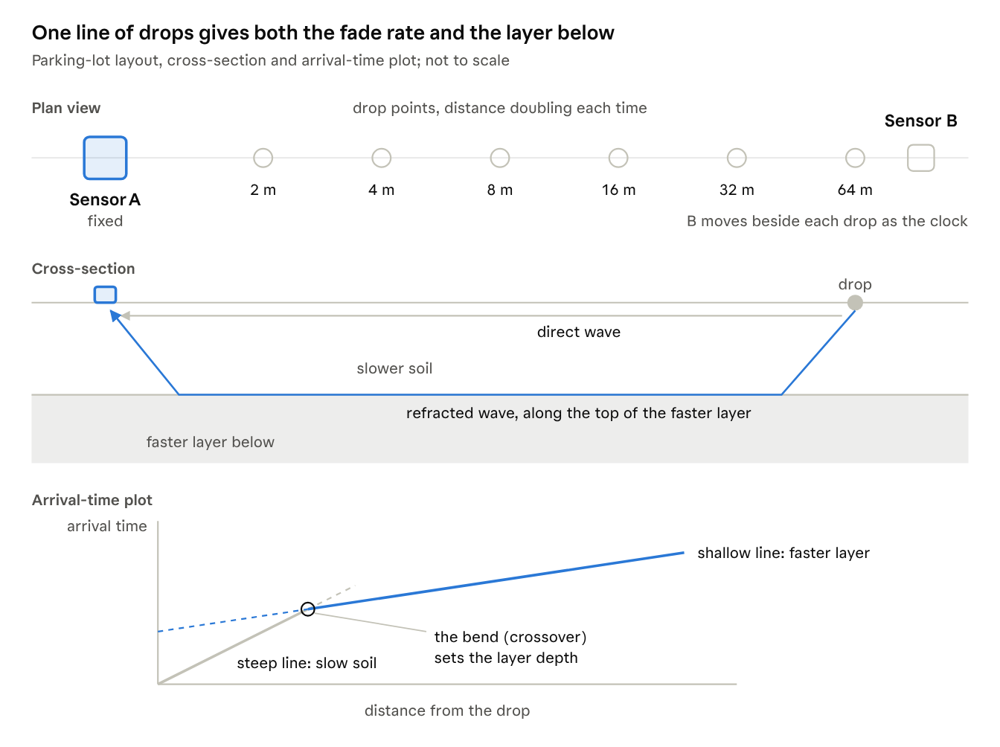

# UHSN classroom activities by setup

*Draft for discussion, 2026-11-24, for Dale Anderson and Cleat (DRI UHSN team), from Gus
Williams. Nothing here is decided. The overview sent with it, "Utah High School Seismic
Network: Student Apps and Activities", describes the program as a whole; this document has
the detail.*

**Please choose which classroom activities the UHSN school program should offer, and which it
should start with.** We want the program to make the most of each school's Raspberry Shake.
The document runs in this order:

- **Questions for Dale and Cleat** come first: what we need from you.
- **Setups:** every activity needs one of four: records from University of Utah stations,
  the school's own Shake, a second Shake that DRI brings, or phones.
- **All activities at a glance:** one row for each of the 46 activities, with columns for
  your choices.
- **Activity cards:** one short card per activity: how ready it is, the question students
  answer, what they do, time, materials and Utah standards.
- **Appendices:** the website today, the physics behind the activities, Utah's phone law and
  student privacy, trials, new tools, strands across setups, more questions, the research
  track, where the 23 November items went, and sources.

## Questions for Dale and Cleat

1. **Which activities?** In the table under "All activities at a glance", mark your top
   three 1, 2 and 3, and each of the others yes, maybe or no. Add comments anywhere. A yes
   commits no one to a date or a budget.
2. **Where to start?** The pilot we suggest: E2 Quake Waves → E1 Quake Locator → S1 Meet our
   Shake now, then S3 School Pulse once the school data and its tool are ready (Stage 4).
   Quake Explorer's investigations are the next step for classes that want more. Would you
   change it?
3. **Which students?** We suggest a general high-school entry, with extensions for advanced
   students, and the mentored research track (the overview's Appendix E; by setup in
   Appendix H) kept separate. Do you agree?
4. **Each school:** can you help fill in a short inventory? Teacher and IT contacts; course
   and class time (periods per year); students' devices and the web filter; the Shake's model
   and where it sits (room, floor, space nearby, distance to the gym and the bus loop); its
   station code, and whether its data sharing is on.
5. **Who supports what?** We suggest naming one person for each of three jobs: helping the
   teachers, looking after the data (the path from the school Shakes to a DRI server), and
   looking after the instruments. Who should they be?
6. **A roaming Shake:** is a kit budgeted? How many, which model (RS3D or RS&BOOM), who takes
   it to schools, and which activities suit a DRI visit?
7. **Phones:** are phone activities worth pursuing under Utah's 2026 phone law (Appendix C)?
   Would a classroom set of old phones help?
8. **Judging the pilot:** we suggest four measures of success: classes finish in the time,
   students explain their result with evidence, teachers would use it again, and the data and
   instruments work. Numerical targets would be set together after the first trials. Would
   you change any?
9. **Could you pass this on to UUSS?** At SUU, the University of Utah station that stands in
   for Juab, the vertical channel records about 10 times weaker than the station's own
   horizontal channels and its neighbors, on three nights checked in 2025–26. It doesn't
   affect our figures.

More questions, for Gus and DRI, are in Appendix G.

## Setups

Every activity needs one of four setups. Card IDs start with the setup's letter.

| Setup | What it is | Equipment | Ready |
| -------------- | ------------------------ | ---------------------------------------- | ------------------ |
| **E: External data** | Records from University of Utah seismic stations near each school, and the USGS earthquake catalog | Any device with a browser (Chromebooks are fine) and a projector. The school's web filter must allow EarthScope and USGS ([before-class checklist](https://gus-p-williams.github.io/utahshake/teachers/#before-class)); a built-in sample quake works when they are blocked | Now |
| **S: School Shake** | The Raspberry Shake installed at the school. It stays where it is: activities move the *source* (drops, jumps, sounds at measured spots), never the Shake | The installed Shake; drop weights for some activities | One activity now (S1); most once the school Shakes' data reach a DRI server (Appendix A) |
| **R: Roaming Shake** | A second Shake that DRI brings to a school for a day or two | A DRI kit: a Shake (an RS3D, which records 3 directions of motion, or an RS&BOOM, which adds an air-pressure channel), a GPS receiver for timing, a battery pack and a weatherproof case | If a kit is budgeted |
| **P: Phones** | Phones or tablets running a page on our website (Phone Recorder, not built yet) | Phones or tablets; old phones without SIM cards, kept in the classroom, will do. Nothing is installed: each opens our page in its browser over the school Wi-Fi, so it needs an internet connection (Appendix B6). Recordings stay on the device | After the district allows it (Utah's 2026 phone law: Appendix C) and a trial |

The school's Shake is the center of the program: 26 of the 46 activities use a Shake directly
(18 the installed Shake, 8 a roaming one). Another 10 use University of Utah stations
standing in for the schools (6 of them work today) and switch to the school Shakes when their
data reach a DRI server. Two phone activities use the Shake as the reference instrument. One Shake activity
works today, before any of that: S1, Meet our Shake.

## All activities at a glance

Descriptions follow in "Activity cards", in the same order. Fill in **Include**: 1, 2 and 3
for your top three; yes, maybe or no for the others.

- **Uses a Shake:** *Yes* (the installed Shake); *Yes, 2* (installed plus roaming);
  *Roaming* (the roaming Shake alone); *Reference* (beside phones); *Later* (uses stand-in
  stations, moves to the school Shakes when their data reach a DRI server); *No*.
- **Readiness:** *Available now* (students can do it today); *Needs data or tool* (in our
  plans, but waits for the school Shakes' data or a new app); *Proposed* (a new idea, not yet
  in our plans); *Needs a trial* (we do not yet know it works in a school; Appendix D). A card
  that fits two labels gets the later one in this list.

| ID | Activity | Uses a Shake | Readiness | Include | Comments |
| -------- | -------------------------- | -------------- | -------------- | ----------- | ------------------ |
| E1 | Quake Locator | Later | Available now |  |  |
| E2 | Quake Waves and P and S motion (demo) | No | Available now |  |  |
| E3 | Can you tell? Mystery seismograms | Later | Available now |  |  |
| E4 | Town Pulse | Later | Needs data or tool |  |  |
| E5 | Quake or blast? | No | Proposed |  |  |
| E6 | Can Utah hear the ocean? | Later | Proposed |  |  |
| E7 | What notes is the ground playing? | Later | Available now |  |  |
| E8 | A message from far away | Later | Available now |  |  |
| E9 | How fast is the rock? | Later | Available now |  |  |
| E10 | Which way did the ground move? | Later | Available now |  |  |
| E11 | How Big Was It? | Later | Proposed |  |  |
| E12 | Build a Detector | Later | Proposed |  |  |
| E13 | Felt Map Locator | No | Proposed |  |  |
| E14 | How often do big ones happen? | No | Proposed |  |  |
| S1 | Meet our Shake | Yes | Available now |  |  |
| S2 | Quake Locator with our schools | Yes | Needs data or tool |  |  |
| S3 | School Pulse | Yes | Needs data or tool |  |  |
| S4 | Bus Detective | Yes | Needs data or tool |  |  |
| S5 | Signal Detective | Yes | Needs data or tool |  |  |
| S6 | Weather Ears | Yes | Proposed |  |  |
| S7 | Game Night Quake | Yes | Needs data or tool |  |  |
| S8 | ShakeOut jump | Yes | Needs data or tool |  |  |
| S9 | Our Shake vs the pros | Yes | Proposed |  |  |
| S10 | Distance line | Yes | Needs data or tool |  |  |
| S11 | Height and mass ladder | Yes | Needs data or tool |  |  |
| S12 | Surface swap | Yes | Needs data or tool |  |  |
| S13 | Bouncing-ball clock | Yes | Needs data or tool |  |  |
| S14 | Quiet Landing challenge | Yes | Needs data or tool |  |  |
| S15 | Rhythm lab | Yes | Needs data or tool |  |  |
| S16 | Speaker sweep | Yes | Needs data or tool |  |  |
| S17 | Frozen vs thawed | Yes | Needs data or tool |  |  |
| S18 | Speed-bump clock | Yes | Needs a trial |  |  |
| R1 | Campus Wave Speed | Yes, 2 | Needs a trial |  |  |
| R2 | Find a hidden layer | Yes, 2 | Needs a trial |  |  |
| R3 | Frozen vs thawed: wave speed | Yes, 2 | Needs a trial |  |  |
| R4 | Floor by floor | Yes, 2 | Needs data or tool |  |  |
| R5 | Sensor coupling test | Yes, 2 | Needs data or tool |  |  |
| R6 | Vehicle speed trap | Yes, 2 | Needs data or tool |  |  |
| R7 | How deep is the soft ground? | Roaming | Needs a trial |  |  |
| R8 | Air vs ground | Roaming | Proposed |  |  |
| P1 | Phone seismometer | No | Needs a trial |  |  |
| P2 | Phone vs Shake | Reference | Needs a trial |  |  |
| P3 | Find the hit | Reference | Needs a trial |  |  |
| P4 | Shake Table Challenge | No | Needs a trial |  |  |
| P5 | Phone on a spring | No | Needs a trial |  |  |
| P6 | Bounce timer | No | Needs a trial |  |  |

Totals: 8 available now, 18 need data or a tool, 9 proposed, 11 need a trial.

## Activity cards

Each card opens with its readiness (as in the table) and what is on the website, then follows
the layout of the website's activity cards: **Time** · **Setup** · **Apps and tools** ·
**Materials** · **Standards** (Utah codes as in the site's
[standards crosswalk](https://gus-p-williams.github.io/utahshake/teachers/standards/);
† marks a code not yet in the crosswalk). "Viewer" means a page for the school Shakes' data,
planned for when they reach a DRI server.

### E: External data

#### E1 Quake Locator

- **Readiness:** Available now.
- **On the website:** app, student guide and activity card with answer key:
  [open Quake Locator](https://gus-p-williams.github.io/utahshake/app/wave-race/) ·
  [guide](https://gus-p-williams.github.io/utahshake/apps/wave-race/) ·
  [activity card](https://gus-p-williams.github.io/utahshake/teachers/wave-race-card/)
- **Driving question:** How far away was that quake, and where did it happen?
- **Students:** pick the P and S waves on real records from University of Utah stations near
  the schools; turn the time between them into distance; place their own epicenter, let the
  app find the best one, and compare with the official location.
- **Time** 15 min (whole class) or 1 period (pairs) · **Setup** E · **Apps and tools** Quake
  Locator, with Quake Waves as the warm-up · **Materials** browser devices, projector ·
  **Standards** PHYS.4.1, ESS.2.2, ESS.2.3, ESS.4.1, GEOL.3.x, CS 9/10.DA.3, CS 11/12.DA.1
- **Raspberry Shake:** University of Utah stations stand in for the five schools; the school
  Shakes replace them when they stream (S2).

#### E2 Quake Waves and P and S motion (demo)

- **Readiness:** Available now.
- **On the website:** both animations, with a guide:
  [Quake Waves](https://gus-p-williams.github.io/utahshake/apps/quake-waves/) ·
  [How P and S waves move rock](https://gus-p-williams.github.io/utahshake/theory/waves/#two-body-waves).
  Its own activity card is
  [One quake, two waves](https://gus-p-williams.github.io/utahshake/teachers/one-quake-two-waves/);
  Quake Waves is also the warm-up in the Quake Locator card.
- **Driving question:** How do P and S waves move rock, and why does the gap between them
  grow with distance?
- **Students:** predict, then watch: P squeezes and S shakes a block of rock; both waves race
  to four stations, and the gaps between them become circles that cross at the quake.
- **Time** 10 min · **Setup** E (cartoons, no data) · **Apps and tools** Quake Waves; How P
  and S waves move rock · **Materials** projector · **Standards** PHYS.4.1, ESS.2.2
- **Raspberry Shake:** none; prepares students to read the Shake's records.

#### E3 Can you tell? Mystery seismograms

- **Readiness:** Available now.
- **On the website:** the science page
  [Reading a seismogram](https://gus-p-williams.github.io/utahshake/theory/seismograms/)
  shows real records of ocean hum, wind, a working week, quakes near and far, blasts and
  instrument problems, and ends with
  [four mystery records](https://gus-p-williams.github.io/utahshake/theory/seismograms/#can-you-tell).
  An activity card is proposed.
- **Driving question:** What made that wiggle?
- **Students:** work through the page's examples, then identify the four mystery records and
  justify each answer from the record's length, shape and frequency.
- **Time** 1 period · **Setup** E · **Apps and tools** Reading a seismogram; Quake Locator (raw
  records) · **Materials** browser devices · **Standards** PHYS.4.1, ESS.2.2, CS 9/10.DA.3
- **Raspberry Shake:** stand-in stations now; the same game with clips from the school's own
  Shake is Signal Detective (S5).

#### E4 Town Pulse

- **Readiness:** Needs data or tool.
- **On the website:** [People and machines](https://gus-p-williams.github.io/utahshake/theory/seismograms/#people-and-machines)
  shows a working week at station HEB near Heber City (weekday noise 8 times the night
  level). The interactive app (a "seismic carpet") is planned.
- **Driving question:** Can a seismometer tell weekdays from weekends, and see the clocks
  change?
- **Students:** read an hour-by-date color map of ground noise at the University of Utah
  station nearest the school; find weekends, holidays, the daylight-saving shift (the data
  are in UTC), and trains or mines with a daily pattern.
- **Time** 15 min or 1 period · **Setup** E · **Apps and tools** School Pulse (planned) ·
  **Materials** browser devices · **Standards** PHYS.4.1, CS 9/10.DA.3
- **Raspberry Shake:** stand-in station now; on the school's own Shake this becomes School
  Pulse (S3).

#### E5 Quake or blast?

- **Readiness:** Proposed.
- **On the website:** [Blasts and mines](https://gus-p-williams.github.io/utahshake/theory/seismograms/#blasts-and-mines)
  shows that 97% of the 301 blasts the USGS catalog marks in Utah since 2015 happened between
  8 am and 6 pm. The interactive catalog activity is proposed.
- **Driving question:** Can you tell blasts from quakes without looking at a seismogram?
- **Students:** plot time of day, weekday and place for Utah quakes and for events the
  catalog labels as blasts; write a rule; test it on events they have not seen. A twist: a
  series of more than 130 events west of the Great Salt Lake that the catalog labels "quarry blast" are
  most likely the Air Force's rocket-motor detonations at the Utah Test and Training Range;
  finding out why makes a good class investigation.
- **Time** 1 period · **Setup** E · **Apps and tools** catalog tool (proposed) ·
  **Materials** browser devices · **Standards** ESS.4.1, CS 9/10.DA.3, CS 11/12.DA.1
- **Raspberry Shake:** none (catalog); leads into Signal Detective on the school's Shake (S5).

#### E6 Can Utah hear the ocean?

- **Readiness:** Proposed.
- **On the website:** proposed (a possible new Quake Explorer view);
  [Ocean hum](https://gus-p-williams.github.io/utahshake/theory/seismograms/#ocean-hum-microseism)
  already shows it at station TMU (0.16 to 0.25 Hz, 2 to 4 times stronger in winter).
- **Driving question:** Do Pacific storms shake Utah?
- **Students:** compare the strength of the ocean hum at a University of Utah broadband
  station with Pacific storm dates over a winter month.
- **Time** 1 period · **Setup** E · **Apps and tools** Quake Explorer (a possible new view) ·
  **Materials** browser devices · **Standards** PHYS.4.1, CS 9/10.DA.3
- **Raspberry Shake:** stand-in station now; whether the school's Shake can hear it too is
  part of S9.

#### E7 What notes is the ground playing?

- **Readiness:** Available now.
- **On the website:** the app, [Quake Explorer, investigation B](https://gus-p-williams.github.io/utahshake/apps/quake-explorer/#b),
  and its activity card,
  [What notes is the ground playing?](https://gus-p-williams.github.io/utahshake/teachers/notes-of-a-quake/)
- **Driving question:** Why does a distant quake sound lower than a near one?
- **Students:** drag a frequency band on a spectrogram to filter a record; play records 50 to
  400 times faster to hear them; compare near and far stations, and a quake with a quarry
  blast.
- **Time** 15 min (whole class) or 1 period (pairs) · **Setup** E · **Apps and tools** Quake
  Explorer B · **Materials** browser devices, headphones or speakers · **Standards** PHYS.4.1,
  PHYS.2.1, ESS.4.1, CS 9/10.DA.3
- **Raspberry Shake:** stand-in stations now; later the school's Shake, whose 100 readings a
  second set the same 50 Hz limit students explore.

#### E8 A message from far away

- **Readiness:** Available now.
- **On the website:** the app, [Quake Explorer, investigation D](https://gus-p-williams.github.io/utahshake/apps/quake-explorer/#d),
  and its activity card,
  [A message from far away](https://gus-p-williams.github.io/utahshake/teachers/far-side-of-the-world/)
- **Driving question:** What do waves that crossed the Earth tell us about its inside?
- **Students:** read P, S and surface waves from large distant quakes; build a class chart of
  S − P against distance, which curves because rock gets faster with depth.
- **Time** 15 min (whole class) or 1 period (pairs) · **Setup** E · **Apps and tools** Quake
  Explorer D · **Materials** browser devices · **Standards** PHYS.4.1, ESS.2.2, CS 9/10.DA.3
- **Raspberry Shake:** stand-in stations now; a Shake records large distant quakes, but its
  own noise hides small ones.

#### E9 How fast is the rock?

- **Readiness:** Available now.
- **On the website:** the app, [Quake Explorer, investigation A](https://gus-p-williams.github.io/utahshake/apps/quake-explorer/#a),
  and its activity card,
  [How fast is the rock?](https://gus-p-williams.github.io/utahshake/teachers/how-fast-is-the-rock/)
- **Driving question:** Where do Quake Locator's wave speeds come from, and how thick is Utah's
  crust?
- **Students:** stack 20 to 30 stations (23 for Junction, 30 for Magna) by distance from a
  quake; drag rulers along the P and S arrivals to read their speeds; find the bend beyond
  about 150 km where the first waves start running along the top of the mantle.
- **Time** 15 min (whole class) or 1 period (pairs) · **Setup** E · **Apps and tools** Quake
  Explorer A · **Materials** browser devices · **Standards** PHYS.4.1, ESS.2.2, GEOL.3.x,
  CS 11/12.DA.1
- **Raspberry Shake:** stand-in stations now; the school Shakes add their records when they
  stream.

#### E10 Which way did the ground move?

- **Readiness:** Available now.
- **On the website:** the app, [Quake Explorer, investigation C](https://gus-p-williams.github.io/utahshake/apps/quake-explorer/#c),
  and its activity card,
  [Which way did the ground move?](https://gus-p-williams.github.io/utahshake/teachers/which-way-did-it-move/)
- **Driving question:** Can one station tell you where a quake is?
- **Students:** trace the ground's path during P and S at a 3-direction station; combine the
  direction of P with the S − P distance to locate a quake from one station.
- **Time** 15 min (whole class) or 1 period (pairs) · **Setup** E · **Apps and tools** Quake
  Explorer C · **Materials** browser devices · **Standards** PHYS.4.1, ESS.2.2, CS 9/10.DA.3
- **Raspberry Shake:** stand-in stations now; a school needs a 3-direction Shake (RS3D) to do
  this on its own.

#### E11 How Big Was It?

- **Readiness:** Proposed.
- **On the website:** proposed.
- **Driving question:** Can we estimate a quake's magnitude from our records?
- **Students:** measure the peak ground speed at 10 to 20 stations; plot it against distance
  on log-log axes; fit how fast it fades; compare with the USGS magnitude.
- **Time** 1 to 2 periods · **Setup** E · **Apps and tools** How Big Was It? (proposed) ·
  **Materials** browser devices · **Standards** PHYS.2.1, ESS.2.6†, PHYS.4.1
- **Raspberry Shake:** stand-in stations now; the five school Shakes add points when they
  stream.

#### E12 Build a Detector

- **Readiness:** Proposed.
- **On the website:** proposed.
- **Driving question:** Can you code your own quake alarm?
- **Students:** write a trigger that compares short-term and long-term average shaking, in the
  browser; test it on replayed records with known quakes and noise; score hits, misses and
  false alarms; later run it live on the school's Shake.
- **Time** 1 to 3 periods · **Setup** E, then S · **Apps and tools** Build a Detector
  (proposed) · **Materials** browser devices · **Standards** CS 11/12.DA.1, ESS.2.6†,
  CS 9/10.NI.1†
- **Raspberry Shake:** replayed stand-in records first, then live on the school's Shake.

#### E13 Felt Map Locator

- **Readiness:** Proposed.
- **On the website:** proposed (a small app; the USGS data are public and load in a browser).
- **Driving question:** Before seismometers, how did people find where a quake was?
- **Students:** map the USGS "Did You Feel It?" reports for a Utah quake; place the epicenter
  where shaking was strongest; compare with the instrument location and with their Quake Locator
  answer. Best with Wasatch Front quakes, which draw thousands of reports.
- **Time** 15 min or 1 period · **Setup** E · **Apps and tools** Felt Map Locator (proposed) ·
  **Materials** browser devices · **Standards** PHYS.4.1, ESS.4.1, CS 9/10.DA.3
- **Raspberry Shake:** none; the same idea students use with phones in P3, and the reason
  seismometers replaced felt reports.

#### E14 How often do big ones happen?

- **Readiness:** Proposed.
- **On the website:** proposed.
- **Driving question:** How often should Utah expect a damaging quake?
- **Students:** count Utah quakes by magnitude (about ten times fewer for each step up) and
  extrapolate; count the Magna 2020 aftershocks day by day; compare with the official
  forecast (a 43% chance of magnitude 6.75 or larger in the Wasatch Front region in 50 years).
- **Time** 1 period · **Setup** E · **Apps and tools** catalog tool (proposed) ·
  **Materials** browser devices · **Standards** ESS.4.1, ESS.2.6†, CS 11/12.DA.1
- **Raspberry Shake:** none; shows why the schools monitor.

### S: School Shake

#### S1 Meet our Shake

- **Readiness:** Available now.
- **On the website:** works today in Raspberry Shake's free viewers,
  [StationView](https://stationview.raspberryshake.org/#/) and
  [DataView](https://dataview.raspberryshake.org/#/), if the school's Shake shares its data
  with Raspberry Shake (question 4); our site would only link to them.
- **Driving question:** What is our school's seismometer recording right now?
- **Students:** find the school's station; watch the live record while the class jumps and a
  few students stomp at measured distances; find the morning buses and the bells on the
  24-hour record; look for the latest Utah quake.
- **Time** 15 to 30 min · **Setup** S · **Apps and tools** StationView, DataView ·
  **Materials** browser devices, projector, tape measure · **Standards** PHYS.4.1,
  CS 9/10.DA.3
- **Raspberry Shake:** central. Needs each school's station code, with its data sharing to
  Raspberry Shake turned on.

#### S2 Quake Locator with our schools

- **Readiness:** Needs data or tool.
- **On the website:** the app exists ([Quake Locator](https://gus-p-williams.github.io/utahshake/app/wave-race/));
  it needs the school Shakes' data.
- **Driving question:** Can our schools locate a Utah quake as well as the University of Utah?
- **Students:** Quake Locator with the school Shakes in place of the stand-in stations; compare
  with the official location.
- **Time** 1 period · **Setup** S (three or more schools streaming) · **Apps and tools** Quake
  Locator · **Materials** browser devices · **Standards** as E1
- **Raspberry Shake:** central; all the schools' Shakes together.

#### S3 School Pulse

- **Readiness:** Needs data or tool.
- **On the website:** planned.
- **Driving question:** Can the ground tell when class changes?
- **Students:** plot ground noise minute by minute over the bell schedule; average a "seismic
  week"; find assemblies, snow days and testing weeks; predict the school calendar from the
  data; find the quietest hour for spotting small quakes.
- **Time** 15 min or 1 period, then weeks of data · **Setup** S · **Apps and tools** School
  Pulse (planned) · **Materials** browser devices · **Standards** PHYS.4.1, CS 9/10.DA.3
- **Raspberry Shake:** central. The signal is weaker where the Shake sits in a quiet room
  away from foot traffic.

#### S4 Bus Detective

- **Readiness:** Needs data or tool.
- **On the website:** planned.
- **Driving question:** Can we hear the buses arrive, and which is which?
- **Students:** log real arrival times; build a detector; score its hits, misses and false
  alarms.
- **Time** 1 to 2 periods, plus days of logging · **Setup** S · **Apps and tools** Bus
  Detective (planned) · **Materials** browser devices, a log sheet · **Standards**
  CS 9/10.DA.3, CS 11/12.DA.1, PHYS.4.1
- **Raspberry Shake:** central; a bus 15 m away shakes the ground hundreds of times more than
  the smallest motion the Shake can detect.

#### S5 Signal Detective

- **Readiness:** Needs data or tool.
- **On the website:** planned; E3 is a version with fixed examples.
- **Driving question:** What made that wiggle on our Shake?
- **Students:** label short clips (bus, bell, train, quake, blast, thunder, the class's own
  logged drops); build a shared catalog; sort by length and pitch; later train a simple
  classifier.
- **Time** 1 period, then ongoing · **Setup** S · **Apps and tools** Signal Detective
  (planned) · **Materials** browser devices · **Standards** CS 11/12.DA.1, ESS.4.1
- **Raspberry Shake:** central.

#### S6 Weather Ears

- **Readiness:** Proposed.
- **On the website:** proposed; wind noise is shown on a University of Utah station in
  [Wind and weather](https://gus-p-williams.github.io/utahshake/theory/seismograms/#wind-and-weather).
- **Driving question:** Can a seismometer feel the wind and hear thunder?
- **Students:** compare the Shake's noise with wind speed from the nearest weather station; on
  a Shake with an air-pressure channel (RS&BOOM), catch thunder and time the flash-to-boom
  delay.
- **Time** 1 period · **Setup** S · **Apps and tools** viewer, weather data · **Materials**
  browser devices · **Standards** PHYS.4.1
- **Raspberry Shake:** central; thunder needs an RS&BOOM.

#### S7 Game Night Quake

- **Readiness:** Needs data or tool.
- **On the website:** planned.
- **Driving question:** Whose crowd shook harder, and is that a fair comparison?
- **Students:** line the record up with the play-by-play; measure peak and average shaking;
  find the band's beat in a spectrogram; design a "standard stomp" (same group, same spot,
  same distance from the Shake) to compare schools fairly.
- **Time** 1 to 2 periods · **Setup** S (all schools) · **Apps and tools** viewer ·
  **Materials** browser devices · **Standards** PHYS.4.1, PHYS.2.1
- **Raspberry Shake:** central; works where the gym is close enough to the Shake.

#### S8 ShakeOut jump

- **Readiness:** Needs data or tool.
- **On the website:** planned (no new app needed).
- **Driving question:** How far away can a school's jump be seen?
- **Students:** every UHSN school jumps at the same minute during the Great Utah ShakeOut
  drill; compare the records across schools and with nearby University of Utah stations.
- **Time** 15 min · **Setup** S (all schools) · **Apps and tools** viewer · **Materials**
  none · **Standards** PHYS.4.1, ESS.4.1, ESS.2.6†
- **Raspberry Shake:** central; all the schools' Shakes together.

#### S9 Our Shake vs the pros

- **Readiness:** Proposed.
- **On the website:** proposed; [Instrument problems](https://gus-p-williams.github.io/utahshake/theory/seismograms/#instrument-problems)
  already shows clipping and a dead channel on University of Utah stations.
- **Driving question:** How good is our school's seismometer?
- **Students:** for the same quakes, compare the school's Shake with the nearest University of
  Utah station: background noise, how clearly the quake stands out, how clear the arrivals
  are; can the Shake hear the ocean (E6)?
- **Time** 1 period · **Setup** S with E · **Apps and tools** viewer, Quake Explorer tools ·
  **Materials** browser devices · **Standards** PHYS.4.1, CS 9/10.DA.3
- **Raspberry Shake:** central.

S10 to S18 are one kind of experiment: they *move the source, not the Shake.* Students make
drops, jumps and sounds at measured spots around the installed Shake and compare what it
records. They need some space near the Shake (Appendix B5) and a viewer that marks each drop.
Every session goes in a log, so the drops are never mistaken for quakes.

\
*Figure 1. A line of drops (from the 23 November planning evaluation; not to scale). The
installed Shake is Sensor A; each drop doubles the distance (S10 goes to 32 m). Timing the
waves and finding a faster layer below needs a second Shake, the roaming one (R1, R2).*

#### S10 Distance line

- **Readiness:** Needs data or tool.
- **On the website:** planned.
- **Driving question:** How fast does shaking fade with distance?
- **Students:** drop the same weight five times at 2, 4, 8, 16 and 32 m along one line from
  the Shake; plot the peak shaking against distance on log-log axes.
- **Time** 1 period · **Setup** S · **Apps and tools** viewer · **Materials** medicine ball
  or sandbag (5 to 10 kg), 30 m tape, floor tape · **Standards** PHYS.4.1
- **Raspberry Shake:** central; needs a straight line of up to 32 m from the Shake.

#### S11 Height and mass ladder

- **Readiness:** Needs data or tool.
- **On the website:** planned.
- **Driving question:** How much of a falling weight's energy turns into shaking?
- **Students:** at one marked spot 5 to 10 m from the Shake, drop 2 to 10 kg from 0.25 to
  2 m; plot the shaking against the energy $mgh$ on log-log axes.
- **Time** 1 period · **Setup** S · **Apps and tools** viewer · **Materials** weights 2 to
  10 kg, step stool, tape · **Standards** PHYS.2.1
- **Raspberry Shake:** central.

#### S12 Surface swap

- **Readiness:** Needs data or tool.
- **On the website:** planned.
- **Driving question:** Does a softer landing make smaller, lower-pitched waves?
- **Students:** same ball, same height, same spot, with different surfaces laid on that spot
  (tile, carpet, gym mat, plywood, a tray of sand or snow); compare peak shaking, pitch and
  how long it lasts.
- **Time** 1 period · **Setup** S · **Apps and tools** viewer · **Materials** one heavy ball,
  the surfaces · **Standards** PHYS.1.3†, PHYS.2.1
- **Raspberry Shake:** central. Outdoor ground types need the roaming Shake.

#### S13 Bouncing-ball clock

- **Readiness:** Needs data or tool.
- **On the website:** planned.
- **Driving question:** Can the ground keep time for a bouncing ball?
- **Students:** drop a ball near the Shake; time the bounces; each bounce height is
  $h = g t^2/8$ and the bounciness is $e = t_{n+1}/t_n$ (heights come out within 2 to 4%).
- **Time** 15 to 30 min · **Setup** S · **Apps and tools** viewer · **Materials** basketball,
  superball · **Standards** PHYS.1.2†, PHYS.2.1
- **Raspberry Shake:** central. A phone-microphone version is P6.

#### S14 Quiet Landing challenge

- **Readiness:** Needs data or tool.
- **On the website:** planned.
- **Driving question:** Can you design a pad that makes a dropped weight nearly invisible to
  the seismometer?
- **Students:** teams build pads within a budget; the Shake scores the peak shaking of a
  standard drop at a marked spot.
- **Time** 1 to 2 periods · **Setup** S · **Apps and tools** viewer · **Materials** foam,
  sand, old tires, springs, a standard weight · **Standards** PHYS.1.3†, ESS.2.6†
- **Raspberry Shake:** central.

#### S15 Rhythm lab

- **Readiness:** Needs data or tool.
- **On the website:** planned.
- **Driving question:** What happens when a crowd jumps in step?
- **Students:** the class jumps 1, 2 and 3 times a second, in step and out of step, at a
  marked spot; find the beat in a spectrogram. In step, 25 jumpers shake the ground about 25
  times as hard as one; at random, only about 5 times.
- **Time** 30 min · **Setup** S · **Apps and tools** viewer with spectrogram · **Materials**
  metronome app, room for the class at a known distance · **Standards** PHYS.4.1
- **Raspberry Shake:** central.

#### S16 Speaker sweep

- **Readiness:** Needs data or tool.
- **On the website:** planned.
- **Driving question:** What can a seismometer that takes 100 readings a second hear?
- **Students:** a subwoofer on the floor sweeps from 10 to 45 Hz, then plays tones above 50 Hz;
  find the floor's resonances; test whether the Shake filters out tones above 50 Hz or shows
  them as false low notes.
- **Time** 30 min · **Setup** S · **Apps and tools** viewer with spectrogram · **Materials**
  subwoofer, tone app · **Standards** PHYS.4.1
- **Raspberry Shake:** central.

#### S17 Frozen vs thawed

- **Readiness:** Needs data or tool.
- **On the website:** planned.
- **Driving question:** Does frozen or wet ground carry shaking differently?
- **Students:** repeat the distance line (S10) at the same marked spots in January, after the
  thaw and after rain; build a class dataset over years.
- **Time** 1 period each season · **Setup** S · **Apps and tools** viewer · **Materials** as
  S10 · **Standards** PHYS.4.1
- **Raspberry Shake:** central; the fixed Shake means the same sensor every season.

#### S18 Speed-bump clock

- **Readiness:** Needs a trial.
- **On the website:** proposed.
- **Driving question:** How fast do cars cross the school lot, measured with one seismometer?
- **Students:** front and rear axles hit a speed bump one after the other; speed = wheelbase ÷
  time between the two thumps (a car at 15 km/h: 0.65 s, timed to a hundredth of a second);
  check with a stopwatch.
- **Time** 30 min plus recording · **Setup** S · **Apps and tools** viewer · **Materials**
  tape measure, stopwatch · **Standards** CS 9/10.DA.3
- **Raspberry Shake:** central; needs a speed bump near the Shake.

### R: Roaming Shake

These bring a second Shake to the school for a day or two, usually beside the installed one.
In the field, the roaming Shake keeps time with its GPS receiver.

#### R1 Campus Wave Speed

- **Readiness:** Needs a trial.
- **On the website:** planned.
- **Driving question:** How fast does a stomp travel across the school grounds?
- **Students:** put the roaming Shake 10 to 30 m from the installed one, on the same floor or
  ground; drop a weight beside each in turn and in between; the time difference ÷ the spacing
  is the speed, and $v = f\lambda$ gives the wavelength.
- **Time** 1 period · **Setup** R · **Apps and tools** viewer (two records) · **Materials**
  roaming kit, weights, tape · **Standards** PHYS.4.1
- **Raspberry Shake:** both Shakes.

#### R2 Find a hidden layer

- **Readiness:** Needs a trial.
- **On the website:** planned.
- **Driving question:** Is there a faster layer (the water table, bedrock) under the field,
  and how deep is it?
- **Students:** keep two Shakes 10 to 20 m apart in a line; move the hammer blows outward
  along the line from 2 to 64 m. When the time between the two Shakes suddenly shrinks, the
  first wave is running along a faster layer below; where that happens gives its depth. The
  same reasoning found the base of Earth's crust (E9).
- **Time** 1 to 2 periods · **Setup** R · **Apps and tools** viewer (two records) ·
  **Materials** roaming kit, sledgehammer and plate, 64 m of tape · **Standards** PHYS.4.1,
  ESS.2.2
- **Raspberry Shake:** both Shakes (or two roaming units).

#### R3 Frozen vs thawed: wave speed

- **Readiness:** Needs a trial.
- **On the website:** planned.
- **Driving question:** Does frost change how fast waves travel?
- **Students:** repeat R1 or R2 at the same marks in winter and in spring.
- **Time** 1 period each visit · **Setup** R · **Apps and tools** viewer · **Materials**
  roaming kit in an insulated box (the Shake's computer is rated down to 0 °C) ·
  **Standards** PHYS.4.1
- **Raspberry Shake:** both Shakes.

#### R4 Floor by floor

- **Readiness:** Needs data or tool.
- **On the website:** planned.
- **Driving question:** Does an upper floor or a stage shake more than the ground?
- **Students:** roaming Shake upstairs or on the stage, installed Shake on the ground floor,
  recording together; comparing their spectra shows the floor's own resonance.
- **Time** 1 period plus an overnight recording · **Setup** R · **Apps and tools** viewer ·
  **Materials** roaming kit · **Standards** ESS.2.6†, PHYS.4.1
- **Raspberry Shake:** both Shakes.

#### R5 Sensor coupling test

- **Readiness:** Needs data or tool.
- **On the website:** planned.
- **Driving question:** Does it matter how a seismometer is installed?
- **Students:** roaming Shake beside the installed one on carpet, on tile, on an outdoor spike
  and buried; both record the same drops; compare noise and response.
- **Time** 1 period · **Setup** R · **Apps and tools** viewer · **Materials** roaming kit,
  ground spike, spade · **Standards** PHYS.4.1, CS 9/10.DA.3
- **Raspberry Shake:** both Shakes.

#### R6 Vehicle speed trap

- **Readiness:** Needs data or tool.
- **On the website:** planned.
- **Driving question:** How fast are the buses going?
- **Students:** two Shakes 20 to 50 m apart along the bus route; the time between the two
  peaks ÷ the spacing is the speed (within 5 to 10%); compare peak shaking with vehicle
  weight.
- **Time** 1 period · **Setup** R · **Apps and tools** viewer (two records) · **Materials**
  roaming kit · **Standards** CS 9/10.DA.3
- **Raspberry Shake:** both Shakes.

#### R7 How deep is the soft ground?

- **Readiness:** Needs a trial.
- **On the website:** proposed.
- **Driving question:** How thick is the soil under our school, and does it amplify quakes?
- **Students:** record 30 to 60 min of quiet-time noise at the school and at points around
  town; the peak of the ratio of side-to-side to up-and-down shaking is the ground's
  resonance, and $f_0 \approx V_S/(4H)$ gives the soil's thickness. Works for layers down to
  about 100 m.
- **Time** 2 periods plus overnight recordings · **Setup** R · **Apps and tools** viewer with
  a ratio tool · **Materials** roaming kit (an RS3D) · **Standards** ESS.2.2, ESS.2.6†,
  GEOL.3.x
- **Raspberry Shake:** the roaming RS3D on its own (or the installed Shake, if it is an RS3D).

#### R8 Air vs ground

- **Readiness:** Proposed.
- **On the website:** proposed.
- **Driving question:** How far away was the blast, from the gap between its ground wave and
  its air wave?
- **Students:** record drops, thunder or quarry blasts; the ground wave arrives first and the
  air wave follows at 343 m/s; the gap grows with distance, like S − P.
- **Time** 1 period plus recording · **Setup** R · **Apps and tools** viewer · **Materials**
  roaming kit (an RS&BOOM) · **Standards** PHYS.4.1
- **Raspberry Shake:** the roaming RS&BOOM; brings Weather Ears (S6) to schools without one.

### P: Phones

These use a page on our website (Phone Recorder, not built yet) on phones or tablets.
Nothing is installed: each device opens the page in its browser over the school Wi-Fi, so it
needs an internet connection (Appendix B6). Old phones without SIM cards, kept in the
classroom, will do. Recordings stay on the device. The district's phone policy must allow the
activity, even on school-owned phones, and there must be a way to take part that needs no
personal phone (Appendix C).

#### P1 Phone seismometer

- **Readiness:** Needs a trial.
- **On the website:** proposed (needs the Phone Recorder page).
- **Driving question:** What does a phone's motion sensor measure, and how well?
- **Students:** watch the phone's acceleration live; lay it on each face to read +1 g and −1 g
  on each axis (a calibration against gravity); read its measured readings per second and
  noise; stomp at 1, 2 and 4 m; compare the phone taped down, loose, and on carpet.
- **Time** 15 to 30 min · **Setup** P · **Apps and tools** Phone Recorder · **Materials**
  phones or tablets, tape · **Standards** PHYS.4.1, CS 9/10.DA.3
- **Raspberry Shake:** none; leads into P2.

#### P2 Phone vs Shake

- **Readiness:** Needs a trial.
- **On the website:** proposed (needs the Phone Recorder page).
- **Driving question:** How much better is a real seismometer than a phone?
- **Students:** phones beside the school's Shake; compare their background noise; drop a
  weight farther and farther away until each phone loses it while the Shake still sees it
  (expect the phones to be thousands of times noisier).
- **Time** 1 period · **Setup** P with S · **Apps and tools** Phone Recorder, viewer ·
  **Materials** phones, a weight, tape · **Standards** PHYS.4.1, CS 9/10.DA.3
- **Raspberry Shake:** the reference.

#### P3 Find the hit

- **Readiness:** Needs a trial.
- **On the website:** proposed.
- **Driving question:** Can a ring of phones find where the ground was hit, the way felt
  reports once located quakes?
- **Students:** place 4 to 6 phones on the ground 10 to 40 m apart; hit the ground with a
  sledgehammer (or have the class jump) somewhere inside the ring; compare how hard each
  phone shook and place the hit where shaking was strongest; check with the tape measure.
  Try it on a table first: the whole table flexes, so the nearest phone does not always
  shake hardest, which shows why the method needs space.
- **Why shaking strength, not arrival times** (discuss with students): waves cross 10 to
  30 m of gym floor (concrete) in 2 to 8 ms, and a tabletop's bending waves cross it in about
  15 ms. A phone takes a reading only every 17 ms or so, and even after a calibration hit
  that all phones feel, two phones' clocks disagree by about ±11 ms. Strength needs no clock.
  What would we need to use arrival times? More distance, or fast sensors with synchronized
  clocks, which is what the Shakes have (S2, R1).
- **Extension:** locate a clap by sound. Sound is slow and a microphone takes 48,000
  readings a second, so arrival times work even across a table (needs a trial).
- **Time** 1 period · **Setup** P (a Shake nearby helps) · **Apps and tools** Phone
  Recorder, Hit Locator (proposed) · **Materials** 4 to 6 phones, sledgehammer and plate,
  tape measure · **Standards** PHYS.4.1, CS 11/12.DA.1
- **Raspberry Shake:** the reference, if the school's or the roaming Shake is near.

#### P4 Shake Table Challenge

- **Readiness:** Needs a trial.
- **On the website:** proposed.
- **Driving question:** Can you design a building that rides out the shaking?
- **Students:** build model towers on a hand-driven shake table; phones taped to the base and
  the roof record the shaking; the roof-to-base ratio at different shaking rates shows the
  tower's resonance; add base isolation and compare. (The Utah State Capitol rests on about
  260 base isolators.)
- **Time** 1 to 2 periods · **Setup** P · **Apps and tools** Phone Recorder · **Materials** a
  board on rollers, building materials, tape · **Standards** ESS.2.6†, PHYS.4.1
- **Raspberry Shake:** none; links to how real floors respond (R4).

#### P5 Phone on a spring

- **Readiness:** Needs a trial.
- **On the website:** proposed.
- **Driving question:** Why does a seismometer need a mass on a spring?
- **Students:** hang a phone in a padded case from a spring; tap it; measure its natural
  frequency $f_0 = \frac{1}{2\pi}\sqrt{k/m}$ and how fast the ringing dies; add damping;
  compare with the 4.5 Hz sensor inside the Shake.
- **Time** 1 period · **Setup** P · **Apps and tools** Phone Recorder · **Materials** spring
  or bungee, padded case, card · **Standards** PHYS.4.1 (closest fit)
- **Raspberry Shake:** none; explains how the Shake's sensor works.

#### P6 Bounce timer

- **Readiness:** Needs a trial.
- **On the website:** proposed.
- **Driving question:** How high did the ball bounce, from sound alone?
- **Students:** a phone's microphone records each bounce; $h = g t^2/8$ with timing 500 times
  finer than the Shake's.
- **Time** 15 min · **Setup** P · **Apps and tools** Phone Recorder (microphone) ·
  **Materials** a ball · **Standards** PHYS.1.2†, PHYS.2.1
- **Raspberry Shake:** none; compare with S13.

---

## Appendix A: The website today

[gus-p-williams.github.io/utahshake](https://gus-p-williams.github.io/utahshake/), checked
2026-11-24. The sidebar has Home and four sections:

- **Apps:** All apps; [Quake Locator](https://gus-p-williams.github.io/utahshake/apps/wave-race/);
  [Quake Explorer](https://gus-p-williams.github.io/utahshake/apps/quake-explorer/) (four
  investigations); [Quake Waves](https://gus-p-williams.github.io/utahshake/apps/quake-waves/);
  [Build a Wiggle](https://gus-p-williams.github.io/utahshake/apps/build-a-wiggle/), each with
  its guide. All apps also has one animation, How P and S waves move rock, and lists School
  Pulse as coming soon.
- **The Science:** eight pages: Seismic waves; Reading a seismogram; Distance from S minus P;
  Locating a quake; Travel times and Earth's layers; Frequencies, fading and sound; Which way
  the ground moves; Our stations and data.
- **Teachers:** six activity cards (Quake Locator; "One quake, two waves", which is E2; one per
  Quake Explorer investigation), each opening with an "At a glance" box. A catalog lists them
  by setup (the site's "Browser only" is setup E). Also Utah standards at a glance, the
  before-class checklist and the standards crosswalk.
- **Developers:** how the apps are built.

Everything uses University of Utah stations standing in for the five schools, because the
school Shakes' data do not yet reach a UHSN server. Switching to the school Shakes needs two
things first: a DRI server that collects their data, and a matching data source in the apps
(roadmap Stage 4). The apps themselves need no rewrite: they read all data through one
switchable source. The site's Teachers catalog groups the cards by setup ("Browser only" is
E, "School Shake" is S), and the cards in this document use the same layout, so the ones you
choose can go there directly.

## Appendix B: The physics behind the activities

In short:

- **Phones measure shaking strength well and timing poorly.** They take about 60 readings a
  second in a browser, and their clocks disagree by milliseconds to a tenth of a second. A
  Shake takes 100 readings a second on network time (±10 ms) and is thousands of times more
  sensitive.
- **Locating by strength needs space:** strength falls steadily with distance outdoors, but
  a table vibrates as a whole.
- **Experiments that measure strength need only the installed Shake.** Experiments that
  measure travel time need a second clock: a roaming Shake.

### B1 Sensors compared

| | Raspberry Shake (RS1D; RS3D where it differs) | Phone motion sensor, in a browser | Phone microphone, in a browser |
| ---------------- | ------------------ | ------------------ | ---------------- |
| Readings per second | 100 (every 10 ms) | About 60 (every 16.7 ms): Chrome and iOS both cap motion data at 60 per second | 44,100 or 48,000 |
| Clock | Network time, ±10 ms; GPS optional; without either it drifts 72 ms per hour | Set by the network: a few ms to 100 ms apart between phones; a hit seen by all phones lines them up to about ±8 ms each, ±11 ms between two (B3) | Same as the motion sensor |
| Smallest motion seen | 0.08 µm/s (1 to 20 Hz) | Noise of 50 to 350 µm/s at 10 to 20 Hz (our estimate from measured phones) | |
| Largest before clipping | About 21 mm/s peak to peak (the specification's estimate for 0.1 to 10 Hz) | Several g | |
| Frequencies | 0.7 to 44 Hz at −3 dB (RS3D: to 39 Hz), falling steeply toward 50 Hz | Up to about 30 Hz | Sound |

Sources: Raspberry Shake specification sheet and timing manual; Chromium and WebKit; Zhang et
al. (2025) for phone clocks and noise (66 phones: noise 0.02 m/s² across the screen, 0.07 m/s²
through it; clocks a few ms to 100 ms apart on Wi-Fi, under 10 ms drift in 10 hours).

What the sensitivity means: a bus 15 m away shakes the ground at about 0.04 mm/s, rising to
0.1 mm/s over a bump (federal transit guidance). That is hundreds of times the Shake's
threshold but at or below a phone's noise. MyShake found phones record magnitude 5 quakes
within about 10 km (Kong et al. 2016). Phones are strong-motion sensors; the Shake is a
weak-motion sensor. Close to a dropped weight, where a Shake can clip, the phone is the
better tool.

### B2 Wave speeds and travel times

| Medium | Wave | Speed (m/s) | Across 1.5 m | Across 30 m | Source |
| ------------------ | ------------- | ------------- | --------- | ------------- | -------------- |
| Air at 20 °C | Sound | 343 | 4.4 ms | 87 ms | GPG table |
| Tabletop (MDF or particleboard, 19 to 32 mm) | Along the board | About 2,200 | 0.7 ms | | Our calculation |
| Same | Bending at 25 Hz (energy speed) | 90 to 115 | 13 to 17 ms | | Our calculation |
| Concrete slab | P | 3,750 to 4,400 or more | 0.4 ms | 7 to 8 ms | Pulse-velocity grading: "good" 3.75 to 4.40 km/s (IIT Delhi virtual lab) |
| Topsoil | P / S | 300 to 700 / 100 to 300 | | 43 to 100 / 100 to 300 ms | GPG table |
| Dry sand | P / S | 400 to 1,200 / 100 to 500 | | 25 to 75 / 60 to 300 ms | GPG table |
| Soil surface | Rayleigh (about 0.9 of S) | 90 to 270 | | 110 to 330 ms | GPG |
| Wet sand, below the water table | P | 1,500 to 2,000 | | 15 to 20 ms | GPG table |

Tabletop values use $E = 3.6$ GPa (MDF, Wood Handbook), density 800 kg/m³ and Poisson's
ratio 0.3. Bending waves are dispersive: their speed grows with the square root of frequency,

$$c_B = \left(\frac{D}{\rho h}\right)^{1/4}\sqrt{\omega}, \qquad D = \frac{E h^3}{12(1-\nu^2)}$$

and their energy travels at twice that speed (the speed in the table).

### B3 Locating by shaking strength (P3, E13)

Before seismometers, quakes were located from felt reports: the strongest shaking surrounds
the epicenter. The method is still used for historical quakes (Bakun and Wentworth 1997), and
the USGS "Did You Feel It?" service collects reports today. It works because the distances
span many wavelengths, so shaking fades steadily with distance, and because many reports
average out local differences. The 2020 Magna magnitude 5.7 quake drew 26,376 reports.

For E13, use Wasatch Front quakes: of the 276 Utah-region quakes and blasts of magnitude 2.5
and above in the last five years, 58 drew 10 or more reports. Wasatch Front quakes draw
thousands (West Valley City, magnitude 3.5, February 14, 2026: 4,122), central Utah ones few
(Junction, magnitude 3.3, 2026: 5; Mount Pleasant, magnitude 3.0, 2022: 22). (USGS event
service, 2026-11-24.)

**Outdoors**, surface-wave strength falls roughly as

$$A(r) \approx \frac{A_0}{\sqrt{r}}\, e^{-\pi f r/(Q v)}$$

For 10 to 20 Hz waves at 200 m/s in lossy soil ($Q$ = 20 to 50), strength drops 2.1 to 2.5
times from 5 to 20 m (our calculation). That is enough to rank phones by distance if their
readings agree within about ±30% for the same shaking. Whether they do depends on phone model,
case and ground contact; trial T3 (Appendix D) measures it.

**On a table**, the bending wavelength is 1.6 to 2.1 m at 30 Hz, the top of a phone's range,
and longer at lower frequencies. That is as long as the table, so the table vibrates as a
whole instead of carrying a wave outward. For a rectangular top $a \times b$ supported at its
edges, the lowest vibration frequencies are

$$f_{mn} = \frac{\pi}{2}\left[\left(\frac{m}{a}\right)^2 + \left(\frac{n}{b}\right)^2\right]\sqrt{\frac{D}{\rho h}}$$

about 56 Hz for a 1.5 × 0.75 m top, 25 mm thick, and 30 to 39 Hz for a 1.8 × 0.9 m top 19 to
25 mm thick, lower still for a table on four legs. Each phone's reading then follows where
the table flexes most (the middle), not its distance from the tap.

**Arrival times** become usable when the travel-time differences across the array are 5 to
10 times the timing error $\sigma_{\Delta t}$:

$$L \gtrsim (5 \text{ to } 10)\, v\, \sigma_{\Delta t}$$

Timing errors add in quadrature (the square root of the sum of their squares). One pick on a
phone record is good to about ±5.7 ms. A hit that all the phones feel lines up their clocks,
but reading it adds a second pick, so each phone's corrected time is good to about ±8 ms
($5.7\sqrt{2}$), and the difference between two phones to about ±11 ms ($8\sqrt{2}$). With
$\sigma_{\Delta t} \approx 11$ ms, the array must span 11 to 23 m on soil carrying surface
waves at 200 m/s, 28 to 57 m for P waves at 500 m/s, and 210 to 420 m on concrete
(3,750 m/s). Waves cross 10 to 30 m of concrete in only 2 to 8 ms, so a gym floor is far too
small. Sound in air with a microphone is different: 1.5 m of air is 4.4 ms, or 210 microphone readings, so a clap can be
located across a table. Phone sound ranging to about 1 cm has been shown (BeepBeep, Peng et
al. 2007).

### B4 Two Shakes at one school (R cards)

- **Clocks.** Two Shakes on network time agree within a few ms; a drop beside both measures
  their offset to about ±5 ms. Across 20 m of soil, P waves take 29 to 67 ms and surface waves
  74 to 222 ms, so five drops give the speed to roughly 5 to 15%.
- **Drops at both ends cancel the clock offset.** A drop beyond Shake A gives
  $\Delta t_{AB} = x/V + \delta$ and a drop beyond Shake B gives
  $\Delta t_{BA} = x/V - \delta$, where $x$ is the spacing and $\delta$ the offset:

$$V = \frac{2x}{\Delta t_{AB} + \Delta t_{BA}}, \qquad \delta = \frac{\Delta t_{AB} - \Delta t_{BA}}{2}$$

- **Hidden layer (R2).** While both Shakes receive the direct wave, the time between them is
  $x/V_1$; once both receive the wave running along a faster layer, it drops to $x/V_2$. For
  Shakes 15 m apart over 300 m/s topsoil and a 1,500 m/s water table, it falls from 50 ms to
  10 ms. The switch comes beyond

$$x_c = 2h\sqrt{\frac{V_2 + V_1}{V_2 - V_1}}$$

  which is 7 m for a layer 3 m deep and 24 m for one 10 m deep; the hammer must go out 2 to 3
  times that far.
- **The building.** The installed Shake is indoors. A line from it through the foundation
  mixes slab and soil, which spoils speed measurements. Better: both Shakes on the same slab
  (a long hallway), or the roaming Shake outdoors with a second roaming unit.
- **In the field.** Raspberry Shake lists 1.5 W (RS1D) and 1.6 W (RS3D) while running and
  2.8 W at startup, so a 20,000 mAh power bank runs an RS3D with its GPS receiver for roughly
  30 hours (our estimate). The Shake keeps 7 days of data by default; its SD card can hold
  about 200 days on an RS1D and 68 on an RS3D. The Shake's Raspberry Pi is rated from 0 to 60 °C. Without a network or GPS the clock drifts 72 ms per hour; the kit's GPS
  receiver (a model Raspberry Shake has tested) fixes that.

### B5 Moving the source around the installed Shake (S10 to S18)

- **Space.** Shakes for earthquake work sit on a ground-floor slab in a quiet room. The
  move-the-source cards need one marked spot 2 to 10 m away; a straight line to 16 or 32 m on
  the same slab or the ground just outside; and room for the class to jump at a known
  distance. Keep each line on one side of the wall.
- **Clipping.** The specification puts the Shake's clip level at about 21 mm/s peak to peak,
  an estimate for 0.1 to 10 Hz; a drop shakes at higher frequencies, so treat it as a guide.
  Start distance lines at 2 m and check for flat-topped traces.
- **Log every session** (time, place, source), so analysts and Signal Detective don't mistake
  the drops for quakes; the log turns them into labeled examples.
- **Before the school Shakes' data reach a DRI server,** students can watch their own Shake
  in DataView, and a teacher can download a day's data from the Shake's own web page over the
  school network (7 days kept by default; the card can hold months, B4); a viewer that loads that file is
  listed in Appendix E.
- **Filtering above 50 Hz (S16).** The Shake's response falls steeply just below 50 Hz,
  the mark of a digital anti-alias filter, so tones above 50 Hz should be removed rather than
  folded back as false low notes. S16 tests this.

### B6 Phone sensors in a browser

- **What a phone needs.** No app and no SIM card. The phone opens our page in its browser over
  the school Wi-Fi, so it needs an internet connection, and the school's web filter must
  allow our site. Old phones kept in the classroom will do if their browser is recent enough;
  trial T1 checks which are.
- **iPhone and iPad** (every iOS browser uses Safari's engine): motion data need permission,
  asked from a button tap on an HTTPS page, each session. Up to 60 readings a second.
- **Android (Chrome):** motion data without a prompt on HTTPS pages, up to 60 readings a
  second.
- **Microphone:** permission each session; HTTPS. The page must turn off the browser's echo
  cancellation, noise suppression and automatic gain.
- **Our website is HTTPS**, so all of this works there. Chromebooks are not a substitute
  unless they report motion (some convertibles may).
- The Phone Recorder page must measure each device's actual readings per second and their
  timing jitter rather than assume them.

## Appendix C: Phone policy and student privacy

- **Utah law** (Utah Code 53G-7-227, as amended by S.B. 69, 2026; in effect since July 1,
  2026): "a student may not use a cellphone, smart watch, or emerging technology at a school
  during school hours". School hours run from the first bell to the last, "including all
  instructional time, lunch periods, recess, and transition times between classes".
- **What counts as a cellphone.** Any handheld, portable device that can send and receive
  "voice, data, or text communication" over a cellular or satellite network "or any other
  wireless technology". Wi-Fi is such a technology, so an old phone without a SIM card on the
  school Wi-Fi, or a DRI loaner phone, most likely still counts. The law excludes
  "school provided or required devices" only from "emerging technology", not from
  "cellphone". The same wording may also cover a Wi-Fi tablet; ask the district. School
  Chromebooks, used by all the E cards, are not handheld devices.
- **Exceptions.** Every district must let students use a device for an imminent threat to
  someone's health or safety, a school-wide emergency, the SafeUT Crisis Line, an IEP or
  Section 504 plan, or a medical need, and must let a parent ask for brief use in a place the
  school designates, outside instructional time. Beyond these, a district "may establish a
  policy that provides for other circumstances when a student may use a cellphone ... during
  the school day". A classroom phone activity needs such a policy.
- **State Board rule R277-495** (current text in effect since October 8, 2025, before S.B. 69,
  so a revision may follow): district policies must prohibit "requiring the use of a
  privately-owned electronic device to complete course work". In a school whose policy
  allows some use, a teacher who lets students use personal devices in class must tell
  parents and students the conditions.
- **So every phone activity needs:** a district policy that allows teacher-directed science
  use (or an after-school club, outside school hours); a path that needs no personal phone
  (classroom phones, school tablets, or groups sharing a device); and notice to parents.
- **District policies for 2026-27:** no adopted policy found online for Juab, North Sanpete,
  South Sanpete (Gunnison Valley) or Millard. Juab's board heard public comment on a
  bell-to-bell policy (FGAB) on June 16, 2026 and sent it back for a third reading in July over
  lunch-time use; we have not checked the outcome. Wasatch Academy is private and sets its
  own policy.
- **Privacy:** no accounts or names. Recordings stay on the device or are loaded into the
  browser on one device; nothing is uploaded. Microphone mode keeps only short windows around
  each sound, in memory. Phones share results by typed numbers or a QR code, not through a
  server. If a future feature uploads recordings or links them to students, DRI would need a
  student data privacy agreement with each district first (Utah rule R277-487).

## Appendix D: Trials before committing

| Trial | What | Decides | Who and time |
| ---------- | -------------------------------------- | -------------- | ---------------- |
| T1 Phones in browsers | The Phone Recorder page on 10 or more devices (iPhone, Android, school iPad, Chromebook): readings per second, timing jitter, permissions, whether a 40 Hz tone shows up as a false low note | All P cards | Developer plus one class, 30 min |
| T2 Tabletop | 4 phones, 20 taps at known spots: shaking strength at each phone; then microphones with a clap | The table part of P3; its sound extension | 1 hour, indoors |
| T3 Schoolyard | Sledgehammer on a plate, phones at 5 to 40 m on grass beside a Shake: how far each phone detects it, strength against distance, phone-to-phone differences | P2, P3 | 2 hours, with a Shake |
| T4 Two Shakes | Roaming and installed Shake: a drop beside both, drops at both ends of a 20 m line, the hidden-layer line | R1 to R3 | 2 hours, DRI |
| T5 Site visit | At each school: the Shake's room, floor, space for lines, the gym, the bus loop, speed bumps | All S and R cards | 30 min per school |

## Appendix E: New apps and tools these activities need

| Tool | What it does | Builds on | Cards | When |
| ------------ | ---------------------------------- | -------------- | -------- | -------------- |
| **Viewer for the school Shakes** | Live and recent records, spectrogram, an experiment mode that marks each drop and plots its shaking against distance or $mgh$, a clipping warning, and timing between two records | Quake Explorer's tools | S and R cards | Once the school Shakes' data reach a DRI server (roadmap Stage 4) |
| **File loader** | Opens a day file downloaded from the school's Shake page | Quake Locator's data reader | S cards | Before then, as a bridge |
| **Session log** | Teacher page or sheet: time, place and source of every experiment at a station, sent to DRI | | S and R cards | A sheet now; a page later |
| **Phone Recorder** | Live acceleration (iOS permission button), microphone mode, measured readings per second and noise, events marked and saved on the device, results shown as text or QR code | Quake Locator's trace drawing | P cards | Before any P card |
| **Hit Locator** | Takes results from 3 to 8 phones; locates the hit by shaking strength (and, for claps, by sound arrival times); shows the answer and how well it fits | Quake Locator's location search and "place your own" pin | P3 | After trials T2 and T3 |
| **Felt Map Locator** | Loads the USGS "Did You Feel It?" map for a quake; students place the epicenter; reveal compares it with the instrument location | Quake Locator's map and USGS source | E13 | Small; any time |
| **Catalog tool** | Utah quakes by magnitude, aftershocks per day, time of day and type | USGS source | E5, E14 | With School Pulse, or any time |
| **Roaming kit** | Hardware, setup and timing checklist, booking | | R cards | If budgeted |
| **Build guides** | Drop kit, shake table, phone on a spring | | S, P cards | With the chosen cards |

## Appendix F: Strands across the setups

How a class can follow one idea from one setup to the next.

| Strand | E: External data | S: School Shake | R: Roaming Shake | P: Phones |
| ------------ | ------------------- | --------------------- | ------------------ | ------------------ |
| **Locating** | E1 Quake Locator, E10 one-station direction, E13 Felt Map | S2 Quake Locator with our schools | (R1 measures the local speed) | P3 Find the hit |
| **Wave speed and layers** | E9 How fast is the rock?, E8 A message from far away | | R1 Campus Wave Speed, R2 Hidden layer, R3 Frozen | |
| **Size and fading** | E11 How Big, E13 Felt Map | S10 Distance line, S11 Height and mass, S12 Surface swap, S8 ShakeOut, S17 Frozen | R5 Coupling | P2 Phone vs Shake, P3 |
| **Frequency and sound** | E7 Notes, E6 Ocean | S15 Rhythm lab, S16 Speaker sweep, S7 Band's beat, S6 Thunder | R4 Floor by floor, R7 Soft ground, R8 Air vs ground | P5 Phone on a spring, P4 Shake table, P6 Bounce timer |
| **Noise and patterns** | E3 Mystery records, E4 Town Pulse, E5 Quake or blast, E14 How often, E12 Detector | S1 Meet our Shake, S3 School Pulse, S4 Bus Detective, S5 Signal Detective, S9 vs the pros, S18 Speed bump | R6 Speed trap | P1 Phone seismometer |
| **Engineering design** | E12 Build a Detector, E14 Hazard | S14 Quiet Landing, S7 Standard stomp | R4 Floor by floor | P4 Shake Table Challenge |

Example paths: E1 → E13 → P3 → S2 (find a quake from records, then from felt reports, then a
hammer blow with phones, then a quake with the schools' own Shakes). E4 → S1 → S3 → S4 (a
town's week, our Shake live, our school's week, a bus detector). S14 → P4 (soften a landing,
then isolate a building).

## Appendix G: More open questions (for Gus and DRI)

1. Confirm that installed Shakes are never moved for activities. Juab has two Shakes: is one
   free to serve as a roaming unit there?
2. Would districts accept phone-microphone use (P3 extension, P6) if nothing is stored or
   uploaded?
3. Who may see live School Pulse data, given that it shows when a building is busy?
4. Who keeps the session log at each station, and where does it go?
5. Confirm the standard codes marked † and add them to the site's crosswalk when their
   activities are published.
6. The written confirmation from Raspberry Shake for the UHSN stations is still open;
   school-to-school pages depend on it.

## Appendix H: Research track by setup

The mentored research projects in the overview (its Appendix E), by the setup each part
needs.

| Project | E | S | R | P |
| ---------------- | ---------------- | ------------------ | ------------------ | ---------------- |
| A. Quake or blast | University of Utah records, USGS labels (E5) | School Shakes; RS&BOOM air wave | Visiting RS&BOOM (R8) | |
| B. Location | Analyst picks, location search (E1) | School Shakes in the location (S2) | | Scale model (P3) |
| C. How waves fade | Strength against distance (E11) | School records | Soft-ground resonance (R7) | |
| D. Many cheap vs few good sensors | Broadband reference | Shake vs University of Utah (S9) | Roaming Shake beside a University of Utah broadband station (with UUSS permission) | Phones as the cheapest sensors (P2) |

## Appendix I: Where each activity in the 23 November planning evaluation went

| Evaluation item | Card(s) |
| ------------------------------ | ---------------- |
| School Pulse | E4, S3 |
| Game Night Quake | S7 |
| Quake Locator | E1, E8, S2 |
| Bus Detective | S4 |
| Campus Wave Speed | R1 |
| Weather Ears | S6, R8 |
| How Big Was It? | E11 |
| Signal Detective | E3, E5, S5 |
| Build a Detector | E12 |
| Plots: waveform, helicorder | E1, S1, S3 |
| Plots: spectrogram; audification | E7, S6, S7, S15, S16 |
| Plots: spectrum and PPSD | E6, S9 |
| Plots: seismic carpet | E4, S3 |
| Plots: record section | E9, S10 |
| Plots: event stack | S4, S5 |
| Plots: particle motion | E10 |
| Plots: amplitude against distance | E11, E13, S10 |
| Plots: H/V ratio | R7 |
| Plots: cross-correlation | R1, R6 |
| Surface swap | S12 |
| Height and mass ladder | S11 |
| Distance line | S10, R1 |
| Mini refraction survey | R2 |
| Frozen vs thawed | S17, R3 |
| Bouncing-ball clock | S13, P6 |
| Quiet Landing challenge | S14 |
| Floor by floor | R4 |
| Rhythm lab | S15 |
| Sensor coupling test | R5, P1 |
| Phone vs Shake | P2 |
| Vehicle speed trap | R6, S18 |
| Speaker sweep | S16 |
| ShakeOut jump | S8 |
| Passive data: snow days, holidays; quietest time | E4, S3 |
| Passive data: ocean microseism | E6, S9 |
| Passive data: trains, wind farms, mines | E4, E5, S5 |
| Passive data: gym design | S7 |
| Raspberry Shake's own viewers | S1 |
| Quake Explorer investigations A, B, C, D (new since; overview section 6) | E9, E7, E10, E8 |
| Research projects A to D | Appendix H |

## Appendix J: Sources

Phones and browsers

- Chromium, [Generic Sensor implementation notes](https://chromium.googlesource.com/chromium/src/+/HEAD/services/device/generic_sensor/README.md) (60 Hz cap)
- WebKit [bug 145814](https://bugs.webkit.org/show_bug.cgi?id=145814) (iOS motion events capped at 60 Hz)
- MDN, [DeviceMotionEvent.requestPermission()](https://developer.mozilla.org/en-US/docs/Web/API/DeviceMotionEvent/requestPermission_static)
- Android developers, [sensor rate limiting](https://developer.android.com/develop/sensors-and-location/sensors/sensors_overview#sensors-rate-limiting)
- Zhang, Mokus, Casoli, Eddi and Perrard, [Distributed network of smartphone sensors](https://arxiv.org/abs/2501.04886), arXiv 2501.04886 (2025, revised 2026)
- Peng et al., [BeepBeep: a high accuracy acoustic ranging system using COTS mobile devices](https://www.cs.purdue.edu/homes/chunyi/pubs/sensys106-beepbeep.pdf), SenSys 2007
- Kong et al. 2016, [MyShake: a smartphone seismic network](https://doi.org/10.1126/sciadv.1501055), Science Advances

Raspberry Shake

- [Technical specifications (PDF)](https://raspberryshake.org/media/global-technical-specifications.pdf); manual: [specifications](https://manual.raspberryshake.org/specifications.html), [timing](https://manual.raspberryshake.org/ntp.html), [GPS timing](https://manual.raspberryshake.org/gpsTiming.html)

Physics and materials

- UBC Geophysics for Practicing Geoscientists, [seismic velocities](https://gpg.geosci.xyz/content/physical_properties/seismic_velocity_duplicate.html)
- Forest Products Laboratory, [Wood Handbook (FPL-GTR-190)](https://research.fs.usda.gov/treesearch/37440), ch. 12 (MDF 3.59 GPa)
- D. Russell, [dispersion of flexural waves](https://www.acs.psu.edu/drussell/Demos/Dispersion/Flexural.html); A. Leissa, [Vibration of Plates, NASA SP-160](https://ntrs.nasa.gov/citations/19700009156)
- [Ultrasonic pulse testing of concrete](https://cs-iitd.vlabs.ac.in/exp/pulse-velocity-test/theory.html), IIT Delhi virtual lab (pulse-velocity grading: "good" 3.75 to 4.40 km/s)
- FTA, [Transit Noise and Vibration Impact Assessment Manual](https://www.transit.dot.gov/research-innovation/transit-noise-and-vibration-impact-assessment-manual-report-0123) (2018), bus levels as quoted in Marin Transit, [Appendix D noise report](https://marintransit.gov/sites/default/files/2025-12/Appendix%20D%20Noise%20Report.pdf) (2025)

Earthquakes and Utah

- Bakun and Wentworth 1997, [Estimating earthquake location and magnitude from seismic intensity data](https://pubs.usgs.gov/publication/70019412), BSSA
- USGS [Did You Feel It?](https://earthquake.usgs.gov/data/dyfi/) and [event service](https://earthquake.usgs.gov/fdsnws/event/1/)
- Working Group on Utah Earthquake Probabilities 2016, [Earthquake probabilities for the Wasatch Front region](https://ugspub.nr.utah.gov/publications/misc_pubs/mp-16-3/mp-16-3.pdf)
- Utah State Capitol base isolation: [ENR](https://www.enr.com/articles/21010-restoring-a-treasure) (265 isolators); [Forell | Elsesser](https://forell.com/projects/utah-state-capitol-seismic-retrofit) (256)

Policy

- [S.B. 69 School Device Revisions](https://le.utah.gov/Session/2026/bills/enrolled/SB0069.pdf) (2026), amending Utah Code 53G-7-227; in effect July 1, 2026
- Utah State Board of Education, [R277-495 Required Policies for Electronic Devices in Public Schools](https://schools.utah.gov/adminrules/R277-495.php), in effect since October 8, 2025 (R277-495-4(2)(g), R277-495-5(2)(b))
- Juab School District board, [minutes of June 16, 2026](https://www.utah.gov/pmn/files/1482901.Pdf), item 5.C (Policy FGAB, electronic devices)
