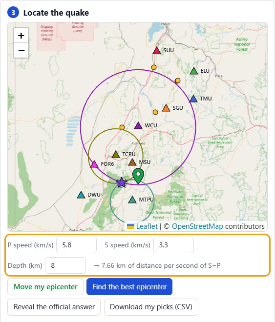
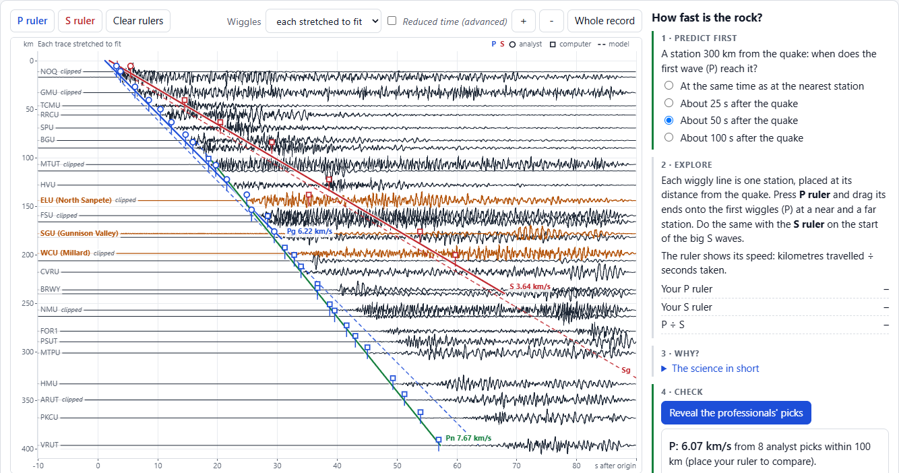
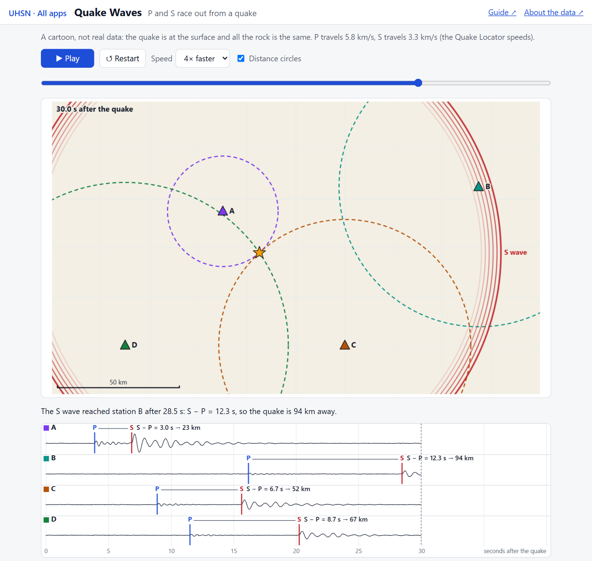
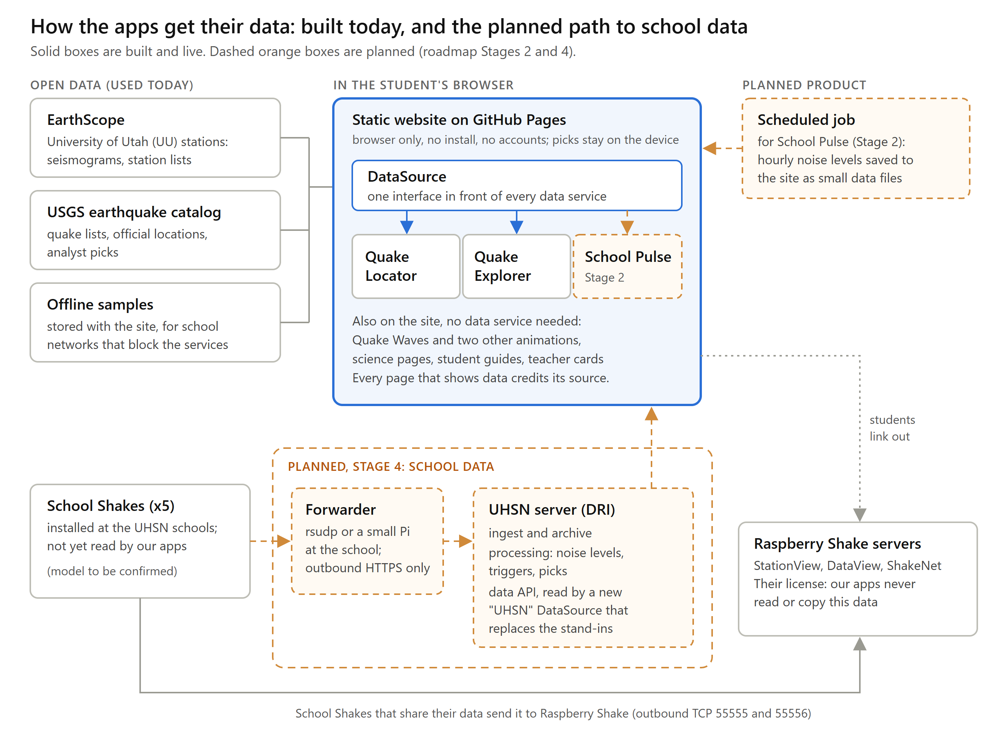

# Utah High School Seismic Network: Student Apps and Activities

*Project overview · Version 2.0 · 24 November 2026 · Gus Williams, DRI UHSN team. Draft for
Dale Anderson and Cleat (DRI co-PIs).*

*This document revises the planning evaluation of 23 November 2026, "Raspberry Shake in Utah
High Schools: Network Evaluation & Student App Concepts". It reports what has been built since,
and it is now the maintained copy (the online document it was taken from is retired). Its
companion, "UHSN classroom activities by setup", holds the activity catalog and the questions
we need you to answer.*

## Contents at a glance

Short on time? Sections 1 to 3 and 9 take about five minutes.

| Section | What you will find |
| ------------------------------- | ---------------------------------------------------------------- |
| 1. What we are trying to do | Students learn by doing, with real, local data; who it is for |
| 2. Where things stand | What is live on the website today, with links, and what is not done yet |
| 3. What comes next | The build plan (roadmap) in the order it is happening |
| 4. Data rules | Raspberry Shake's license; their own viewers; student privacy; the path to school data |
| 5. How the material fits together | Activity cards; one table from topic to science page, activities and apps; Utah standards |
| 6. The apps today | Quake Locator, Quake Explorer and Quake Waves: what students do in each |
| 7. The science, topic by topic | One line per topic: on the website or planned |
| 8. Plots students learn to read | The 12 plots and the status of each |
| 9. Decisions we need from you | What we ask, in brief; the questions are in the companion document |
| Appendix A. Raspberry Shake | Models, data quality, software, education offer |
| Appendix B. Getting the data | Data paths and their rules; school networks |
| Appendix C. Architecture | How the website and apps are built, and the planned school-data server |
| Appendix D. Proposed apps | Apps and tools not built yet, with the activities that need them |
| Appendix E. Research track | A mentored program for a few students; Utah's "ground truth" |
| Appendix F. What changed | Where each part of the 23 November version went; corrections |
| Appendix G. Sources | References and links |

Status words used throughout: **live** (on the website now), **being built** (work under way),
**planned** (in the build plan, not started), **proposed** (an idea, not scheduled).

## 1. What we are trying to do

The **Utah High School Seismic Network (UHSN)** is run by the **Desert Research Institute
(DRI)**. It installs Raspberry Shake seismometers in small, rural Utah high schools. Phase I
has five schools: Juab, North Sanpete, Wasatch Academy, Gunnison Valley and Millard. The first
Shake went into Juab High School in January 2026.

**Our aim is that students learn science by doing it, with real, local data.** They pick
waves on real seismograms, measure how fast the rock carries them, find where a quake
happened, and check their answers against the professionals'. Each activity starts with a
question, often about their own region.

**The school's own Shake is the center.** The school Shakes do not yet send their data to a
UHSN server our apps can read (section 4.4). Until they do, a **University of Utah (UU)**
seismic station near each school **stands in** for it. The apps label these stations with the
school's name.

| School | Town | Stand-in UU station |
| ------------------------------ | -------------- | ---------- |
| Juab High School | Nephi | SUU |
| North Sanpete High School | Mt. Pleasant | ELU |
| Wasatch Academy | Mt. Pleasant | TMU |
| Gunnison Valley High School | Gunnison | SGU |
| Millard High School | Fillmore | WCU |

**Who it is for: any high-school science class** (we suggest this; please confirm it, section 9). The main homes are Earth and Space Science,
Physics, Geology and Computer Science. We aim for every activity to have a short entry path
that needs no more than basic algebra, with deeper physics and math as optional extensions for
strong students. Classroom trials will tell us whether we got the level right.
A separate mentored research track serves a few motivated students (Appendix E).

**Two words we use everywhere.** An earthquake sends out two kinds of waves through the rock.
The **P wave** (primary) pushes and pulls the rock along its path and arrives first. The
**S wave** (secondary) shakes the rock sideways and arrives later. The gap between them grows
with distance, which is how students find a quake.

**How it works in school.**

- Everything runs in a web browser, including Chromebooks. Nothing to install, no accounts.
- Teachers work from **activity cards**: one card per lesson, with timings and an answer key.
- Each app has a student guide and links to short science pages.
- An offline sample is stored with the website for schools whose network blocks the data.

## 2. Where things stand

Status on 24 November 2026. Website: <https://gus-p-williams.github.io/utahshake/>

| What | Status | Links |
| ------------------------------ | -------- | ---------------------------------------------- |
| **Quake Locator** (app): pick P and S, find the quake | Live | [Open](https://gus-p-williams.github.io/utahshake/app/wave-race/) · [Guide](https://gus-p-williams.github.io/utahshake/apps/wave-race/) · [Card](https://gus-p-williams.github.io/utahshake/teachers/wave-race-card/) |
| **Quake Explorer** (app): four investigations | Live | [Open](https://gus-p-williams.github.io/utahshake/app/quake-explorer/) · [Guide](https://gus-p-williams.github.io/utahshake/apps/quake-explorer/) |
| **Quake Waves** and two more animations | Live | [All apps](https://gus-p-williams.github.io/utahshake/apps/) |
| **Science pages**: eight | Live | [The Science](https://gus-p-williams.github.io/utahshake/theory/) |
| **Activity cards**: six (One quake, two waves; Quake Locator; one per Quake Explorer investigation), each opening with an "At a glance" box, listed in a catalog by setup | Live | [Teachers](https://gus-p-williams.github.io/utahshake/teachers/) |
| **Utah standards**: a summary table and a crosswalk | Live | [At a glance](https://gus-p-williams.github.io/utahshake/teachers/#utah-standards) · [Crosswalk](https://gus-p-williams.github.io/utahshake/teachers/standards/) |
| **Before-class checklist**: network, offline samples, shared links, privacy | Live | [Before class](https://gus-p-williams.github.io/utahshake/teachers/#before-class) |
| **Offline samples**: one quake for Quake Locator, six for Quake Explorer | Live | Stored with the website |

**Not done yet:**

- **No school Shake data.** Everything runs on UU stand-in stations. So the school-Shake
  activities (S2 to S18) and the roaming-Shake activities (R1 to R8) wait on a DRI server and
  a UHSN data source (roadmap Stage 4). Only S1, "Meet our Shake", can work today, in
  Raspberry Shake's own viewers, where the school's Shake shares its data.
- **No classroom trial.** The timings on the cards (15 minutes, or a full period) are
  estimates. So far only the developer has checked the apps. For example, clicking the UU
  analysts' P and S times in Quake Locator put the offline sample's quake within 6 km of the
  official location from 3 stations.
- **No teacher review of the standards.** Section 5.3 shows what each activity contributes
  to, as a draft.
- **School Pulse is not built.** It is next (section 3).
- **No written confirmation from Raspberry Shake** about pages that show several UHSN schools
  side by side (section 4.1).

## 3. What comes next

The build plan is the project's
[roadmap](https://github.com/gus-p-williams/utahshake/blob/main/planning/roadmap.md). Its
stage numbers are kept below, but Quake Explorer (Stage 3) was built before School Pulse
(Stage 2), by Gus's choice on 24 November.

| Order | Stage and work | Status |
| --------- | ---------------------------------------------------- | ------------------------ |
| 1 | **Stage 0.** Website, code repository, automatic build and publishing | Done. A license file (MIT or BSD) is still for DRI to choose |
| 2 | **Stage 1.** Quake Locator, with Quake Waves as its warm-up | Done. Classroom trial to do |
| 3 | **Stage 3.** Quake Explorer: four investigations, guide, three science pages, four cards | Built. Classroom trial to do |
| 4 | **Plots.** Helicorder, noise spectra over a month (PPSD), seismic carpet, event stack, H/V, cross-correlation (section 8) | Being built |
| 5 | **Stage 2.** School Pulse: hourly noise levels for the stand-in stations, computed by a scheduled job, shown as a "seismic carpet" (hour of day against date) | Next |
| 6 | **Activity cards** for the activities you choose from the companion document | After your choices |
| 7 | **Stage 4.** School data: a DRI server, a UHSN data source in the apps, live views inside the schools, campus apps | Needs DRI decisions and resources (section 4.4) |
| Later | Python notebooks for local analysis and the research track | Planned |

**Trials come first.** The pilot we suggest (section 9): E2 Quake Waves → E1 Quake Locator → S1
Meet our Shake now, then S3 School Pulse once the school data and its tool are ready (Stage 4).
Quake Explorer's investigations are the next step for classes that want more. The trials set
the timings and the reading level for everything after.

## 4. Data rules

### 4.1 Raspberry Shake's license

Raspberry Shake (Raspberry Shake, S.A.) makes the seismometers and runs the community server
that Shakes can share their data with. Its [license](https://raspberryshake.org/license/) has two kinds of data
in mind: data read straight from our own Shakes, which is ours, and data from Raspberry Shake's
servers, which falls under the license.

**We may:**

- read our own UHSN Shakes directly over the school network, and build apps on that data;
- send students to Raspberry Shake's free viewers (section 4.2);
- let students make their own small requests for other Shakes' data in a notebook, with
  credit (the license allows requests that are "irregular and reasonable in size");
- show pictures of Raspberry Shake data, with credit (visual redistribution is allowed).

**We may not:**

- pull data from Raspberry Shake's servers into our apps or a back end: "Integration into a
  back end application such as a mobile app is not allowed";
- show "a 'network'-style page with data from other Raspberry Shakes in your area";
- pass on real-time data from their servers in digital form;
- get live data from other stations without a paid contract.

**Still open.** A page that shows all UHSN schools side by side should be fine if it reads our
own Shakes directly, not Raspberry Shake's servers. DRI should get that confirmed in writing by
Raspberry Shake for the stations it registers.

### 4.2 Raspberry Shake's own viewers: we link out

Raspberry Shake's viewers are free, live and good. We link to them and do not rebuild them.

- **[StationView](https://stationview.raspberryshake.org/#/)**: a world map of stations and
  recent quakes; click a station to see its live record.
- **[DataView](https://dataview.raspberryshake.org/#/)**: a 24-hour record, zoom, spectrogram
  and filters for any shared station.
- **ShakeNet**: the phone app version of both.

Activity S1, "Meet our Shake", uses them today, where the school's Shake shares its data.
Our apps add what they lack: guided analysis
(picking, distances, locating, speeds), comparison with professional stations, the school's
own context, and teacher cards. Appendix A lists their other software.

### 4.3 Student privacy

- **No student accounts, names or other personal information.** Picks and answers stay in the
  browser on the student's device. Students download a CSV file to hand in.
- **Why it matters.** If an app ever stored anything tied to a student, DRI would become a
  third-party contractor under Utah's Student Data Protection Act and Board rule
  [R277-487](https://www.law.cornell.edu/regulations/utah/Utah-Admin-Code-R277-487-7). A Utah
  Student Data Privacy Agreement with each district would then be needed first. North Sanpete
  already uses one ([example](https://sdpc.a4l.org/agreements/UT_DPA_V2%20no%20Exhibit%20E_Naviance.pdf)).
  R277-487 was being amended in fall 2026, so check the current text.
- **Occupancy privacy.** A live record from a hallway sensor shows when a building is busy or
  empty. Our plan: show campus data live only inside the school, and publicly only delayed or
  averaged. Earthquake records can be public in real time.
- **Phones.** Utah's 2026 rules on phones in school apply to the phone activities. The
  companion document covers them.

### 4.4 The path to school data

Today the apps read UU stations through EarthScope (the US archive of seismic data) and quake
information from the US Geological Survey (USGS). They do this through one "data source" layer,
so the apps will not need rewriting when school data arrives. **But school data is real work,
not a configuration switch.** It needs:

1. **A way out of each school.** A small "forwarder" on the school network (Raspberry Shake's
   rsudp software, or a second small computer) sends the Shake's data out over ordinary web
   traffic (HTTPS), so no port has to be opened into the school. School IT must agree.
2. **A UHSN server run by DRI.** It takes in and archives the data, computes products (noise
   levels, event triggers, picks) and offers them to the apps.
3. **A UHSN data source in the apps** that reads that server, with each Shake's location and
   instrument details.
4. **Decisions** on who runs and pays for the server, and who may see live campus data
   (section 4.3).

**Until this is built, the school-Shake activities wait.** The companion document has 26
activities that use a Shake; of those, only S1 can work today, where the school's Shake shares
its data.

A possible bridge before streaming: a page that opens a day of data downloaded from a Shake's
own web page (proposed). Appendix D lists it (File loader).

## 5. How the material fits together

### 5.1 Activity cards

**Teachers work from activities, not apps.** An activity card is one lesson. Every card opens
with an "At a glance" box: the driving question, time, setup, apps and tools, materials and
Utah standards. Then come a 15-minute version, a full-period version, an exit ticket, an answer
key, common difficulties and extensions. The Teachers page lists the cards in a catalog by
setup.

**Cards and apps are many-to-many.** A card may use several apps: the Quake Locator card opens
with Quake Waves. A card may use no app at all: campus experiments and phone activities. One
app may serve several cards: Quake Explorer has one card per investigation. Every app has at
least one card. Each card lists its apps, and each app's page lists its cards.

**So teachers can build a lesson plan from cards.** For example, for a waves unit: "One
quake, two waves" (10 minutes), then Quake Locator (a period), then "How fast is the rock?" and
"Which way did the ground move?" (a period that chains the two).

**Setups and IDs.** The companion document sorts activities by the setup they need, and gives
each an ID used in this document:

- **E**: external data (UU stations and USGS); 7 of its 14 activities work now, the rest need
  a new tool;
- **S**: the school's installed Shake; S1 can work now where the Shake shares its data, the
  others wait on Stage 4;
- **R**: a roaming Shake that DRI brings for a day or two; waits on Stage 4 and a kit;
- **P**: phones or tablets; waits on a phone page and a trial.

Its current draft lists 46 activities (14 E, 18 S, 8 R, 6 P). Six have cards on the website
today.

### 5.2 From topic to science page, activities and apps

How the parts link. Activities are given by their IDs in the companion document. Apps in
*italics* are not built yet.

| Topic | Science page | Activities | Apps and tools |
| ---------------------- | ---------------------- | -------------- | ---------------------------- |
| P and S waves; how they move rock | [Seismic waves](https://gus-p-williams.github.io/utahshake/theory/waves/) | E1, E2 | Quake Waves; the P and S motion animation |
| What a seismogram shows: quakes, ocean hum, wind, people, blasts, instrument problems | [Reading a seismogram](https://gus-p-williams.github.io/utahshake/theory/seismograms/) | E3, E4, E5, E6, S1, S5, S6 | Quake Locator; Quake Explorer B; Raspberry Shake's viewers (S1) |
| Distance from the S − P time | [Distance from S minus P](https://gus-p-williams.github.io/utahshake/theory/s-minus-p/) | E1, E2, E8, S2 | Quake Locator; Quake Waves; Quake Explorer D |
| Locating a quake | [Locating a quake](https://gus-p-williams.github.io/utahshake/theory/locating/) | E1, E10, E13, S2, P3 | Quake Locator; Quake Explorer C; *Felt Map Locator*; *Hit Locator* |
| Wave speeds and Earth's layers | [Travel times and Earth's layers](https://gus-p-williams.github.io/utahshake/theory/travel-times/) | E8, E9, R1, R2, R3 | Quake Explorer A and D; *viewer for the school Shakes* |
| Frequencies, fading and sound | [Frequencies, fading and sound](https://gus-p-williams.github.io/utahshake/theory/frequencies/) | E5, E7, S10, S12, S15, S16 | Quake Explorer B; Build a Wiggle |
| Which way the ground moves | [Which way the ground moves](https://gus-p-williams.github.io/utahshake/theory/ground-motion/) | E10 | Quake Explorer C |
| Magnitude and logarithms | Proposed | E11, S7, S8 | *How Big Was It?* |
| Daily and weekly noise patterns | Planned (with School Pulse) | E4, S3, S4, S18 | *School Pulse*; *Bus Detective* |
| Detecting events automatically | Proposed | E12, S4 | *Build a Detector* |
| Energy in drops, bounces and landings | Proposed | S11, S13, S14, P6 | *viewer for the school Shakes*; *Phone Recorder* |
| Resonance in soil and buildings | Proposed | R4, R7, P4, P5 | *viewer*; *Phone Recorder* |
| Sensors compared: Shake, professional station, phone | Proposed | S9, R5, P1, P2 | Quake Explorer tools; *Phone Recorder* |
| Where the data come from, and credits | [Our stations and data](https://gus-p-williams.github.io/utahshake/theory/stations/) | All | All apps |

### 5.3 Utah standards

**Which courses.** Utah requires 3 science credits. Two must come from two different
Foundational areas (Biology, Chemistry, Earth Science, Physics, Computer Science). The third may
be Foundational or Applied/Advanced, which includes Geology
([USBE course list](https://www.schools.utah.gov/curr/_curr_/_earlycollege_/202526%20Current%20Core%20Courses%20Meeting%20the%20Criteria%20for%20Graduation%20Requirements.pdf)).
So Earth and Space Science, Physics and Computer Science are the main homes, with Geology as an
elective.

**What each mark means.** A mark shows what an activity **contributes to**: students do work
that gives evidence or practice toward that standard. It does not mean one lesson meets the
whole standard. **These marks are pending teacher review.**

| Activity (live card) | PHYS 4.1 | PHYS 2.1 | ESS 2.2 | ESS 2.3 | ESS 4.1 | GEOL 3 | CS DA.3 | CS DA.1 |
| ------------------------ | ------- | ------- | ------- | ------- | ------- | ------- | ------- | ------- |
| E1 Quake Locator | ● | | ● | ● | ● | ● | ● | ● |
| E2 One quake, two waves (Quake Waves) | ● | | ● | | | | | |
| E9 How fast is the rock? (Quake Explorer A) | ● | | ● | | | ● | | ● |
| E7 What notes is the ground playing? (B) | ● | ● | | | ● | | ● | |
| E10 Which way did the ground move? (C) | ● | | ● | | | | ● | |
| E8 A message from far away (D) | ● | | ● | | | | ● | |

What the codes ask (paraphrased from the Utah Education Network course pages):

- **[PHYS.4.1](https://www.uen.org/core/core.do?courseNum=3642)** (Physics): relate frequency,
  wavelength and wave speed in different materials; seismic waves are an example.
- **[PHYS.2.1](https://www.uen.org/core/core.do?courseNum=3642)** (Physics): track and
  calculate energy transfer within a system.
- **[ESS.2.2](https://www.uen.org/core/core.do?courseNum=3601)** (Earth and Space Science):
  model Earth's interior from evidence, including seismic waves.
- **[ESS.2.3](https://www.uen.org/core/core.do?courseNum=3601)**: explain how plate tectonics
  produces patterns at Earth's surface.
- **[ESS.4.1](https://www.uen.org/core/core.do?courseNum=3601)**: explain how natural hazards
  and resources affect human activity.
- **[GEOL.3](https://www.uen.org/core/core.do?courseNum=3608)** (Geology elective): Earth's
  interior, evidence for plate tectonics, stress in the crust. The exact Geology codes are to
  be confirmed.
- **[CS 9/10.DA.3](https://Schools.Utah.gov/cte/_cte/computer/612ComputerScienceStandards.pdf)**
  (Computer Science): create data visualizations that help others understand real phenomena.
- **[CS 11/12.DA.1](https://Schools.Utah.gov/cte/_cte/computer/612ComputerScienceStandards.pdf)**:
  refine or create computational models from data.

The website's [crosswalk](https://gus-p-williams.github.io/utahshake/teachers/standards/)
says where each standard comes up in each lesson. It also lists the science pages. Activities
proposed in the companion document would add PHYS.1.2, PHYS.1.3, ESS.2.6 and CS 9/10.NI.1.
Before teacher-facing materials go out, the wording must be checked against the current
[Utah SEEd standards](https://www.schools.utah.gov/curr/science/_science_/UtahSEEdStandards.pdf).

**Math.** Utah's revised math standards, with a data-science strand, were still in draft
after a July 2026 review ([WestEd](https://www.utah.gov/pmn/files/1482225.pdf)). The
activities follow the statistical cycle (ask, collect, analyze, interpret), so they should map
cleanly once the standards are adopted.

## 6. The apps today

All apps share a top bar with links to their guide and to the data credits, and all run in any
browser with no accounts. The two data apps also offer offline samples, and let a teacher send
the whole class to the same quake with one web address.

### Quake Locator (activity E1)

*How far away was that quake, and where did it happen?*
[Open](https://gus-p-williams.github.io/utahshake/app/wave-race/) ·
[Guide](https://gus-p-williams.github.io/utahshake/apps/wave-race/) ·
[Activity card](https://gus-p-williams.github.io/utahshake/teachers/wave-race-card/)

1. **Choose a quake.** Utah quakes of magnitude 2 and up from the last 90 days. The location
   is hidden: finding it is the students' job.
2. **Pick P and S** on real records from up to ten stations: the five school stand-ins and
   helper stations around the quake. Filters and zoom help.
3. **Locate.** The app turns each S − P into a distance (P 5.8, S 3.3 km/s: about 7.7 km per
   second). Students can change the speeds and the quake's depth. They drag a pin to their own
   best guess and watch the misfit change; then the app searches for the best point.
4. **Reveal.** The official location, and the picks of the analysts at University of Utah
   Seismograph Stations (UUSS), which runs the UU network.

**Time:** about 15 minutes as a class demo, or a full period in pairs.

### Quake Explorer (activities E7 to E10)

*Measure the Earth with one quake.*
[Open](https://gus-p-williams.github.io/utahshake/app/quake-explorer/) ·
[Guide](https://gus-p-williams.github.io/utahshake/apps/quake-explorer/)

Every investigation has the same four steps: **Predict** (the Check button stays off until
students choose an answer), **Explore**, **Why?** (the science in a few sentences) and
**Check** (the professionals' answer).

| Investigation | What students do | Card |
| ------------------- | ------------------------------------------------------------ | ---------- |
| **A. How fast is the rock?** | Lay rulers along the P and S arrivals on a record section of many stations (30 for the Magna quake), and read the speeds. For the 2020 Magna quake, find the bend past about 150 km that shows the crust is about 36 km thick. | [Card](https://gus-p-williams.github.io/utahshake/teachers/how-fast-is-the-rock/) |
| **B. What notes is the ground playing?** | Drag a band on the spectrogram to filter the record; listen to it sped up; compare near and far stations, and a quarry blast with a quake of the same size. | [Card](https://gus-p-williams.github.io/utahshake/teachers/notes-of-a-quake/) |
| **C. Which way did the ground move?** | Watch the path the ground traced, aim a guess at the quake, then compare with the computer's and the true direction. Locate the quake from one station. | [Card](https://gus-p-williams.github.io/utahshake/teachers/which-way-did-it-move/) |
| **D. A message from far away** | Pick P and S from a big quake thousands of kilometers away, turn S − P into a distance with an Earth model, and build a class travel-time chart. | [Card](https://gus-p-williams.github.io/utahshake/teachers/far-side-of-the-world/) |

**Quakes:** Utah quakes and blasts (magnitude 2.5 and up, last 12 months) for A to C; big
quakes far away (magnitude 6.5 and up, last 2 years) for B to D; six offline samples cover all
four. Where analysts made no picks, the computer's picks fill in and are labeled as such.

**Time:** each investigation about 15 minutes as a class demo, or a full period in pairs. Do
Quake Locator first.

### Quake Waves, Build a Wiggle and an animation (E2; Build a Wiggle is the warm-up in E7)

[Quake Waves](https://gus-p-williams.github.io/utahshake/app/quake-waves/) ·
[Guide](https://gus-p-williams.github.io/utahshake/apps/quake-waves/)

- **Quake Waves** is a cartoon of P and S waves racing from a quake to four stations. The
  seismograms are made up, but the arrival times are exact (the Quake Locator speeds), so the
  distance circles cross at the quake. One run takes about 10 seconds; with the guide's
  questions, 5 to 10 minutes. It is the Quake Locator warm-up, and it has its own card,
  [One quake, two waves](https://gus-p-williams.github.io/utahshake/teachers/one-quake-two-waves/).
- **[How P and S waves move rock](https://gus-p-williams.github.io/utahshake/app/wave-motion/)**:
  P squeezes and stretches a block of rock; S shakes it.
- **[Build a Wiggle](https://gus-p-williams.github.io/utahshake/app/build-a-wiggle/)**
  ([guide](https://gus-p-williams.github.io/utahshake/apps/build-a-wiggle/)): a small app with
  made-up waves. Students add up to three sine waves and watch their sum and its spectrum,
  add noise, filter out notes, and see why a far quake sounds lower than a near one.

## 7. The science, topic by topic

The website's science pages are short and built from real records. One line per topic:

1. **What the instrument records**: a magnet on a spring makes a voltage as the ground moves;
   "counts" become velocity. Live, on
   [Reading a seismogram](https://gus-p-williams.github.io/utahshake/theory/seismograms/). Its
   diagram shows a generic geophone until the UHSN Shake model is confirmed.
2. **P, S and surface waves; how they move rock**: live, on
   [Seismic waves](https://gus-p-williams.github.io/utahshake/theory/waves/).
3. **Signals and noise**: ocean hum, wind, people, blasts, instrument problems, filters. Live,
   on Reading a seismogram.
4. **Distance from S − P**: the speeds, the formula and why depth matters. Live, on
   [Distance from S minus P](https://gus-p-williams.github.io/utahshake/theory/s-minus-p/).
5. **Locating a quake**: circles, the computer's search, why station positions matter. Live,
   on [Locating a quake](https://gus-p-williams.github.io/utahshake/theory/locating/).
6. **Travel times and Earth's layers**: record sections, the crust's thickness, waves through
   the whole Earth. Live, on
   [Travel times and Earth's layers](https://gus-p-williams.github.io/utahshake/theory/travel-times/).
7. **Frequency, spectrograms and sound**: any wiggle is a mix of notes; 100 readings a second
   means nothing above 50 Hz can be seen. Live, on
   [Frequencies, fading and sound](https://gus-p-williams.github.io/utahshake/theory/frequencies/).
8. **Why waves fade, and why high notes fade first**: live, on Frequencies, fading and sound.
9. **Which way the ground moves**: P along its path, S across it; direction from one station.
   Live, on [Which way the ground moves](https://gus-p-williams.github.io/utahshake/theory/ground-motion/).
10. **Magnitude and logarithms**: one magnitude unit is 10 times the ground motion. Proposed,
    with How Big Was It?
11. **Noise as data: a town's and a school's daily rhythm**: an example week is live on Reading
    a seismogram; a full page is planned with School Pulse.
12. **Detecting events automatically**: proposed, with Build a Detector.
13. **Timing limits**: each Shake's clock is good to about 10 milliseconds, which limits
    two-sensor experiments. Proposed, with the school-data and roaming-Shake activities.
14. **Our stations and data**: who runs the stations and how to credit them. Live, on
    [Our stations and data](https://gus-p-williams.github.io/utahshake/theory/stations/).

## 8. Plots students learn to read

| Plot | What it shows | Status | Where |
| -------------------- | ---------------------------------------------- | ---------------- | ------------------------ |
| Waveform (trace) | Ground motion against time, raw or filtered | Live | Quake Locator; all of Quake Explorer; science pages |
| Spectrogram | Frequency against time; color shows strength | Live | Quake Explorer B and D; Reading a seismogram |
| Record section | One quake at many stations, stacked by distance | Live | Quake Explorer A; Distance from S minus P |
| Particle motion | The path the ground traced, from three sensors | Live (Quake Explorer) | Quake Explorer C |
| Sound (audification) | The record played 50 to 400 times faster | Live (Quake Explorer) | Quake Explorer B and D |
| Amplitude against distance | How fast shaking fades with distance | Live (Quake Explorer) | Quake Explorer A ("true ground speed"); Frequencies page |
| Spectrum | Strength at each frequency | Live (Quake Explorer) | Quake Explorer B; Build a Wiggle |
| PPSD (probabilistic power spectral density) | A month of spectra as a cloud, against world quiet and noisy curves | Being built | |
| Helicorder | 24 hours folded into rows, like a drum recorder | Being built | |
| Seismic carpet | Hour of day across, date down, color for noise level | Being built | For School Pulse |
| Event stack | Many similar events (each bus, each blast) lined up and averaged | Being built | |
| H/V ratio | Horizontal against vertical noise; its peak is the ground's resonance | Being built | Needs a three-sensor Shake |
| Cross-correlation | How alike two records are at each time shift | Being built | |

The original list of 12 plots joined spectrum and PPSD in one row; they are split here because
their status differs.

## 9. Decisions we need from you

The questions open the companion document, **"UHSN classroom activities by setup"**. In short, we ask
you to:

- mark your top three activities, and yes, maybe or no for the others;
- react to our suggestions on the audience, the pilot (below), who supports what, and how to
  judge a pilot;
- help fill in a short inventory for each school;
- tell us whether a roaming Shake kit is budgeted, and whether phone activities are worth
  pursuing.

**The pilot we suggest:** E2 Quake Waves → E1 Quake Locator → S1 Meet our Shake now, then S3
School Pulse once the school data and its tool are ready (Stage 4). Quake Explorer's
investigations are the next step for classes that want more.

A yes commits no one to a date or a budget. Its tables can be filled in by hand or in Word.

---

## Appendix A. Raspberry Shake: models, data quality and software

Raspberry Shake sells seismographs built on the Raspberry Pi computer. Its
[Data Center](https://raspberryshake.org/data-center/) advertises "over 2000" stations, with
an archive back to December 2016. Every unit takes 100 readings a second and keeps time from
the internet, to about 10 milliseconds
([manual](https://manual.raspberryshake.org/specifications.html)).

| Model | Sensors | Best for |
| ---------------- | ---------------------------------- | -------------------------------------------- |
| RS1D | 1 vertical geophone | Classroom basics, campus noise, distant quakes |
| RS3D | 3 geophones (up, north, east) | Telling P from S, wave direction, locating |
| RS4D | 1 vertical geophone and a 3-axis accelerometer | Strong shaking that would overload a geophone |
| RS&BOOM | Vertical geophone and an air-pressure sensor | Thunder, sonic booms, blasts |
| School Lite / Standard | 1 or 2 RS1D and a cut-open geophone | Raspberry Shake's school bundles |

Models from the [product page](https://raspberryshake.org/all-products/) and
[school packages](https://raspberryshake.org/schools), November 2026. Which model each UHSN
school has is to be confirmed.

**How good is the data?** USGS lab tests found the geophone's sensitivity within 4% of its
rating. They judged the RS4D suitable for adding to professional networks for local and
regional quakes. But its own noise hides weak, slow signals, such as surface waves from
moderate distant quakes ([Anthony et al. 2019](https://www.usgs.gov/publications/do-low-cost-seismographs-perform-well-enough-your-network-overview-laboratory-tests)).
In short: excellent within a few hundred kilometers and for large distant quakes; weak for
small distant ones.

**Raspberry Shake's software.**

| Tool | What it does | Type |
| ------------------ | ------------------------------------------------------------ | -------------- |
| [StationView](https://raspberryshake.org/the-new-stationview/) | World map of stations and recent quakes; live records with spectrogram | Web app |
| [DataView](https://raspberryshake.org/dataview-official-release/) | 24-hour record, zoom, spectrogram, filters, image export | Web app |
| ShakeNet ([iOS](https://apps.apple.com/us/app/shakenet/id1517784831), [Android](https://play.google.com/store/apps/details?id=org.raspberryshake.app)) | Phone version of both | Phone app |
| [rsudp](https://github.com/raspishake/rsudp) | Live plot, quake alarm, data forwarding, own code on alarm (own Shake) | Open-source software |
| [Swarm](https://manual.raspberryshake.org/traces.html) (USGS) | Desktop records, spectra and spectrograms (own Shake) | Desktop app |
| [jAmaSeis, seisgram2k](https://manual.raspberryshake.org/traces.html) | Pick arrivals, simple location and magnitude | Older desktop software |

**What these tools lack, for our goals:** the school's context (bells, buses, games); comparison
between schools (which the license discourages building from their servers); student labels;
guided analysis (S − P distance, locating, magnitude); a classroom layer; and pairing the air
and ground channels.

**Education offer.** Raspberry Shake's [curriculum](https://raspberryshake.org/curriculum)
has four one-hour beginner lessons. It has no data-science or research thread, which is the gap
our work fills.

**Programs to learn from.** The Alaska Earthquake Center's
[Seismology in Schools](https://earthquake.alaska.edu/schools) runs 15 or more rural school
Shakes, a monthly online club for students, and student-built hallway displays.

## Appendix B. Getting the data

| Path | What you get | Delay | Rules |
| -------------------- | ---------------------------------------- | ------------ | ---------------------- |
| The Shake's own web page | Settings, a 12-hour record, file downloads; 7 days kept by default; the card can hold months | 2 minutes | Ours |
| [UDP "datacast"](https://manual.raspberryshake.org/udp.html) from the Shake | Raw data streamed to any address we choose | Under 1 s | Ours; rsudp reads this |
| [SeedLink](https://manual.raspberryshake.org/traces.html) on the Shake | The standard real-time protocol | Real time | Ours; needs a route into the school network |
| [FDSN web services](https://manual.raspberryshake.org/fdsn.html) at Raspberry Shake | Any shared station, back to 2016 | 30 minutes and older | Free for small, occasional requests, with credit; not in our apps |
| Real-time streams from Raspberry Shake's servers | Other stations, live | Real time | Paid |
| StationView, DataView, ShakeNet | Viewing any station | Live | Free to view; we link out |
| EarthScope (UU and other networks) | Seismograms and station details | Recent and archived | Open; what our apps use now |
| USGS earthquake catalog | Quake lists, locations, analyst picks | Minutes after a quake | Open; what our apps use now |

**Professional open data.** UU stations (network UU,
[doi:10.7914/SN/UU](https://doi.org/10.7914/SN/UU)) come through EarthScope's data services;
quakes come from the [USGS catalog](https://earthquake.usgs.gov/fdsnws/event/1/). Both allow
browser requests from our website. Both have none of the limits above, so they also serve as
the "truth" stations in comparisons with school Shakes.

**School networks.**

- A Shake that shares its data sends it out on TCP ports 55555 and 55556, and every Shake keeps
  time with NTP (UDP 123) ([firewall page](https://manual.raspberryshake.org/firewallIssues.html)).
  District filters often block these, so ask IT before installation.
- Give the Shake a fixed address, so its own web page stays reachable.
- Our apps need these addresses allowed: `service.earthscope.org`, `earthquake.usgs.gov`,
  `tile.openstreetmap.org` (maps) and `gus-p-williams.github.io` (the website).
- Bandwidth is no problem: four channels at 100 readings a second is a few kilobits a second.
- A small UPS rides through power cuts and protects the SD card; remote health checks catch
  silent failures.

## Appendix C. Architecture: as built and planned

**As built.**

- A static website on GitHub Pages holds the apps, guides, science pages and teacher cards.
  It is rebuilt and published automatically on every change.
- The apps are plain JavaScript that runs in the browser, with no build step, so students can
  read the code. Two open-source libraries are bundled with the site: seisplotjs (reading and
  filtering seismic data) and Leaflet (maps).
- Every app gets data through one **DataSource** interface. Today it has two versions:
  EarthScope and USGS online, and the offline samples. The school-to-station table is one
  configuration file.
- Automatic tests check the physics code, the real-data samples and the links between apps and
  pages. Figures on the science pages are drawn by scripts from real records.
- The code is public: <https://github.com/gus-p-williams/utahshake>. A license file is still to
  be chosen by DRI.

**Planned.**

- **Stage 2:** a scheduled job computes hourly noise levels and saves them to the website as
  small data files. It is a first version of the DRI server's processing.
- **Stage 4:** the DRI server and a UHSN data source (section 4.4). The school Shakes keep
  sending to Raspberry Shake as usual, so StationView and DataView keep working where sharing
  is on.
- **Later:** Python notebooks (ObsPy) on a DRI server for the research track.
- The website's toolkit (MkDocs Material) reaches end of life in May 2027; a move to its
  successor is planned before then.

## Appendix D. Proposed apps

Apps and tools not built yet, with the activities in the companion document that need them.

| App or tool | Driving question or job | Activities | Data | Status |
| ---------------- | ------------------------------ | -------------- | ---------------- | ---------------- |
| **School Pulse** | Can the ground tell when class changes? | E4, S3 | Stand-in stations first, then school Shakes | Planned, next (Stage 2) |
| **How Big Was It?** | Can we estimate magnitude from our records? | E11 | UU and USGS | Proposed |
| **Build a Detector** | Can you code your own quake alarm? | E12 | UU, then school Shakes | Proposed |
| **Quake Locator with our schools** | Can our schools locate a quake as well as UUSS? | S2 | School Shakes (Quake Locator on school data) | Planned (Stage 4) |
| **Viewer for the school Shakes** | Live and recent records, spectrogram, an experiment mode for drops and jumps | S and R cards | School Shakes | Planned (Stage 4) |
| **Game Night Quake** | Whose crowd shook harder, and is that fair? | S7 | All school Shakes | Planned (Stage 4) |
| **Bus Detective** | Can we hear the buses arrive? | S4 | School Shake | Planned (Stage 4) |
| **Signal Detective** | What made that wiggle? Build a shared catalog | S5 (E3, E5 with fixed examples) | School Shakes | Planned (Stage 4) |
| **Weather Ears** | Can a seismometer feel wind and hear thunder? | S6 | School Shake (RS&BOOM ideal) | Proposed |
| **Campus Wave Speed** | How fast does a stomp cross the school grounds? | R1 | Roaming and installed Shake | Planned (Stage 4) |
| **File loader** | Open a day of data downloaded from the school's Shake | S cards | School Shake | Proposed (bridge before streaming) |
| **Phone Recorder** | Phone motion sensor and microphone, recordings kept on the device | P cards | Phones | Proposed, after a trial |
| **Hit Locator** | Find where the ground was hit from a ring of phones | P3 | Phones | Proposed |
| **Felt Map Locator** | Locate a quake from "Did You Feel It?" reports | E13 | USGS | Proposed (small) |
| **Catalog tool** | Utah quakes by size, time of day and type | E5, E14 | USGS | Proposed |

## Appendix E. Research track

Separate from the classroom apps: a small, mentored program, for example 5 to 15 students
across UHSN schools, with a summer session and monthly online meetings. Students work in Python
notebooks on a DRI server. They aim at real outputs: a poster at a Seismological Society of
America or AGU meeting, a state science fair project, or a co-authored data report.

**Utah's ground truth.** Central Utah suits this well, because the answers are known for many
events:

- the University of Utah catalog, with event types;
- a catalog of explosions in the Utah region, including mine blasts and weapons testing and
  disposal ([Voyles et al. 2020](https://stacks.cdc.gov/view/cdc/227941/cdc_227941_DS1.pdf));
- the Utah Geological Survey's coal-mining-region catalog
  ([OFR-667](https://ugspub.nr.utah.gov/publications/open_file_reports/ofr-667/ofr-667.pdf));
- rocket-motor demolitions at the Utah Test and Training Range, used as seismic and air-wave
  ground truth ([Park et al. 2014](https://agu.confex.com/agu/fm14/webprogram/Paper10771.html);
  [Sandia](https://www.osti.gov/biblio/2480087));
- Utah FORGE's microseismic monitoring near Milford ([UUSS](https://quake.utah.edu/research/forge/)).

| Project | Research question | Methods students learn | Ground truth |
| -------------- | ---------------------------------- | ------------------------------ | ------------------ |
| **A. Quake or blast?** | Can school Shakes tell a quake from a mine blast or a surface explosion? | Features (time of day, frequency content, an air wave on an RS&BOOM), then simple machine learning | Voyles et al. 2020; coal-region catalog |
| **B. Location** | How well does a sparse school network locate central Utah events, alone and with UU stations? | Picking (by hand, then by machine), grid search, error estimates, the timing limit | UUSS locations |
| **C. How waves fade** | How do waves lose energy crossing central Utah, and how much does each school's ground amplify them? | Amplitude against distance; H/V for the soil under each school (needs three sensors) | UUSS events, range detonations |
| **D. Many cheap or few good sensors?** | Do many lower-quality sensors beat a few high-quality ones, and for which tasks? | Shake beside a UU broadband station; self-noise; thinning networks to compare | UU broadband |

**Background.** Utah already has published ways to tell mining events from quakes, for
example the difference between two magnitude scales
([Koper et al. 2016](https://stacks.cdc.gov/view/cdc/207664/cdc_207664_DS1.pdf)), and a study
of 6,402 Wasatch Plateau events ([Stein 2016](https://collections.lib.utah.edu/ark:/87278/s6fn4fj5)).
Students ask whether close-in school sensors add anything, especially an air-wave channel. On
"many cheap or few good": in theory N stations with independent noise improve the signal about
√N times, but shared noise, site differences and sensor noise break that ideal. The best real
case is Haiti, where 15 citizen-hosted Shakes recorded the 2021 M7.2 earthquake and its
aftershocks while the national network was down
([Calais et al. 2022](https://shop.raspberryshake.org/media/science.abn1045.pdf)). An Oslo study
used up to 11 Shakes to detect, locate and classify urban blasts
([Seismica 2024](https://seismica.library.mcgill.ca/article/view/1166)).

The companion document shows which setup (E, S, R, P) each part of these projects needs.

## Appendix F. What changed from the 23 November version

| 23 November section | Now |
| ---------------------------------- | -------------------------------------------------------- |
| Summary | Sections 1 to 3 |
| The Raspberry Shake network today | Appendix A |
| Getting the data | Section 4.1 (license) and Appendix B |
| Raspberry Shake's own tools, and the gaps | Section 4.2 and Appendix A |
| Theory primer for students | Section 7, one line per topic; the full text is on the science pages |
| Student app concepts | Section 6 (built) and Appendix D (proposed); each idea is a card in the companion document |
| Plots students should learn to read | Section 8, with status |
| Campus experiments; questions to ask of passive data | The companion document (mostly cards S8–S18, R1–R8 and P1, P2, P6; its Appendix I maps every item) |
| Research track | Appendix E |
| Fit with Utah state requirements | Section 5.3; privacy in section 4.3 |
| Practical constraints in small rural schools | Section 4.3 (occupancy privacy), Appendix B (IT, bandwidth, power); sensor choice, siting and station care belong with the companion document's questions |
| Proposed architecture and roadmap | Section 3 and Appendix C |

**Corrections.**

- **S − P speeds.** The old primer used P 6.0 km/s and S 3.5 km/s (8.4 km per second of
  S − P). The apps use 5.8 and 3.3 km/s (7.66 km per second). Those values matched UUSS
  analysts' picks for three 2026 quakes; 8.4 made distances about 10% too long. Students can
  still change the speeds, and the science page explains both.
- **What gets built first.** The old summary named School Pulse, Game Night Quake and Wave
  Race (now Quake Locator). Quake Locator and Quake Explorer are built; School Pulse is next;
  Game Night Quake needs school data (Stage 4).
- **Quake Explorer** (roadmap Stage 3; not in the 23 November version) is now built.
- **Audience.** The old document said "technically strong students". The program now aims at
  any high-school science class, with extensions and a separate research track.
- **School data.** Earlier project notes called the switch to school Shakes a configuration
  change. It needs a server and agreements (section 4.4).

## Appendix G. Sources

**This project**

- Website: <https://gus-p-williams.github.io/utahshake/> · Code and plans:
  <https://github.com/gus-p-williams/utahshake> (roadmap and decision log in `planning/`)
- Companion document: "UHSN classroom activities by setup" (`planning/activities.md`)

**Raspberry Shake**

- [Home](https://raspberryshake.org/) · [Data Center](https://raspberryshake.org/data-center/) · [License](https://raspberryshake.org/license/) · [Products](https://raspberryshake.org/all-products/) · [School packages](https://raspberryshake.org/schools) · [Curriculum](https://raspberryshake.org/curriculum)
- Manual: [FDSN web services](https://manual.raspberryshake.org/fdsn.html) · [Visualizing waveforms](https://manual.raspberryshake.org/traces.html) · [UDP datacast](https://manual.raspberryshake.org/udp.html) · [Firewall ports](https://manual.raspberryshake.org/firewallIssues.html) · [Specifications](https://manual.raspberryshake.org/specifications.html)
- [StationView](https://raspberryshake.org/the-new-stationview/) · [DataView](https://raspberryshake.org/dataview-official-release/) · [rsudp](https://github.com/raspishake/rsudp)

**Data**

- University of Utah Seismograph Stations, network UU: [doi:10.7914/SN/UU](https://doi.org/10.7914/SN/UU), via EarthScope Data Services
- [USGS earthquake catalog (ComCat)](https://earthquake.usgs.gov/fdsnws/event/1/)

**Utah programs and requirements**

- DRI / UHSN: [Juab High School install, January 2026](https://www.juabsd.org/article/2666429) · [Phase I schools, March 2026](https://www.juabsd.org/article/2794120)
- [Utah SEEd standards (USBE)](https://www.schools.utah.gov/curr/science/_science_/UtahSEEdStandards.pdf) · [UEN Earth and Space Science](https://www.uen.org/core/core.do?courseNum=3601) · [UEN Physics](https://www.uen.org/core/core.do?courseNum=3642) · [UEN Geology](https://www.uen.org/core/core.do?courseNum=3608)
- [Courses meeting graduation requirements, 2025-26](https://www.schools.utah.gov/curr/_curr_/_earlycollege_/202526%20Current%20Core%20Courses%20Meeting%20the%20Criteria%20for%20Graduation%20Requirements.pdf) · [Utah 6-12 Computer Science standards](https://Schools.Utah.gov/cte/_cte/computer/612ComputerScienceStandards.pdf) · [WestEd math standards review, 2026](https://www.utah.gov/pmn/files/1482225.pdf)
- [R277-487-7, third-party contractors](https://www.law.cornell.edu/regulations/utah/Utah-Admin-Code-R277-487-7) · [Example Utah Student Data Privacy Agreement](https://sdpc.a4l.org/agreements/UT_DPA_V2%20no%20Exhibit%20E_Naviance.pdf)

**Science and comparable programs**

- [Anthony et al. 2019, low-cost seismograph tests (USGS)](https://www.usgs.gov/publications/do-low-cost-seismographs-perform-well-enough-your-network-overview-laboratory-tests)
- [Calais et al. 2022, citizen seismology in Haiti (Science)](https://shop.raspberryshake.org/media/science.abn1045.pdf) · [Temblor summary](https://temblor.net/?p=13942)
- [Lecocq et al. 2020, global seismic quieting (Science)](https://authors.library.caltech.edu/104578)
- [Oslo urban blast classification with Raspberry Shakes (Seismica 2024)](https://seismica.library.mcgill.ca/article/view/1166)
- [Koper et al. 2016](https://stacks.cdc.gov/view/cdc/207664/cdc_207664_DS1.pdf) · [Voyles et al. 2020](https://stacks.cdc.gov/view/cdc/227941/cdc_227941_DS1.pdf) · [Stein 2016](https://collections.lib.utah.edu/ark:/87278/s6fn4fj5) · [UGS OFR-667](https://ugspub.nr.utah.gov/publications/open_file_reports/ofr-667/ofr-667.pdf)
- [Park et al. 2014, range rocket-motor infrasound](https://agu.confex.com/agu/fm14/webprogram/Paper10771.html) · [Sandia seismo-acoustic location](https://www.osti.gov/biblio/2480087) · [UUSS Utah FORGE monitoring](https://quake.utah.edu/research/forge/)
- [Alaska Seismology in Schools](https://earthquake.alaska.edu/schools)
